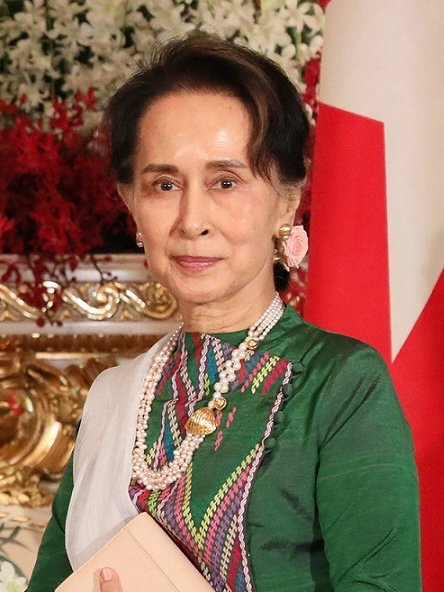

# ဒေါ်အောင်ဆန်းစုကြည် ကိုယ်စား သားကြီး အလက်ဇန္ဒားအဲရစ် မြွက်ကြားခဲ့သော ၁၉၉၁ နိုဘယ်လ်ငြိမ်းချမ်းရေးဆု လက်ခံမိန့်ခွန်း (မြန်မာဘာသာပြန်အပြည့်အစုံ)

*On October 21, 2019, State Counsellor Aung San Suu Kyi held a meeting with H.E. Mr. Shinzo Abe, Prime Minister of the State of Japan at the Guest House Akasaka Palace.*

- **မူရင်းမြွက်ကြားသူ:** အလက်ဇန္ဒားအဲရစ် (Alexander Aris — ဒေါ်အောင်ဆန်းစုကြည် ကိုယ်စား)
- **နေ့ရက်နှင့် နေရာ:** ၁၉၉၁ ခုနှစ် ဒီဇင်ဘာလ ၁၀ ရက် (ကမ္ဘာ့လူ့အခွင့်အရေးနေ့) — နော်ဝေနိုင်ငံ၊ အော့စလိုမြို့
- **မြန်မာဘာသာပြန်ဆိုသူ (Translator):** ထက်မြတ်ဧကရီ (ထက် / Htet)
- **တရားဝင် မူရင်းအင်္ဂလိပ်စာသားနှင့် ဗီဒီယိုလင့်ခ်:** [NobelPrize.org — Aung San Suu Kyi Acceptance Speech (1991)](https://www.nobelprize.org/prizes/peace/1991/kyi/acceptance-speech/)

---

## သမိုင်းကြောင်းနောက်ခံနှင့် ဒဿနိကဗေဒဆိုင်ရာ အကျဉ်းသုံးသပ်ချက် (Historical Context & Philosophical Overview)

၁၉၉၁ ခုနှစ် ဒီဇင်ဘာလ ၁၀ ရက်နေ့ — ကမ္ဘာ့လူ့အခွင့်အရေးနေ့၌ မြန်မာ့ဒီမိုကရေစီခေါင်းဆောင် ဒေါ်အောင်ဆန်းစုကြည်သည် ရန်ကုန်မြို့ရှိ နေအိမ်အကျယ်ချုပ်အတွင်း ထိန်းသိမ်းခံထားရသောကြောင့် နော်ဝေနိုင်ငံ အော့စလိုမြို့တွင် ကျင်းပသော နိုဘယ်လ်ငြိမ်းချမ်းရေးဆု ချီးမြှင့်ပွဲအခမ်းအနားသို့ ကိုယ်တိုင်တက်ရောက်နိုင်ခြင်း မရှိခဲ့ပေ။ ထိုသမိုင်းဝင်အခမ်းအနားတွင် အသက် ၁၈ နှစ်အရွယ် သားကြီးဖြစ်သူ အလက်ဇန္ဒားအဲရစ် (Alexander Aris) က မိခင်ကိုယ်စား ဆုလက်ခံရယူရင်း ဤမိန့်ခွန်းကို မြွက်ကြားခဲ့ခြင်း ဖြစ်သည်။ ဒဿနိကဗေဒရှုထောင့်မှကြည့်လျှင် ဤမိန့်ခွန်းသည် ဒီမိုကရေစီတိုက်ပွဲကို အာဏာလုပွဲအဖြစ်မဟုတ်ဘဲ နိုင်ငံရေးအာဏာရှင်စနစ်နှင့် စိတ်ပိုင်းဆိုင်ရာ ကြောက်ရွံ့ကျွန်ပြုမှုမှ လွတ်မြောက်ရေး၊ လူသားတိုင်း အခြားသူများ၏ လိုအပ်ချက်အပေါ် တာဝန်ယူရဲသည့် **“စိတ်ဝိညာဉ်၏ တော်လှန်ရေး (Revolution of the Spirit)”** အဖြစ် ဖော်ကျူးထားသော ခေတ်သစ်မြန်မာ့နိုင်ငံရေးဒဿန မော်ကွန်းတစ်ခု ဖြစ်ပေသည်။

---

## ၁၉၉၁ နိုဘယ်လ်ငြိမ်းချမ်းရေးဆု လက်ခံမိန့်ခွန်း (မြန်မာဘာသာပြန်)

**ဘုရင်မင်းမြတ်နှင့် တော်ဝင်မိသားစုဝင်များ၊ ဂုဏ်သရေရှိ ဧည့်သည်တော်ကြီးများနှင့် လူကြီးမင်းများ ခင်ဗျား —**

ကျွန်တော့်မိခင် ဒေါ်အောင်ဆန်းစုကြည် ကိုယ်စား အကြီးမြတ်ဆုံးသော ဆုတံဆိပ်ဖြစ်သည့် နိုဘယ်လ်ငြိမ်းချမ်းရေးဆုကို လက်ခံရယူရန် ယနေ့ ဤနေရာ၌ လူကြီးမင်းတို့ရှေ့မှောက်ဝယ် ကျွန်တော် ရပ်တည်နေရပါသည်။ အခြေအနေအကြောင်းကြောင်းကြောင့် ကျွန်တော့်မိခင် ကိုယ်တိုင်တက်ရောက်နိုင်ခြင်း မရှိသည့်အတွက် သူမ ပြောကြားလိုမည်ဟု ကျွန်တော်ယုံကြည်သည့် ခံစားချက်သဘောထားများကို အကောင်းဆုံး ဖော်ပြပြောဆိုသွားပါမည်။

ပထမဦးစွာ မိခင်သည် ဤနိုဘယ်လ်ငြိမ်းချမ်းရေးဆုကို သူမတစ်ဦးတည်း၏ အမည်ဖြင့် လက်ခံခြင်းမဟုတ်ဘဲ မြန်မာပြည်သူတစ်ရပ်လုံး၏ အမည်ဖြင့် လက်ခံကြောင်း အစပြုပြောကြားမည်ကို ကျွန်တော် သိရှိပါသည်။ ဤဆုသည် သူမတစ်ဦးတည်းနှင့်သာ သက်ဆိုင်ခြင်းမဟုတ်ဘဲ ယခု ကျွန်တော် စကားပြောနေသည့် ဤအခိုက်အတန့်မှာပင် ဒီမိုကရေစီမြန်မာနိုင်ငံတော် ပေါ်ထွန်းရေးအတွက် မိမိတို့၏ ကောင်းကျိုးချမ်းသာ၊ လွတ်လပ်ခွင့်နှင့် အသက်များကို ဆက်လက်စွန့်လွှတ်ပေးဆပ်နေကြသော အမျိုးသား၊ အမျိုးသမီးနှင့် ကလေးသူငယ်များအားလုံးနှင့် သက်ဆိုင်ကြောင်း သူမ ပြောကြားမည် ဖြစ်ပါသည်။ ဤဆုသည် သူတို့၏ ဆုဖြစ်ပြီး၊ ငြိမ်းချမ်းရေး၊ လွတ်လပ်ရေးနှင့် ဒီမိုကရေစီအတွက် မြန်မာနိုင်ငံ၏ ရှည်လျားလှသော ရုန်းကန်တိုက်ပွဲဝင်မှုတွင် နောက်ဆုံးအောင်ပွဲသည်လည်း သူတို့၏ အောင်ပွဲသာ ဖြစ်ပါလိမ့်မည်။

သို့ရာတွင် သူမ၏ သားတစ်ဦးအနေဖြင့် ကျွန်တော် ဖြည့်စွက်ပြောကြားလိုသည်မှာ မိခင်၏ ကိုယ်ကျိုးစွန့်အနစ်နာခံမှုနှင့် စိတ်ရင်းနှစ်မြှုပ် ကြိုးပမ်းမှုများကြောင့် သူမသည် မြန်မာပြည်သူတစ်ရပ်လုံး၏ ဒုက္ခဆင်းရဲများကို ကမ္ဘာက သိမြင်နားလည်လာစေသည့် ထိုက်တန်သော သင်္ကေတတစ်ခု ဖြစ်လာခဲ့သည်ဟု ကျွန်တော် ကိုယ်တိုင်ယုံကြည်ပါသည်။ ထိုဒုက္ခဆင်းရဲများကို မည်သူမျှ လျှော့တွက်၍ မဖြစ်ပါ။ ကျေးလက်နှင့် မြို့ပြများတွင် ဆင်းရဲမွဲတေ ချွတ်ခြုံကျစွာ နေထိုင်နေကြရသူများ၏ ဒုက္ခ၊ အကျဉ်းထောင်များအတွင်း ရိုက်နှက်ညှဉ်းပန်းနှိပ်စက်ခံနေကြရသူများ၏ ဒုက္ခ၊ မြန်မာနိုင်ငံ၏ အနာဂတ်မျှော်လင့်ချက်ဖြစ်ကြသော်လည်း ထွက်ပြေးတိမ်းရှောင်ရာ တောတောင်များအတွင်း ငှက်ဖျားရောဂါဖြင့် သေဆုံးနေကြရသည့် လူငယ်များ၏ ဒုက္ခ၊ ရိုက်နှက်စော်ကား ဂုဏ်သိက္ခာချခံနေကြရသည့် ဗုဒ္ဓဘာသာ ရဟန်းသံဃာတော်များ၏ ဒုက္ခတို့ ဖြစ်ကြပါသည်။ ထို့အပြင် ကျွန်တော့်မိခင်နည်းတူ အကျဉ်းချခံထားရသည့် အများလေးစားကြည်ညိုရသော ဝါရင့်ခေါင်းဆောင်ကြီးများစွာကိုလည်း ကျွန်တော်တို့ မေ့လျော့မထားသင့်ပါ။ သူတို့အားလုံး၏ ကိုယ်စား ဤအမြင့်မြတ်ဆုံးသော ဂုဏ်ပြုမှုအတွက် လူကြီးမင်းတို့ကို ကျွန်တော် နှလုံးသားအတွင်းမှ ကျေးဇူးတင်ရှိပါသည်။ ဤမျှဝေးကွာလှသော အရပ်ဒေသ၌ပင် မိမိတို့၏ ဒုက္ခဆင်းရဲများကို ကြားသိအလေးထားခြင်း ခံရပြီဟူသော အသိကြောင့် မြန်မာပြည်သူများသည် ယနေ့တွင် ခေါင်းမော့၍ အနည်းငယ်ပိုမို ဂုဏ်ယူဝင့်ကြွားနိုင်ကြပြီ ဖြစ်ပါသည်။

ရန်ကုန်မြို့ရှိ အစောင့်အကြပ်ထူထပ်သော ခြံဝင်းအတွင်း၌ ဖြစ်ပွားနေသည့် ထိုအထီးကျန် ရုန်းကန်တိုက်ပွဲဝင်မှုသည် နိုင်ငံရေးအာဏာရှင်စနစ်နှင့် စိတ်ပိုင်းဆိုင်ရာ ကျွန်ပြုဖိနှိပ်ခံရမှုတို့မှ လူသားစိတ်ဝိညာဉ် လွတ်မြောက်ရေးအတွက် ကမ္ဘာတစ်ဝန်း ဖြစ်ပွားနေသော ပိုမိုကြီးမားကျယ်ပြန့်သည့် တိုက်ပွဲကြီး၏ တစ်စိတ်တစ်ပိုင်းဖြစ်ကြောင်းကိုလည်း ကျွန်တော်တို့ သတိရနေရမည် ဖြစ်ပါသည်။ ဤဆုသည် မည်သည့်နေရာ၌မဆို ထိုတိုက်ပွဲတွင် ပါဝင်ဆင်နွှဲနေကြသူအားလုံးကို ဂုဏ်ပြုရန် ရည်ရွယ်ထားခြင်းဖြစ်ကြောင်း ကျွန်တော် အသေအချာ ယုံကြည်ပါသည်။ ယနေ့ အော့စလိုမြို့တွင် ကျင်းပသည့် ဤအခမ်းအနားသည် တစ်ကမ္ဘာလုံး၌ ဆင်နွှဲကျင်းပကြသည့် ကမ္ဘာ့လူ့အခွင့်အရေးနေ့နှင့် တိုက်ဆိုင်နေခြင်းမှာလည်း အကြောင်းမဲ့ မဟုတ်ပါပေ။ [၁]

**ဥက္ကဋ္ဌကြီး ခင်ဗျား —**

လူကြီးမင်းတို့ ကော်မတီ၏ ရွေးချယ်မှုကို နိုင်ငံတကာအသိုင်းအဝိုင်းတစ်ခုလုံးက ဩဘာပေး ကြိုဆိုခဲ့ကြပါသည်။ လွန်ခဲ့သော ရက်အနည်းငယ်ကပင် ကုလသမဂ္ဂသည် အတွင်းရေးမှူးချုပ် ဂျာဗီယာ ပဲရက်ဇ် ဒီ ကွေးလား (Javier Pérez de Cuéllar) ၏ ဤဆု၏ အရေးပါမှုဆိုင်ရာ ထုတ်ပြန်ချက်ကို ကြိုဆိုပြီး ကျွန်တော့်မိခင်အား အကျယ်ချုပ်မှ အမြန်ဆုံးလွှတ်ပေးရန် အကြိမ်ကြိမ်မေတ္တာရပ်ခံချက်များကို ထောက်ခံအတည်ပြုသည့် တညီတညွတ်တည်းဖြစ်သော သမိုင်းဝင်ဆုံးဖြတ်ချက်တစ်ရပ်ကို ချမှတ်ခဲ့ပါသည်။ မြန်မာနိုင်ငံရှိ ဆိုးရွားလှသော လူ့အခွင့်အရေးအခြေအနေအပေါ် တစ်ကမ္ဘာလုံး၏ စိုးရိမ်ပူပန်မှုကို ရှင်းလင်းပြတ်သားစွာ ဖော်ပြခဲ့ကြပါသည်။ ကမ္ဘာ့နိုင်ငံအားလုံးအကြား တစ်ဦးတည်း အထီးကျန်နေသည့် ကန့်ကွက်သံတစ်သံတည်းသာ ထွက်ပေါ်ခဲ့ပြီး ယင်းမှာ ရန်ကုန်ရှိ စစ်အုပ်စုထံမှ အချိန်နှောင်းလွန်းပြီး အားနည်းလှသော အသံသာ ဖြစ်ခဲ့ပါသည်။

ဤအုပ်ချုပ်ရေးစနစ်သည် နှစ်ပေါင်းသုံးဆယ်နီးပါး မှားယွင်းသောအုပ်ချုပ်မှုဖြင့် တစ်ချိန်က ကြွယ်ဝချမ်းသာခဲ့သော “ရွှေနိုင်ငံ (Golden Land)” မြန်မာပြည်ကို ကမ္ဘာပေါ်တွင် စီးပွားရေးအချွတ်ခြုံကျဆုံး နိုင်ငံတစ်နိုင်ငံအဖြစ်သို့ ကျဆင်းစေခဲ့ပါသည်။ ကြောက်ရွံ့မှု၊ ဖိနှိပ်မှုနှင့် အမုန်းတရားတို့ဖြင့် မိမိတို့၏ အာဏာကို တည်ဆောက်ရန် ကြိုးပမ်းသည့် အာဏာရှင်စနစ်အားလုံး၏ နောက်ဆုံးကံကြမ္မာသည် မည်သို့ဖြစ်လာမည်ကို ယနေ့ ရန်ကုန်တွင် အာဏာချုပ်ကိုင်ထားသူများကိုယ်တိုင်ပင် နှလုံးသားအတွင်း၌ သိရှိနေကြမည်မှာ သေချာပါသည်။ ၁၉၈၈ ခုနှစ်တွင် ယနေ့မြန်မာ့ဒီမိုကရေစီတိုက်ပွဲသည် လမ်းမများပေါ်သို့ ပေါက်ကွဲထွက်ပေါ်လာခဲ့စဉ်က ယင်းသည် အရှေ့ဥရောပ၊ အာရှနှင့် အာဖရိကတစ်လွှား ဖြစ်ပွားခဲ့သည့် နိုင်ငံတကာ ဒီမိုကရေစီလှိုင်းလုံးကြီးများ၏ ပထမဦးဆုံးသော ရှေ့ပြေးဖြစ်ခဲ့ပါသည်။ ယနေ့ ၁၉၉၁ ခုနှစ်တွင်မူ မြန်မာနိုင်ငံသည် ဖိနှိပ်ရက်စက်၍ ခေါင်းမာသော စစ်အုပ်စုဖြစ်သည့် နိုင်ငံတော် ငြိမ်ဝပ်ပိပြားမှု တည်ဆောက်ရေးအဖွဲ့ (SLORC) လက်အောက်၌ ဆက်လက်ဒုက္ခခံစားနေရမှုကြောင့် ထင်ရှားစွာ ကျန်ရစ်နေပါသည်။ သို့သော် ဒီမိုကရေစီကို အောင်မြင်စွာ ရယူနိုင်ခဲ့ကြသော နိုင်ငံများ၏ သာဓကသည် မြန်မာပြည်သူများအတွက် အရေးကြီးသော သတင်းစကားတစ်ခုကို ပေးစွမ်းနေပါသည်— ယင်းမှာ နောက်ဆုံးတွင် အာဏာရှင်စနစ်၏ စီးပွားရေးအရ မအောင်မြင်နိုင်မှုကြောင့်ပင် ယခုလက်ရှိအုပ်ချုပ်ရေးစနစ်သည် တိုက်စားဖယ်ရှားခံရမည် ဖြစ်ပါသည်။ ယနေ့ မြင့်တက်နေသော ငွေကြေးဖောင်းပွမှု၊ မှားယွင်းသော စီးပွားရေးစီမံခန့်ခွဲမှုနှင့် တန်ဖိုးမရှိသလောက်နီးပါး ကျဆင်းနေသော ကျပ်ငွေတို့ကို ရင်ဆိုင်နေရခြင်းဖြင့် မြန်မာအစိုးရသည် မိမိတို့စိုက်ပျိုးခဲ့သည့်အတိုင်း ပြန်လည်ရိတ်သိမ်းနေရပြီမှာ သံသယဖြစ်ဖွယ် မရှိပါ။

သို့ရာတွင် စီးပွားရေး လုံးဝပြိုလဲပျက်စီးမှသာ ဤစနစ် ကျဆုံးသွားရန်ထက် ယခုနှစ်ဆုချီးမြှင့်မှုဖြင့် နိုဘယ်လ်ကော်မတီက ဖော်ပြလိုက်သည့် အခြေခံလူသားဆန်မှုဆိုင်ရာ ပန်ကြားချက်များကို အုပ်ချုပ်နေသော စစ်အုပ်စုအနေဖြင့် နားထောင်လက်ခံလာစေရန်မှာ ကျွန်တော့်၏ အနက်ရှိုင်းဆုံးသော မျှော်လင့်ချက် ဖြစ်ပါသည်။ လက်ရှိ ကြောက်ရွံ့မှုနှင့် ဖိနှိပ်မှုမူဝါဒများသည် မြန်မာ့ဗုဒ္ဓဘာသာ အမွေအနှစ်၏ အမြင့်မြတ်ဆုံးသော အခြေခံမူများကို ချိုးဖောက်နေသောကြောင့် စက်ဆုပ်ရွံရှာနေကြသူများ စစ်အစိုးရအတွင်း၌ပင် ရှိနေကြောင်း ကျွန်တော် သိရှိပါသည်။ ဤသည်မှာ အချည်းနှီးသော စိတ်ကူးယဉ်မျှော်လင့်ချက် မဟုတ်ဘဲ၊ အာဏာပိုင်ရာထူးရှိသူများနှင့် ဆက်ဆံဆောင်ရွက်ခဲ့ရာမှ ကျွန်တော့်မိခင် ရရှိခဲ့သည့် ခိုင်မာသော ယုံကြည်ချက်ဖြစ်ပြီး၊ စစ်မှုထမ်းများနှင့် ၎င်းတို့၏ မိသားစုများသာ အဓိကနေထိုင်ရာ မဲဆန္ဒနယ်များတွင်ပင် သူမ၏ ပါတီက ရွေးကောက်ပွဲအနိုင်ရရှိခဲ့ခြင်းက ယင်းအချက်ကို သက်သေပြနေပါသည်။ လက်ရှိအာဏာပိုင်များအကြားမှ အလယ်အလတ်သဘောထားနှင့် ပြန်လည်သင့်မြတ်ရေးကို လိုလားသော ထိုအင်အားစုများအနေဖြင့် မြန်မာနိုင်ငံ၏ အလိုအပ်ဆုံးအချိန်တွင် မိမိတို့၏ သဘောထားခံစားချက်များကို ထင်ဟပ်ပေါ်လွင်စေရန်မှာ ကျွန်တော့်၏ အပြင်းပြဆုံးသော ဆန္ဒဖြစ်ပါသည်။

အကယ်၍ ကျွန်တော့်မိခင်သာ ယနေ့ လွတ်မြောက်နေခဲ့ပါလျှင် လူကြီးမင်းတို့ကို ကျေးဇူးတင်စကားပြောကြားရင်း ဖိနှိပ်သူများနှင့် ဖိနှိပ်ခံများ နှစ်ဖက်စလုံး လက်နက်များချ၍ ငြိမ်းချမ်းရေးစိတ်ဓာတ်ဖြင့် လူသားဆန်မှုအပေါ် အခြေခံသော နိုင်ငံတော်တစ်ရပ်ကို အတူတကွ တည်ဆောက်နိုင်ကြစေရန် ဆုတောင်းပေးကြပါဟုလည်း မေတ္တာရပ်ခံမည်ဖြစ်ကြောင်း ကျွန်တော် သိရှိပါသည်။

ကျွန်တော့်မိခင်ကို ငြိမ်းချမ်းသောနည်းလမ်းဖြင့် ဒီမိုကရေစီပြောင်းလဲရေးအတွက် ကြိုးပမ်းနေသည့် နိုင်ငံရေးအတိုက်အခံတစ်ဦးအဖြစ် မကြာခဏ ဖော်ပြလေ့ရှိကြသော်လည်း သူမ၏ ရှာဖွေကြိုးပမ်းမှုသည် အခြေခံအားဖြင့် စိတ်ဝိညာဉ်ဆိုင်ရာ ကြိုးပမ်းမှုဖြစ်ကြောင်း ကျွန်တော်တို့ အမှတ်ရသင့်ပါသည်။ သူမ ပြောကြားခဲ့သည့်အတိုင်း **“အနှစ်သာရအရှိဆုံး တော်လှန်ရေးသည် စိတ်ဝိညာဉ်၏ တော်လှန်ရေးဖြစ်သည်”** ဟူ၍ဖြစ်ပြီး၊ ဤတိုက်ပွဲ၏ “အခြေခံကျသော စိတ်ဝိညာဉ်ဆိုင်ရာ ရည်မှန်းချက်များ” အကြောင်းကိုလည်း သူမ ရေးသားခဲ့ပါသည်။ ယင်းကို လက်တွေ့အကောင်အထည်ဖော်နိုင်မှုသည် လူသား၏ တာဝန်ယူမှုအပေါ်၌သာ လုံးလုံးလျားလျား မူတည်ပါသည်။ ထိုတာဝန်ယူမှု၏ အရင်းအမြစ်တွင် သူမ၏ စကားကို ကိုးကားရသော် — *“ပြည့်စုံကောင်းမွန်မှုဆိုင်ရာ သဘောတရား၊ ယင်းကို ရရှိရန် ပြင်းပြသောဆန္ဒ၊ ယင်းသို့ရောက်ရှိမည့် လမ်းကြောင်းကို ရှာဖွေနိုင်သော ဉာဏ်ပညာနှင့် အဆုံးတိုင် မရောက်နိုင်သည့်တိုင်အောင် တစ်ဦးချင်းကန့်သတ်ချက်များထက် ကျော်လွန်တက်လှမ်းနိုင်ရန် လိုအပ်သည့် ခရီးအကွာအဝေးအထိ ထိုလမ်းကြောင်းအတိုင်း လျှောက်လှမ်းလိုသော စိတ်ဓာတ်ခွန်အားတို့”* တည်ရှိနေပါသည်။ **“ပြည့်စုံသောဘဝကို နေထိုင်နိုင်ရန် အခြားသူများ၏ လိုအပ်ချက်များအတွက် တာဝန်ယူထမ်းဆောင်ရဲသည့် သတ္တိရှိရမည်... ထိုတာဝန်ကို ထမ်းဆောင်လိုသော ဆန္ဒရှိရမည်”** ဟု သူမက ဆိုပါသည်။ ယင်းကို သူမ၏ ဘာသာရေးယုံကြည်ချက်နှင့် ခိုင်မာစွာ ဆက်စပ်၍ ရေးသားခဲ့သည်မှာ — *“...မြန်မာ့ရိုးရာယဉ်ကျေးမှု၏ အခြေခံအုတ်မြစ်ဖြစ်သော ဗုဒ္ဓဘာသာသည် သတ္တဝါအားလုံးအနက် အမြင့်မြတ်ဆုံးသော ဗုဒ္ဓအဖြစ်သို့ ရောက်ရှိနိုင်သည့် တစ်ခုတည်းသော သတ္တဝါဖြစ်သူ လူသားအပေါ် အကြီးမားဆုံးတန်ဖိုးကို ထားရှိပါသည်။ လူသားတိုင်း၌ မိမိ၏ ကိုယ်ပိုင်စိတ်ဆန္ဒနှင့် လုံ့လဝီရိယဖြင့် အမှန်တရားကို ထိုးထွင်းသိမြင်နိုင်စွမ်းနှင့် အခြားသူများကိုလည်း ထိုးထွင်းသိမြင်အောင် ကူညီနိုင်စွမ်း ရှိပါသည်”* ဟူ၍ ဖြစ်ပါသည်။ နောက်ဆုံးတွင် သူမက ဤသို့ ဆိုထားပါသည်— **“မြန်မာနိုင်ငံ၏ ဒီမိုကရေစီရှာဖွေမှုသည် ကမ္ဘာ့မိသားစု၏ လွတ်လပ်တန်းတူသော အဖွဲ့ဝင်များအဖြစ် ပြည့်စုံအဓိပ္ပာယ်ရှိသော ဘဝများကို နေထိုင်နိုင်ရန် ပြည်သူတစ်ရပ်လုံး၏ ရုန်းကန်တိုက်ပွဲဝင်မှု ဖြစ်ပါသည်။ ယင်းသည် လူသား၏ စိတ်ဝိညာဉ်က မိမိသဘာဝ၏ ချို့ယွင်းချက်များကို ကျော်လွှားနိုင်ကြောင်း သက်သေပြရန် မရပ်မနား ကြိုးပမ်းနေသည့် လူသားတို့၏ ကြိုးပမ်းမှုတစ်စိတ်တစ်ပိုင်း ဖြစ်ပါသည်။”** [၂]

ဤသည်မှာ ကျွန်တော်နှင့် ကျွန်တော့်ညီငယ်တို့ နော်ဝေနိုင်ငံတွင် မိခင်ကိုယ်စား ကြီးမြတ်သော ဆုတစ်ခုကို လက်ခံရယူရခြင်းမှာ ဒုတိယအကြိမ် ဖြစ်ပါသည်။ မနှစ်ကလည်း ကျွန်တော်တို့သည် ဘာဂန် (Bergen) မြို့သို့ သွားရောက်ကာ ယခုနှစ်အခမ်းအနားအတွက် ကြည်နူးဖွယ် ရှေ့ပြေးဖြစ်ခဲ့သည့် Thorolf Rafto လူ့အခွင့်အရေးဆုကို မိခင်ကိုယ်စား လက်ခံရယူခဲ့ကြပါသည်။ [၃] ယခုအချိန်တွင် ကျွန်တော်တို့သည် နော်ဝေပြည်သူများအပေါ် အထူးတလည် ခင်မင်တွယ်တာသော ခံစားချက်တစ်ခု ရှိနေပြီဖြစ်ပါသည်။ မကြာမီတွင် ကျွန်တော့်မိခင်ကိုယ်တိုင် ဤခံစားချက်ကို မျှဝေနိုင်ပြီး ကျွန်တော်မှတစ်ဆင့် မဟုတ်ဘဲ သူမကိုယ်တိုင် တိုက်ရိုက်စကားပြောဆိုနိုင်လိမ့်မည်ဟု ကျွန်တော် မျှော်လင့်မိပါသည်။ ဤအတောအတွင်း သူမနှင့် မြန်မာပြည်သူများအပေါ် ပေးအပ်ခဲ့သည့် ဤကြီးမားသော ထောက်ခံအားပေးမှုသည် ကမ္ဘာကြီး၏ တစ်ဖက်စီမှ ပြည်သူနှစ်ရပ်ကို ပေါင်းစည်းပေးနိုင်ခဲ့ပါသည်။ ယခုတည်ဆောက်လိုက်သည့် ချစ်ကြည်ရင်းနှီးမှုများမှ ကောင်းကျိုးများစွာ ဆက်လက်ဖြစ်ထွန်းလာမည်ဟု ကျွန်တော် ယုံကြည်ပါသည်။

နောက်ဆုံးအနေဖြင့် လူကြီးမင်းတို့အားလုံးကို နှလုံးသားအတွင်းမှ ကျေးဇူးတင်စကားပြောကြားရန်သာ ကျန်ရှိပါတော့သည်။ ယနေ့မှစ၍ ဒဏ်ရာများ စတင်ကျက်စေရန်နှင့် လာမည့်နှစ်များအတွင်း ၁၉၉၁ ခုနှစ် နိုဘယ်လ်ငြိမ်းချမ်းရေးဆုကို မြန်မာနိုင်ငံ၌ စစ်မှန်သော ငြိမ်းချမ်းရေးရရှိရေးဆီသို့ လှမ်းတက်ခဲ့သည့် သမိုင်းဝင်ခြေလှမ်းတစ်ရပ်အဖြစ် ရှုမြင်နိုင်ကြစေရန် ကျွန်တော်တို့ မျှော်လင့်ဆုတောင်းကြပါစို့။ အတိတ်၏ သင်ခန်းစာများကို မေ့ပျောက်မည်မဟုတ်သော်လည်း ယနေ့ ကျွန်တော်တို့ ဂုဏ်ပြုဆင်နွှဲနေသည်မှာ အနာဂတ်အတွက် ကျွန်တော်တို့၏ မျှော်လင့်ချက်ပင် ဖြစ်ပါသည်။

---

### မူရင်းမှတ်စုများ (Original Footnotes)
1. ၁၉၄၈ ခုနှစ် ဒီဇင်ဘာလ ၁၀ ရက်နေ့တွင် ကုလသမဂ္ဂသည် အပြည်ပြည်ဆိုင်ရာ လူ့အခွင့်အရေးကြေညာစာတမ်း (Universal Declaration of Human Rights) ကို အတည်ပြုခဲ့သည်။ မြန်မာနိုင်ငံသည် ယင်းကို အတည်ပြုရန် ထောက်ခံမဲပေးခဲ့သော နိုင်ငံများအနက် တစ်နိုင်ငံဖြစ်သည်။
2. ဤကောက်နုတ်ချက်များသည် *Freedom from Fear* (စာမျက်နှာ ၁၈၃၊ ၁၈၅၊ ၁၇၄) မှ ကိုးကားထားခြင်း ဖြစ်သည်။
3. နော်ဝေ စီးပွားရေးနှင့် စီမံခန့်ခွဲမှုတက္ကသိုလ်မှ စီးပွားရေးသမိုင်း ပါမောက္ခ Thorolf Rafto သည် အထူးသဖြင့် အရှေ့ဥရောပရှိ လူ့အခွင့်အရေးလုပ်ငန်းများကြောင့် ကျော်ကြားသူဖြစ်သည်။ ၁၉၈၆ ခုနှစ် နိုဝင်ဘာ ၄ ရက်နေ့တွင် သူကွယ်လွန်ပြီးနောက် မိတ်ဆွေများနှင့် လေးစားသူများက သူ၏အမည်ဖြင့် လူ့အခွင့်အရေးဖောင်ဒေးရှင်းကို တည်ထောင်ခဲ့ကြပြီး နှစ်စဉ် ကွယ်လွန်ခြင်းနှစ်ပတ်လည်နေ့တိုင်း လူ့အခွင့်အရေး ရှေ့ဆောင်များအား ဆုချီးမြှင့်လျက်ရှိသည်။

---

## တရားဝင် ကိုးကားချက်နှင့် မူပိုင်ခွင့်အညွှန်း (Official Citation & Attribution)

- **မြန်မာဘာသာပြန်ဆိုသူ:** ထက်မြတ်ဧကရီ (ထက် / Htet) — Non-Commercial Educational & Research Translation
- **မူရင်းမူပိုင်ခွင့်:** Copyright © The Nobel Foundation 1991 (Distribution rights managed by Nobel Prize Outreach)
- **တိုက်ရိုက်လင့်ခ် (Official Source):** [https://www.nobelprize.org/prizes/peace/1991/kyi/acceptance-speech/](https://www.nobelprize.org/prizes/peace/1991/kyi/acceptance-speech/)
- **MLA Citation:** Aung San Suu Kyi – Acceptance Speech. NobelPrize.org. Nobel Prize Outreach. <https://www.nobelprize.org/prizes/peace/1991/kyi/acceptance-speech/>
- **Print Publication:** From *Nobel Lectures, Peace 1991–1995*, Editor Irwin Abrams, World Scientific Publishing Co., Singapore, 1999.
- **အသိပေးချက်:** ဤဘာသာပြန်စာမူကို အကျိုးအမြတ်မယူသော ပညာရေးနှင့် နိုင်ငံရေးဒဿနိကဗေဒ သုတေသန (Strictly Editorial, Educational & Non-Commercial Research Use) အတွက်သာ အခမဲ့ မျှဝေဖော်ပြထားခြင်း ဖြစ်ပါသည်။
