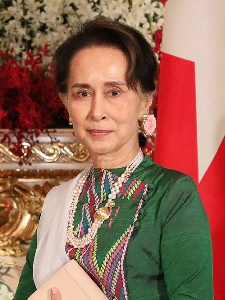

# ဒေါ်အောင်ဆန်းစုကြည်၏ ၁၉၉၁ နိုဘယ်လ်ငြိမ်းချမ်းရေးဆု လက်ခံမိန့်ခွန်း — “စိတ်ဝိညာဉ်၏ တော်လှန်ရေး” ပညာရပ်ဆိုင်ရာ လေ့လာသုံးသပ်ချက်

**Scholarly Study & Critical Analysis of the 1991 Nobel Peace Prize Acceptance Speech (Delivered by Alexander Aris on Behalf of Aung San Suu Kyi, Oslo, December 10, 1991)**

*On October 21, 2019, State Counsellor Aung San Suu Kyi held a meeting with H.E. Mr. Shinzo Abe, Prime Minister of the State of Japan at the Guest House Akasaka Palace.*

- **လေ့လာသုံးသပ်သူ (Analyst):** ထက် (Htet) — Htet Official Digital Archive
- **မူရင်းအခမ်းအနားရက်စွဲ (Original Ceremony Date):** December 10, 1991 (International Human Rights Day, Oslo, Norway)
- **တရားဝင် မူရင်းစာသားနှင့် ဗီဒီယို ကြည့်ရှုဖတ်ရှုရန် (Official Complete HTML Page & Video):** [NobelPrize.org — Aung San Suu Kyi Acceptance Speech (1991)](https://www.nobelprize.org/prizes/peace/1991/kyi/acceptance-speech/)

---

> **မူပိုင်ခွင့်နှင့် ဥပဒေဆိုင်ရာ အသိပေးချက် (Copyright & Fair Use Compliance — Nobel Prize Outreach):**  
> ၁၉၉၁ ခုနှစ် ဒီဇင်ဘာလ ၁၀ ရက်နေ့တွင် ဒေါ်အောင်ဆန်းစုကြည် ကိုယ်စား သားဖြစ်သူ အလက်ဇန္ဒားအဲရစ် (Alexander Aris) မြွက်ကြားခဲ့သော နိုဘယ်လ်ငြိမ်းချမ်းရေးဆု လက်ခံမိန့်ခွန်း မူရင်းစာသားနှင့် ဗီဒီယိုတို့၏ မူပိုင်ခွင့်သည် **Copyright © The Nobel Foundation 1991** (Nobel Prize Outreach မှ ဖြန့်ချိခွင့် စီမံခန့်ခွဲသည်) ထံတွင် တည်ရှိပါသည်။  
> ဤစာတမ်းသည် မူရင်းမိန့်ခွန်းစာသားတစ်ခုလုံးကို ပြန်လည်ကူးယူဖော်ပြခြင်း သို့မဟုတ် `nobelprize.org` ၏ ဗီဒီယိုဖိုင်ကို တိုက်ရိုက် hotlink/embed လုပ်ခြင်း မပြုလုပ်ဘဲ **Berne Convention Article 10(1)**၊ **17 U.S.C. § 107 (Fair Use)** နှင့် Nobel Prize Outreach ၏ *Strictly Editorial, Educational & Non-Commercial Fair Use* စည်းကမ်းချက်များနှင့်အညီ ပညာရေးနှင့် သမိုင်းသုတေသနအတွက်သာ တိုတောင်းသော ကောက်နုတ်ချက်အနည်းငယ်နှင့် ပညာရပ်ဆိုင်ရာ သုံးသပ်ချက်များကို ဖော်ပြထားခြင်း ဖြစ်ပါသည်။ မူရင်းစာသားအပြည့်အစုံနှင့် ဗီဒီယိုကို တရားဝင် [NobelPrize.org စာမျက်နှာ](https://www.nobelprize.org/prizes/peace/1991/kyi/acceptance-speech/) တွင် တိုက်ရိုက်ဖတ်ရှုကြည့်ရှုနိုင်ပါသည်။

---

## ၁။ သမိုင်းဝင်နောက်ခံ (Oslo, December 10, 1991 — International Human Rights Day)

၁၉၉၁ ခုနှစ် ဒီဇင်ဘာလ ၁၀ ရက်နေ့ — ကမ္ဘာ့လူ့အခွင့်အရေးနေ့ (International Human Rights Day; ၁၉၄၈ ခုနှစ်တွင် ကုလသမဂ္ဂ အပြည်ပြည်ဆိုင်ရာ လူ့အခွင့်အရေးကြေညာစာတမ်းကို မြန်မာနိုင်ငံကိုယ်တိုင် ထောက်ခံမဲပေးခဲ့သည့် နှစ်ပတ်လည်နေ့) ၌ နော်ဝေနိုင်ငံ အော့စလိုမြို့တွင် ဒေါ်အောင်ဆန်းစုကြည် နေအိမ်အကျယ်ချုပ် ကျခံနေရစဉ် ၁၈ နှစ်အရွယ် သားကြီး **အလက်ဇန္ဒားအဲရစ် (Alexander Aris)** က မိခင်ကိုယ်စား နိုဘယ်လ်ငြိမ်းချမ်းရေးဆုကို လက်ခံရယူကာ သမိုင်းဝင်မိန့်ခွန်းကို မြွက်ကြားခဲ့သည်။

မိန့်ခွန်းမတိုင်မီ ရက်အနည်းငယ်အလိုတွင် ကုလသမဂ္ဂသည် အတွင်းရေးမှူးချုပ် Javier Pérez de Cuéllar ၏ ထုတ်ပြန်ချက်ကို ထောက်ခံကာ ဒေါ်အောင်ဆန်းစုကြည်အား အမြန်ဆုံးလွှတ်ပေးရန် တညီတညွတ်တည်း ဆုံးဖြတ်ချက်ချမှတ်ခဲ့ပြီး ရန်ကုန်ရှိ စစ်အုပ်စု (SLORC) ၏ ကန့်ကွက်သံတစ်ခုတည်းသာ ကမ္ဘာ့နိုင်ငံများအကြား အထီးကျန်နေခဲ့သည်။

---

## ၂။ အဓိက ပညာရပ်ဆိုင်ရာ မဏ္ဍိုင် (၄) ရပ် (Four Conceptual Pillars)

### (၁) တစ်ဦးတည်း၏ ဆုမဟုတ်ဘဲ မြန်မာပြည်သူတစ်ရပ်လုံး၏ ဆု (A Prize for All People of Burma)
မိခင်သည် ဤနိုဘယ်လ်ငြိမ်းချမ်းရေးဆုကို မိမိတစ်ဦးတည်းအမည်ဖြင့် မဟုတ်ဘဲ ဒီမိုကရေစီမြန်မာနိုင်ငံအတွက် မိမိတို့၏ ဘဝ၊ လွတ်လပ်ခွင့်နှင့် အသက်များကို စွန့်လွှတ်ပေးဆပ်နေကြသော အမျိုးသား၊ အမျိုးသမီးနှင့် ကလေးငယ်များအားလုံး၏ ကိုယ်စား လက်ခံမည်ဖြစ်ကြောင်း အလက်ဇန္ဒားအဲရစ်က ဖော်ပြခဲ့သည်။ ကျေးလက်မြို့ပြ ဆင်းရဲမွဲတေသူများ၊ အကျဉ်းထောင်အတွင်း ညှဉ်းပန်းနှိပ်စက်ခံနေရသူများ၊ တောတွင်း၌ ငှက်ဖျားဖြင့် ကျဆုံးနေရသည့် လူငယ်များနှင့် ရိုက်နှက်စော်ကားခံရသော ရဟန်းသံဃာများ၏ ဒုက္ခကို ကမ္ဘာက ကြားသိအသိအမှတ်ပြုလိုက်ခြင်းဖြစ်ကြောင်း ဖော်ကျူးခဲ့သည်။

### (၂) နိုင်ငံရေးအာဏာရှင်စနစ်နှင့် စိတ်ပိုင်းဆိုင်ရာ ကျွန်ပြုမှုမှ လွတ်မြောက်ရေး (Emancipation of the Human Spirit)
ရန်ကုန်မြို့ရှိ အစောင့်အကြပ်ထူထပ်သော ခြံဝင်းအတွင်းမှ တစ်ကိုယ်တည်းရုန်းကန်မှုသည် တစ်ကမ္ဘာလုံးအတိုင်းအတာဖြင့် နိုင်ငံရေးအာဏာရှင်စနစ်နှင့် စိတ်ပိုင်းဆိုင်ရာ ဖိနှိပ်ကျွန်ပြုမှုမှ လူသားစိတ်ဝိညာဉ် လွတ်မြောက်ရေးတိုက်ပွဲ၏ တစ်စိတ်တစ်ပိုင်းဖြစ်ကြောင်း ဖော်ပြခဲ့သည်—

> *"...part of the much larger struggle, worldwide, for the emancipation of the human spirit from political tyranny and psychological subjection."*  
> *(— Acceptance Speech on behalf of Aung San Suu Kyi, Dec 10, 1991, Copyright © The Nobel Foundation 1991)*

### (၃) အာဏာရှင်စနစ်၏ စီးပွားရေးပြိုလဲမှုနှင့် လူသားဆန်သော ပြန်လည်သင့်မြတ်ရေး
နှစ်ပေါင်း ၃၀ နီးပါး မှားယွင်းသောအုပ်ချုပ်မှုကြောင့် ကြွယ်ဝခဲ့သည့် “ရွှေနိုင်ငံ (Golden Land)” သည် စီးပွားရေးချွတ်ခြုံကျပြီး ငွေကြေးဖောင်းပွမှုနှင့် ကျပ်ငွေတန်ဖိုးကျဆင်းမှုတို့ကို ရင်ဆိုင်နေရကြောင်း၊ ၁၉၈၈ ဒီမိုကရေစီလှုပ်ရှားမှုသည် အရှေ့ဥရောပ၊ အာရှနှင့် အာဖရိက ဒီမိုကရေစီလှိုင်းလုံးကြီးများ၏ ရှေ့ပြေးဖြစ်ခဲ့ကြောင်း ထောက်ပြခဲ့သည်။ စီးပွားရေးလုံးဝပြိုလဲမှ ပြောင်းလဲခြင်းထက် ဖိနှိပ်သူနှင့် ဖိနှိပ်ခံနှစ်ဖက်စလုံး လက်နက်ချကာ လူသားဆန်မှုနှင့် ငြိမ်းချမ်းရေးစိတ်ဓာတ်အပေါ် အခြေခံသော နိုင်ငံတော်တည်ဆောက်နိုင်ရေးကို ဆုတောင်းခဲ့သည်။

### (၄) စိတ်ဝိညာဉ်၏ တော်လှန်ရေးနှင့် လူသားတာဝန်ယူမှု (The Revolution of the Spirit)
ဒေါ်အောင်ဆန်းစုကြည်၏ ဒီမိုကရေစီတိုက်ပွဲသည် နိုင်ငံရေးသက်သက်မဟုတ်ဘဲ ဗုဒ္ဓဘာသာလူသားဝါဒနှင့် လူသားတာဝန်ယူမှုအပေါ် အခြေခံသည့် စိတ်ဝိညာဉ်တော်လှန်ရေးဖြစ်ကြောင်း (*Freedom from Fear* မှ ကောက်နုတ်ချက်များဖြင့်) ရှင်းလင်းခဲ့သည်—

> *"The quintessential revolution is that of the spirit."*  
> *"The quest for democracy in Burma is the struggle of a people to live whole, meaningful lives as free and equal members of the world community."*  
> *(— Aung San Suu Kyi, quoted in 1991 Nobel Acceptance Speech, Copyright © The Nobel Foundation 1991)*

---

## ၃။ သမိုင်းမှတ်စုများနှင့် ကျမ်းကိုးအညွှန်း (Historical Notes & Citations)

- **၁၉၄၈ UDHR မှတ်တမ်း:** ၁၉၄၈ ခုနှစ် ဒီဇင်ဘာ ၁၀ ရက်နေ့တွင် ကုလသမဂ္ဂ အပြည်ပြည်ဆိုင်ရာ လူ့အခွင့်အရေးကြေညာစာတမ်းကို မြန်မာနိုင်ငံသည် ထောက်ခံမဲပေးခဲ့သော နိုင်ငံတစ်နိုင်ငံဖြစ်သည်။
- **Thorolf Rafto Prize (1990):** ၁၉၉၁ နိုဘယ်လ်ဆုမတိုင်မီ ၁၉၉၀ ခုနှစ်တွင် နော်ဝေနိုင်ငံ Bergen မြို့၌ သားနှစ်ဦးက မိခင်ကိုယ်စား Thorolf Rafto လူ့အခွင့်အရေးဆုကို ပထမအကြိမ် လက်ခံရယူခဲ့သည်။
- **Official MLA Citation (NobelPrize.org):** Aung San Suu Kyi – Acceptance Speech. NobelPrize.org. Nobel Prize Outreach. <https://www.nobelprize.org/prizes/peace/1991/kyi/acceptance-speech/>
- **Print Publication Reference:** *Nobel Lectures, Peace 1991-1995*, Editor Irwin Abrams, World Scientific Publishing Co., Singapore, 1999.
- **Copyright Notice:** Copyright © The Nobel Foundation 1991. Strictly non-commercial editorial, educational, and fair-use scholarly commentary.
