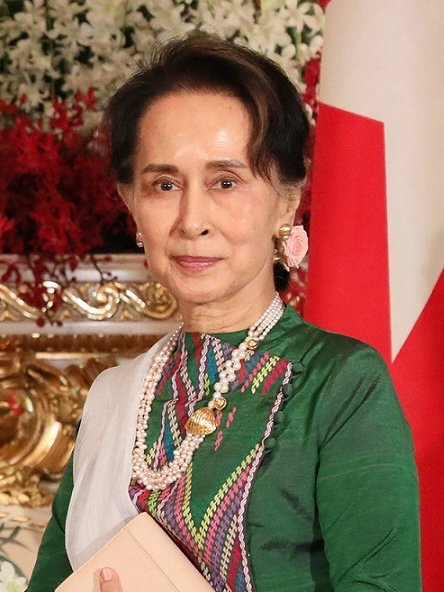

# ကြောက်ရွံ့မှုမှ လွတ်မြောက်ခြင်း (Freedom from Fear — 1990) — ဒေါ်အောင်ဆန်းစုကြည် (မြန်မာဘာသာပြန်အပြည့်အစုံ)

*On October 21, 2019, State Counsellor Aung San Suu Kyi held a meeting with H.E. Mr. Shinzo Abe, Prime Minister of the State of Japan at the Guest House Akasaka Palace.*

- **မူရင်းရေးသားသူ (Author):** ဒေါ်အောင်ဆန်းစုကြည် (Aung San Suu Kyi)
- **အခမ်းအနားနှင့် ခုနှစ်:** ၁၉၉၀ ခုနှစ် ဥရောပပါလီမန်၏ ဆာခါရော့ဗ် လွတ်လပ်စွာတွေးခေါ်ခွင့်ဆု (1990 Sakharov Prize for Freedom of Thought) အထိမ်းအမှတ် မိန့်ခွန်းစာတမ်း
- **မြန်မာဘာသာပြန်ဆိုသူ (Translator):** ထက်မြတ်ဧကရီ (ထက် / Htet)
- **ကိုးကားမူရင်းလင့်ခ် (Reference Archive Source):** [Archives of Women's Political Communication — Freedom from Fear (1990)](https://awpc.cattcenter.iastate.edu/communication/freedom-fear-1990)

---

## သမိုင်းကြောင်းနောက်ခံနှင့် ဒဿနိကဗေဒဆိုင်ရာ အကျဉ်းသုံးသပ်ချက် (Historical Context & Philosophical Overview)

၁၉၉၀ ခုနှစ်တွင် ဥရောပပါလီမန်က ချီးမြှင့်သော **ဆာခါရော့ဗ် လွတ်လပ်စွာတွေးခေါ်ခွင့်ဆု (Sakharov Prize for Freedom of Thought)** ကို ဂုဏ်ပြုအထိမ်းအမှတ်ပြု၍ ဒေါ်အောင်ဆန်းစုကြည် ရေးသားခဲ့သော **“Freedom from Fear (ကြောက်ရွံ့မှုမှ လွတ်မြောက်ခြင်း)”** သည် ၂၀ ရာစုနှောင်းပိုင်း မြန်မာ့နိုင်ငံရေးဒဿနနှင့် ကမ္ဘာ့လူ့အခွင့်အရေးစာပေသမိုင်းတွင် အထင်ရှားဆုံး စာတမ်းတစ်စောင် ဖြစ်သည်။ ဤစာတမ်း၌ မြန်မာ့ဗုဒ္ဓဘာသာကျင့်ဝတ်မှ **အဂတိတရား (၄) ပါး (ဆန္ဒာဂတိ၊ ဒေါသာဂတိ၊ မောဟာဂတိ၊ ဘယာဂတိ)** ကို အခြေခံ၍ ကြောက်ရွံ့မှု (ဘယာဂတိ) သည် အာဏာရှင်များကိုသာမက အုပ်ချုပ်ခံပြည်သူများကိုပါ မည်သို့အကျင့်ပျက်စေကြောင်း ခွဲခြမ်းစိတ်ဖြာထားသည်။ ထို့အပြင် ဗိုလ်ချုပ်အောင်ဆန်းနှင့် မဟတ္တမဂန္ဒီတို့၏ ကိုယ်ကျင့်တရားသတ္တိ (*Abhaya* — ကြောက်ရွံ့မှုကင်းခြင်း)၊ “လက်ခုပ်ထဲက ဖန်ကွဲစများ” သင်္ကေတနှင့် **“စိတ်ဝိညာဉ်၏ တော်လှန်ရေး”** တို့ကို ချိတ်ဆက်ဖော်ကျူးထားသည့် ထာဝရနိုင်ငံရေးဒဿန လက်ရာတစ်ပုဒ် ဖြစ်ပေသည်။

---

## ကြောက်ရွံ့မှုမှ လွတ်မြောက်ခြင်း (မြန်မာဘာသာပြန်အပြည့်အစုံ)

အာဏာက လူကို အကျင့်ပျက်စေသည် မဟုတ်ပါ၊ ကြောက်ရွံ့မှုကသာ အကျင့်ပျက်စေခြင်း ဖြစ်ပါသည်။ အာဏာလက်လွှတ်ရမည်ကို ကြောက်ရွံ့မှုက အာဏာကိုင်စွဲထားသူများကို အကျင့်ပျက်စေပြီး၊ အာဏာ၏ နှိပ်စက်ကလူပြုမှုကို ကြောက်ရွံ့မှုက အာဏာလက်အောက်ခံ ပြည်သူများကို အကျင့်ပျက်စေပါသည်။ မြန်မာလူမျိုးအများစုသည် အကျင့်ပျက်ခြင်းလေးမျိုးဖြစ်သော **အဂတိတရား လေးပါး** နှင့် ရင်းနှီးကျွမ်းဝင်ကြပါသည်။

**ဆန္ဒာဂတိ (Chanda-gati)** ဆိုသည်မှာ လိုချင်တပ်မက်မှုကြောင့် ဖြစ်ပေါ်သော အကျင့်ပျက်ခြင်းဖြစ်ပြီး၊ လာဘ်လာဘကို မျှော်ကိုး၍လည်းကောင်း၊ မိမိချစ်ခင်သူများ၏ မျက်နှာကို ထောက်ထား၍လည်းကောင်း မှန်ကန်သောလမ်းကြောင်းမှ သွေဖည်သွားခြင်း ဖြစ်သည်။ **ဒေါသာဂတိ (Dosa-gati)** သည် မိမိမုန်းတီးရန်ငြိုးထားသူများကို ထိခိုက်နစ်နာစေလို၍ မှားယွင်းသောလမ်းကို လိုက်ခြင်းဖြစ်ပြီး၊ **မောဟာဂတိ (Moha-gati)** သည် မသိနားမလည်မှု အဝိဇ္ဇာကြောင့် လမ်းလွဲသွားခြင်း ဖြစ်သည်။ သို့သော် ထိုလေးပါးအနက် အဆိုးရွားဆုံးမှာ **ဘယာဂတိ (Bhaya-gati)** ပင် ဖြစ်ပေလိမ့်မည်။ အဘယ်ကြောင့်ဆိုသော် ဘယ (ကြောက်ရွံ့မှု) သည် အမှားအမှန် ခွဲခြားသိမြင်စိတ်အားလုံးကို မွန်းကျပ်စေပြီး တဖြည်းဖြည်း ဖျက်ဆီးပစ်ရုံသာမက ကျန်အဂတိသုံးပါး၏ အမြစ်အရင်းခံလည်း ဖြစ်နေတတ်သောကြောင့် ဖြစ်သည်။ လောဘသက်သက်ကြောင့် မဟုတ်သည့်အခါမျိုး၌ ဆန္ဒာဂတိသည် ချို့တဲ့ဆင်းရဲမည်ကို ကြောက်ရွံ့ခြင်း သို့မဟုတ် ချစ်ခင်သူများ၏ စေတနာမေတ္တာ ဆုံးရှုံးမည်ကို ကြောက်ရွံ့ခြင်းတို့ကြောင့် ဖြစ်ပေါ်နိုင်သကဲ့သို့၊ မိမိထက် သာလွန်သွားမည်၊ အရှက်ခွဲခံရမည် သို့မဟုတ် တစ်နည်းနည်းဖြင့် ထိခိုက်နာကျင်စေမည်ကို ကြောက်ရွံ့ခြင်းကလည်း ရန်ငြိုးအမုန်းတရားအတွက် တွန်းအားဖြစ်စေနိုင်ပါသည်။ ကြောက်ရွံ့မှု၏ ချုပ်နှောင်ခြင်းကင်းစွာဖြင့် အမှန်တရားကို ရှာဖွေနိုင်သော လွတ်လပ်ခွင့်မရှိလျှင် အဝိဇ္ဇာမောဟကိုလည်း ဖယ်ရှားရန် ခက်ခဲပေလိမ့်မည်။ ကြောက်ရွံ့မှုနှင့် အကျင့်ပျက်ခြစားမှုတို့အကြား ဤမျှနီးကပ်သော ဆက်နွှယ်မှုရှိနေသောကြောင့် ကြောက်ရွံ့မှု ပျံ့နှံ့နေသည့် မည်သည့်လူ့အဖွဲ့အစည်းတွင်မဆို ပုံစံအမျိုးမျိုးသော အကျင့်ပျက်ခြစားမှုများ နက်ရှိုင်းစွာ အမြစ်တွယ်နေခြင်းမှာ အံ့ဩစရာမရှိတော့ပေ။

၁၉၈၈ ခုနှစ် ကျောင်းသားဆန္ဒပြပွဲများမှ မီးပွားစတင်ခဲ့သော မြန်မာ့ဒီမိုကရေစီလှုပ်ရှားမှု၏ အဓိကအကြောင်းရင်းမှာ စီးပွားရေးကျပ်တည်းမှုအပေါ် ပြည်သူလူထု၏ မကျေနပ်ချက်ဖြစ်သည်ဟု ရှုမြင်လေ့ရှိကြသည်။ နှစ်ပေါင်းများစွာ ရှေ့နောက်မညီသော မူဝါဒများ၊ အရည်အချင်းမဲ့သော အာဏာပိုင်တို့၏ လုပ်ဆောင်ချက်များ၊ တဟုန်ထိုးတက်လာသော ငွေကြေးဖောင်းပွမှုနှင့် ကျဆင်းလာသော လက်တွေ့ဝင်ငွေတို့က တိုင်းပြည်ကို စီးပွားရေးပျက်ကပ်အတွင်း ကျရောက်စေခဲ့သည်မှာ မှန်ပါသည်။ သို့သော် အစဉ်အလာအားဖြင့် စိတ်သဘောထားကောင်းမွန်၍ သည်းခံအေးဆေးလေ့ရှိသော ပြည်သူလူထု၏ သည်းခံနိုင်စွမ်းကို တိုက်စားပျက်ပြားစေခဲ့သည်မှာ လက်ခံနိုင်ရုံမျှ လူနေမှုအဆင့်အတန်းကိုပင် ခက်ခဲပင်ပန်းစွာ ရုန်းကန်ရှာဖွေနေရသည့် ဒုက္ခတစ်ခုတည်း မဟုတ်ပါ— အကျင့်ပျက်ခြစားမှုနှင့် ကြောက်ရွံ့မှုတို့ကြောင့် ပုံပျက်ပန်းပျက် ဖြစ်နေရသော ဘဝနေထိုင်မှုပုံစံ၏ သိက္ခာကျအရှက်ရမှုလည်း ပါဝင်ပါသည်။

ကျောင်းသားများသည် မိမိတို့ရဲဘော်များ ကျဆုံးခဲ့ရခြင်းကိုသာ ကန့်ကွက်ဆန္ဒပြခဲ့ကြခြင်း မဟုတ်ဘဲ၊ ပစ္စုပ္ပန်ကို အဓိပ္ပာယ်မဲ့စေပြီး အနာဂတ်အတွက် မျှော်လင့်ချက်တစ်စုံတစ်ရာမျှ မပေးနိုင်သော အာဏာရှင်စနစ်က မိမိတို့၏ အသက်ရှင်နေထိုင်ပိုင်ခွင့်ကို ငြင်းပယ်နေခြင်းအား ဆန့်ကျင်ဆန္ဒပြခဲ့ကြခြင်း ဖြစ်သည်။ ကျောင်းသားများ၏ ဆန္ဒပြမှုသည် ပြည်သူလူထုတစ်ရပ်လုံး၏ နာကြည်းမကျေနပ်ချက်များကို ကိုယ်စားပြု ဖော်ထုတ်ပေးနိုင်ခဲ့သောကြောင့် ဆန္ဒပြပွဲများသည် တစ်နိုင်ငံလုံးအတိုင်းအတာ လှုပ်ရှားမှုကြီးအဖြစ် လျင်မြန်စွာ ကြီးထွားလာခဲ့သည်။ ဤလှုပ်ရှားမှုကို အပြင်းထန်ဆုံး ထောက်ခံအားပေးသူအချို့မှာ လက်ရှိစနစ်အတွင်း ရပ်တည်နိုင်ရုံသာမက ကြီးပွားချမ်းသာရန်ပါ လိုအပ်သော ကျွမ်းကျင်မှုနှင့် အဆက်အသွယ်များ ရှိထားကြသည့် စီးပွားရေးလုပ်ငန်းရှင်များ ဖြစ်ကြသည်။ သို့သော် သူတို့၏ ကြွယ်ဝချမ်းသာမှုသည် သူတို့အား စစ်မှန်သော လုံခြုံမှု သို့မဟုတ် ဘဝပြည့်စုံကျေနပ်မှုကို မပေးစွမ်းနိုင်ခဲ့ပေ။ စီးပွားရေးအဆင့်အတန်း မည်သို့ပင်ရှိစေကာမူ မိမိတို့နှင့် နိုင်ငံသားအားလုံး တန်ဖိုးရှိသော ဘဝတစ်ခုကို ပိုင်ဆိုင်နိုင်ရန်အတွက် တာဝန်ခံမှုရှိသော အုပ်ချုပ်ရေးစနစ်တစ်ရပ်သည် လုံလောက်သောအခြေအနေ မဟုတ်သည့်တိုင်အောင် အနည်းဆုံး မရှိမဖြစ်လိုအပ်သော အခြေအနေတစ်ခုဖြစ်ကြောင်း သူတို့ မမြင်ဘဲမနေနိုင်ခဲ့ကြပေ။ မြန်မာပြည်သူများသည် အာဏာပိုင်တို့၏ “လက်ခုပ်ထဲက ရေ” သဖွယ် စိုးရိမ်ထိတ်လန့်စွာ ငြိမ်ခံနေရသည့် မရေရာသော အခြေအနေကို ငြီးငွေ့စိတ်ကုန်နေကြပြီ ဖြစ်သည်။

> *“လက်ခုပ်ထဲက ရေပမာ — မြစိမ်းရောင်အေးမြနေနိုင်သော်လည်း*  
> *ဪ... လက်ခုပ်ထဲက ဖန်ကွဲစလေးများသဖွယ် ဖြစ်ခွင့်ရလိုက်ချင်ပါဘိ။”*

ဖိညှစ်ချေမွရန် ကြိုးစားလာသော လက်ဖဝါးများရန်မှ မိမိကိုယ်ကိုယ် ကာကွယ်နိုင်သည့် ထက်ရှတောက်ပသော စွမ်းအားရှိသည့် အသေးငယ်ဆုံးသော ဖန်ကွဲစလေးများကို ဖိနှိပ်ချုပ်ချယ်မှုလက်အောက်မှ မိမိကိုယ်ကိုယ် လွတ်မြောက်လိုသူများအတွက် မရှိမဖြစ်လိုအပ်သည့် သတ္တိမီးပွား၏ ထင်ရှားသော သင်္ကေတအဖြစ် ရှုမြင်နိုင်ပါသည်။ ဗိုလ်ချုပ်အောင်ဆန်းသည် မိမိကိုယ်ကိုယ် တော်လှန်ရေးသမားတစ်ဦးအဖြစ် ခံယူခဲ့ပြီး မြန်မာနိုင်ငံ၏ စမ်းသပ်ခံကာလများအတွင်း ရင်ဆိုင်နေရသော ပြဿနာများအတွက် အဖြေများကို မမောမပန်း ရှာဖွေခဲ့သည်။ သူသည် ပြည်သူများအား သတ္တိမွေးမြူကြရန် ဤသို့ တိုက်တွန်းခဲ့သည်— *“သူများတွေရဲ့ သတ္တိနဲ့ ရဲစွမ်းသတ္တိကိုချည်း အားကိုးမနေကြပါနဲ့။ ခင်ဗျားတို့ တစ်ယောက်ချင်းစီဟာ သတ္တိနဲ့ ရဲစွမ်းသတ္တိပြည့်ဝတဲ့ သူရဲကောင်းတစ်ယောက် ဖြစ်လာအောင် စွန့်လွှတ်အနစ်နာခံကြရမယ်။ အဲဒီအခါကျမှသာ ကျုပ်တို့အားလုံး စစ်မှန်တဲ့ လွတ်လပ်ရေးကို ခံစားနိုင်ကြလိမ့်မယ်။”*

နေ့စဉ်ဘဝ၏ အစိတ်အပိုင်းတစ်ခုအဖြစ် ကြောက်ရွံ့မှုက လွှမ်းမိုးနေသော ပတ်ဝန်းကျင်မျိုးတွင် အကျင့်မပျက်ဘဲ ရပ်တည်နိုင်ရန် လိုအပ်သည့် ကြိုးပမ်းအားထုတ်မှုကို တရားဥပဒေစိုးမိုးသော နိုင်ငံများတွင် ကံကောင်းစွာ နေထိုင်ခွင့်ရသူများအနေဖြင့် ချက်ချင်းမြင်သာနားလည်နိုင်မည် မဟုတ်ပေ။ တရားမျှတသော ဥပဒေများသည် ပြစ်မှုကျူးလွန်သူများကို ဘက်မလိုက်ဘဲ အပြစ်ပေးခြင်းဖြင့် အကျင့်ပျက်ခြစားမှုကို တားဆီးရုံသာမက၊ ပြည်သူများအနေဖြင့် မသမာသောနည်းလမ်းများကို အားကိုးစရာမလိုဘဲ လူ့ဂုဏ်သိက္ခာကို ထိန်းသိမ်းရန် လိုအပ်သည့် အခြေခံလိုအပ်ချက်များကို ဖြည့်ဆည်းနိုင်သော လူ့အဖွဲ့အစည်းတစ်ရပ်ကိုလည်း ဖန်တီးပေးပါသည်။ ထိုကဲ့သို့သော ဥပဒေများ မရှိသည့်နေရာတွင် တရားမျှတမှုနှင့် သာမန်လူ့ကျင့်ဝတ်မူများကို ထိန်းသိမ်းစောင့်ရှောက်ရမည့် တာဝန်သည် သာမန်ပြည်သူများ၏ ပခုံးပေါ်သို့ ကျရောက်လာပါသည်။ ကြောက်ရွံ့မှုကြောင့် အသိဉာဏ်နှင့် ကိုယ်ကျင့်သိက္ခာ တိမ်းစောင်းနေသော နိုင်ငံတစ်နိုင်ငံကို လူသား၏ ပျက်စီးစေတတ်သော ဗီဇဆိုးများကို ထိန်းချုပ်ပေးပြီး သဟဇာတဖြစ်မှုနှင့် တရားမျှတမှုအပေါ် လိုလားတောင့်တမှုကို မြှင့်တင်ပေးသည့် တရားဥပဒေစည်းမျဉ်းများ တည်ရှိသော နိုင်ငံတစ်နိုင်ငံအဖြစ် ပြောင်းလဲပေးမည်မှာ ထိုသာမန်ပြည်သူများ၏ စဉ်ဆက်မပြတ် ကြိုးပမ်းအားထုတ်မှုနှင့် ကြံ့ကြံ့ခံ သည်းခံနိုင်စွမ်းတို့၏ စုပေါင်းအကျိုးသက်ရောက်မှုပင် ဖြစ်ပါသည်။

ကြီးမားလှသော နည်းပညာတိုးတက်မှုများက အင်အားကြီး၍ ကိုယ်ကျင့်တရားကင်းမဲ့သူများ အားနည်း၍ အကူအညီမဲ့သူများအပေါ် လွှမ်းမိုးချုပ်ကိုင်ရန် အသုံးပြုနိုင်ပြီး လက်တွေ့အသုံးပြုနေကြသည့် အသက်အန္တရာယ်ပြု လက်နက်များကို ဖန်တီးပေးထားသော ဤခေတ်ကြီးတွင် အမျိုးသားအဆင့်၌သာမက နိုင်ငံတကာအဆင့်၌ပါ နိုင်ငံရေးနှင့် ကိုယ်ကျင့်တရားတို့အကြား ပိုမိုနီးကပ်သော ဆက်နွှယ်မှုရှိရန် အရေးတကြီး လိုအပ်နေပါသည်။ ကုလသမဂ္ဂ၏ အပြည်ပြည်ဆိုင်ရာ လူ့အခွင့်အရေးကြေညာစာတမ်းက “လူတစ်ဦးချင်းစီနှင့် လူ့အဖွဲ့အစည်း၏ အစိတ်အပိုင်းတိုင်း” သည် လူမျိုး၊ နိုင်ငံသား သို့မဟုတ် ဘာသာတရား မခွဲခြားဘဲ လူသားတိုင်း ရပိုင်ခွင့်ရှိသော အခြေခံအခွင့်အရေးနှင့် လွတ်လပ်ခွင့်များကို မြှင့်တင်ရန် ကြိုးပမ်းသင့်ကြောင်း ကြေညာထားပါသည်။ သို့သော် ပြည်သူ့လုပ်ပိုင်ခွင့်အာဏာအစား အဓမ္မဖိအားပေးမှုအပေါ် အခြေခံသည့် အစိုးရများနှင့် ရေရှည်ငြိမ်းချမ်းရေးနှင့် ကြွယ်ဝချမ်းသာမှုထက် ရေတိုအကျိုးအမြတ်ကို ဦးစားပေးသည့် အကျိုးစီးပွားအုပ်စုများ ရှိနေသရွေ့ လူ့အခွင့်အရေးကို ကာကွယ်မြှင့်တင်ရန် နိုင်ငံတကာ၏ ပူးပေါင်းဆောင်ရွက်မှုသည် အကောင်းဆုံးအခြေအနေ၌ပင် တစ်စိတ်တစ်ပိုင်းသာ အကောင်အထည်ဖော်နိုင်သော ရုန်းကန်မှုအဖြစ် ကျန်ရှိနေဦးမည် ဖြစ်သည်။ ဖိနှိပ်ခံသားကောင်များအနေဖြင့် လူသားမိသားစုဝင်များအဖြစ် မိမိတို့၏ မွေးရာပါအခွင့်အရေးများကို ကာကွယ်ရန် မိမိတို့၏ အတွင်းစိတ်စွမ်းအားများကိုသာ အားကိုးရုန်းကန်ရမည့် တိုက်ပွဲနယ်ပယ်များ ဆက်လက်တည်ရှိနေဦးမည် ဖြစ်ပါသည်။

**အနှစ်သာရအရှိဆုံး တော်လှန်ရေးသည် စိတ်ဝိညာဉ်၏ တော်လှန်ရေးဖြစ်ပြီး**၊ နိုင်ငံတစ်နိုင်ငံ၏ ဖွံ့ဖြိုးတိုးတက်မှုလမ်းကြောင်းကို ပုံဖော်ပေးသည့် စိတ်နေသဘောထားများနှင့် တန်ဖိုးထားမှုများကို ပြောင်းလဲရန် လိုအပ်ကြောင်း အသိဉာဏ်ဖြင့် ခိုင်မာစွာ ယုံကြည်မှုမှ မွေးဖွားလာခြင်း ဖြစ်သည်။ ရုပ်ပိုင်းဆိုင်ရာ အခြေအနေများ တိုးတက်ကောင်းမွန်စေရန် ရည်ရွယ်၍ တရားဝင်မူဝါဒများနှင့် အဖွဲ့အစည်းများကို ပြောင်းလဲရုံမျှ ရည်မှန်းသော တော်လှန်ရေးသည် စစ်မှန်သော အောင်မြင်မှုရရှိရန် အခွင့်အလမ်း အလွန်နည်းပါးပါသည်။ စိတ်ဝိညာဉ်၏ တော်လှန်ရေးမပါရှိဘဲ စနစ်ဟောင်း၏ မတရားမှုများကို မွေးဖွားပေးခဲ့သော အင်အားစုများသည် ဆက်လက်လှုပ်ရှားနေမည်ဖြစ်ပြီး ပြုပြင်ပြောင်းလဲရေးနှင့် ပြန်လည်ထူထောင်ရေး လုပ်ငန်းစဉ်အပေါ် အမြဲတမ်း ခြိမ်းခြောက်နေမည် ဖြစ်သည်။ လွတ်လပ်ရေး၊ ဒီမိုကရေစီနှင့် လူ့အခွင့်အရေးတို့ကို တောင်းဆိုအော်ဟစ်နေရုံဖြင့် မလုံလောက်ပါ။ တိုက်ပွဲတွင် မဆုတ်မနစ် ဇွဲရှိရှိ ကြိုးပမ်းရန်၊ ထာဝရအမှန်တရားများအတွက် စွန့်လွှတ်အနစ်နာခံရန်နှင့် ဆန္ဒ၊ ဒေါသ၊ မောဟ၊ ဘယ ဟူသော အကျင့်ပျက်စေသည့် လွှမ်းမိုးမှုများကို တွန်းလှန်ရန် စည်းလုံးညီညွတ်သော သန္နိဋ္ဌာန် ရှိရမည် ဖြစ်ပါသည်။

“သူတော်စင်များဆိုသည်မှာ ဆက်လက်ကြိုးစားနေကြသော အပြစ်သားများဖြစ်သည်” ဟု ဆိုရိုးစကားရှိပါသည်။ ထိုနည်းတူစွာ လွတ်လပ်သောလူသားများဆိုသည်မှာ ဆက်လက်ကြိုးစားရုန်းကန်နေကြသော ဖိနှိပ်ခံများဖြစ်ပြီး၊ ထိုသို့ကြိုးစားရင်းဖြင့် လွတ်လပ်သော လူ့အဖွဲ့အစည်းတစ်ရပ်ကို ထိန်းသိမ်းစောင့်ရှောက်မည့် တာဝန်များကို ထမ်းဆောင်ရန်နှင့် စည်းကမ်းများကို လိုက်နာရန် ထိုက်တန်အောင် မိမိတို့ကိုယ်ကိုယ် ပြုစုပျိုးထောင်ကြသူများ ဖြစ်ပါသည်။ လူသားများ၏ ဘဝပြည့်စုံ၍ ကျဉ်းကျပ်မှုကင်းစေရန် မျှော်မှန်းတောင့်တကြသည့် အခြေခံလွတ်လပ်ခွင့်များအနက် **ကြောက်ရွံ့မှုမှ လွတ်မြောက်ခြင်း** သည် နည်းလမ်းတစ်ခုအဖြစ်သာမက ပန်းတိုင်တစ်ခုအဖြစ်ပါ ထင်ရှားစွာ ရပ်တည်နေပါသည်။ နိုင်ငံတော်အာဏာ အလွဲသုံးစားမှုကို အာမခံချက်ပေးကာကွယ်နိုင်မည့် ခိုင်မာသော ဒီမိုကရေစီအင်စတီကျူးရှင်းများ တည်ဆောက်လိုသော ပြည်သူတစ်ရပ်သည် ဦးစွာ မိမိတို့၏ စိတ်နှလုံးကို ဂရုမစိုက်လျစ်လျူရှုမှုနှင့် ကြောက်ရွံ့မှုတို့မှ လွတ်မြောက်အောင် သင်ယူကြရမည် ဖြစ်ပါသည်။

ပြောသည့်အတိုင်း အမြဲလက်တွေ့ကျင့်သုံးခဲ့သူ ဗိုလ်ချုပ်အောင်ဆန်းသည် ရုပ်ပိုင်းဆိုင်ရာ သတ္တိသာမက အမှန်တရားကို ပြောရဲခြင်း၊ မိမိကတိကို တည်ခြင်း၊ ဝေဖန်မှုကို လက်ခံခြင်း၊ မိမိအမှားကို ဝန်ခံပြင်ဆင်ခြင်း၊ အတိုက်အခံကို လေးစားခြင်း၊ ရန်သူနှင့်ပင် ဆွေးနွေးညှိနှိုင်းရဲခြင်းနှင့် ခေါင်းဆောင်တစ်ဦးအဖြစ် မိမိထိုက်တန်မှု ရှိမရှိကို ပြည်သူလူထုအား ဆုံးဖြတ်စေခြင်း စသည့် သတ္တိမျိုးကို အမြဲတမ်း ပြသခဲ့ပါသည်။ ထိုကဲ့သို့သော ကိုယ်ကျင့်တရားသတ္တိကြောင့်ပင် သူ့ကို မြန်မာနိုင်ငံတွင် စစ်သူရဲကောင်းတစ်ဦးအဖြစ်သာမက နိုင်ငံတော်၏ စိတ်ဓာတ်ခွန်အားနှင့် ကိုယ်ကျင့်သိက္ခာအဖြစ်ပါ အမြဲတမ်း ချစ်ခင်လေးစားနေကြမည် ဖြစ်သည်။ မဟတ္တမဂန္ဒီကို ဖော်ညွှန်းရန် ဂျဝါဟာလာ နေရူး အသုံးပြုခဲ့သော စကားလုံးများသည် ဗိုလ်ချုပ်အောင်ဆန်းအတွက်လည်း အတိအကျ ကိုက်ညီလှပါသည်—

> *“သူ၏ သွန်သင်ဆုံးမမှု အနှစ်သာရမှာ ကြောက်ရွံ့မှုကင်းခြင်းနှင့် အမှန်တရားဖြစ်ပြီး၊ ပြည်သူလူထု၏ ကောင်းကျိုးချမ်းသာကို အမြဲရှေ့တန်းတင်ကာ ယင်းတို့နှင့် ပေါင်းစပ်လက်တွေ့ဆောင်ရွက်ခြင်း ဖြစ်သည်။”*

အကြမ်းမဖက်ဝါဒ၏ ကြီးမြတ်သော တမန်တော် ဂန္ဒီနှင့် အမျိုးသားတပ်မတော်ကို တည်ထောင်သူ အောင်ဆန်းတို့သည် အလွန်ကွဲပြားသော ပုဂ္ဂိုလ်နှစ်ဦး ဖြစ်ကြသော်လည်း၊ မည်သည့်အချိန် မည်သည့်နေရာ၌မဆို အာဏာရှင်အုပ်ချုပ်မှု၏ စိန်ခေါ်မှုများမှာ မလွဲမသွေ တူညီနေတတ်သကဲ့သို့ ထိုစိန်ခေါ်မှုကို ရင်ဆိုင်ရန် မတ်တတ်ရပ်လာကြသူများ၏ ပင်ကိုအရည်အသွေးများမှာလည်း တူညီနေကြပါသည်။ အိန္ဒိယပြည်သူများအတွင်း သတ္တိသွတ်သွင်းပေးနိုင်ခဲ့ခြင်းကို ဂန္ဒီ၏ အကြီးမြတ်ဆုံး အောင်မြင်မှုတစ်ခုဟု ရှုမြင်ခဲ့သော နေရူးသည် ခေတ်မီနိုင်ငံရေးအမြင်ရှိသူတစ်ဦး ဖြစ်သော်လည်း ၂၀ ရာစု လွတ်လပ်ရေးလှုပ်ရှားမှု၏ လိုအပ်ချက်များကို သုံးသပ်ရာ၌ ရှေးဟောင်းအိန္ဒိယဒဿနသို့ ပြန်လည်ကြည့်ရှုခဲ့ရသည်— *“လူတစ်ဦး သို့မဟုတ် နိုင်ငံတစ်နိုင်ငံအတွက် အကြီးမြတ်ဆုံးသော လက်ဆောင်မှာ **အဘယ (Abhaya)** ခေါ် ကြောက်ရွံ့မှုကင်းခြင်းဖြစ်ပြီး၊ ယင်းမှာ ကိုယ်ကာယသတ္တိသက်သက်မဟုတ်ဘဲ စိတ်နှလုံးအတွင်းမှ ကြောက်ရွံ့မှု လုံးဝကင်းစင်ခြင်း ဖြစ်သည်။”*

ကြောက်ရွံ့မှုကင်းခြင်း (Fearlessness) သည် မွေးရာပါလက်ဆောင်တစ်ခု ဖြစ်ကောင်းဖြစ်နိုင်သော်လည်း ပို၍တန်ဖိုးကြီးမားသည်မှာ ကြိုးပမ်းအားထုတ်မှုမှတစ်ဆင့် ရရှိလာသော သတ္တိ— မိမိ၏ လုပ်ရပ်များကို ကြောက်ရွံ့မှုက စေခိုင်းခြင်းအား ငြင်းပယ်သည့် အလေ့အကျင့်ကို ပြုစုပျိုးထောင်ခြင်းမှ ပေါက်ဖွားလာသော သတ္တိ၊ ပြင်းထန်၍ မရပ်မနား ဖိအားများကြားတွင် ထပ်တလဲလဲ ပြန်လည်ဆန်းသစ်နေသည့် **“ဖိအားအောက်မှ တည်ငြိမ်ကျက်သရေ (Grace under pressure)”** ဟု ဖော်ညွှန်းနိုင်သော သတ္တိပင် ဖြစ်ပါသည်။

အခြေခံလူ့အခွင့်အရေးများ တည်ရှိမှုကို ငြင်းပယ်ထားသော စနစ်တစ်ခုအတွင်း ကြောက်ရွံ့မှုသည် နေ့စဉ်ပုံမှန်အခြေအနေ ဖြစ်နေတတ်သည်။ ထောင်ချခံရမည်ကို ကြောက်ရွံ့ခြင်း၊ ညှဉ်းပန်းနှိပ်စက်ခံရမည်ကို ကြောက်ရွံ့ခြင်း၊ သေဆုံးရမည်ကို ကြောက်ရွံ့ခြင်း၊ မိတ်ဆွေများ၊ မိသားစု၊ ပိုင်ဆိုင်မှု သို့မဟုတ် အသက်မွေးဝမ်းကျောင်း ဆုံးရှုံးရမည်ကို ကြောက်ရွံ့ခြင်း၊ ဆင်းရဲမွဲတေမည်ကို ကြောက်ရွံ့ခြင်း၊ အထီးကျန်ဖယ်ကြဉ်ခံရမည်ကို ကြောက်ရွံ့ခြင်း၊ ကျရှုံးမည်ကို ကြောက်ရွံ့ခြင်းတို့ ဖြစ်ကြသည်။ အန္တရာယ်အကြီးဆုံးနှင့် အလျှို့ဝှက်ဆုံးသော ကြောက်ရွံ့မှုပုံစံမှာ သာမန်အသိဉာဏ် သို့မဟုတ် ပညာဉာဏ်အဖြစ်ပင် ဟန်ဆောင်အယောင်ဆောင်ထားပြီး၊ လူသား၏ ကိုယ်ပိုင်ဂုဏ်သိက္ခာနှင့် မွေးရာပါလူ့တန်ဖိုးကို ထိန်းသိမ်းစောင့်ရှောက်ပေးသည့် နေ့စဉ်သေးငယ်သော သတ္တိလုပ်ရပ်လေးများကို မိုက်မဲသည်၊ မဆင်မခြင်လုပ်သည်၊ အရေးမပါသည် သို့မဟုတ် အချည်းနှီးဖြစ်သည်ဟု ရှုတ်ချပစ်တတ်သော ကြောက်ရွံ့မှု ဖြစ်သည်။ “အင်အားရှိသူသည် အမှန်ဖြစ်သည်” ဟူသော သံမဏိစည်းမျဉ်းအောက်၌ ကြောက်ရွံ့မှုဖြင့် ပုံသွင်းခံထားရသော ပြည်သူတစ်ရပ်အတွက် စိတ်ဓာတ်အားအင်ကုန်ခန်းစေသည့် ကြောက်ရွံ့မှုမြူဆိုင်းကြီးထဲမှ လွတ်မြောက်ရန် မလွယ်ကူလှပါ။ သို့သော် အပြင်းထန်ဆုံး ဖိနှိပ်ချေမွနေသည့် နိုင်ငံတော်ယန္တရားအောက်မှာပင် သတ္တိသည် အကြိမ်ကြိမ် ပြန်လည်နိုးထပေါ်ပေါက်လာမြဲ ဖြစ်ပါသည်— အဘယ်ကြောင့်ဆိုသော် ကြောက်ရွံ့မှုသည် ယဉ်ကျေးသော လူသား၏ သဘာဝအခြေအနေ မဟုတ်သောကြောင့် ဖြစ်ပါသည်။

အထိန်းအကွပ်မဲ့သော အာဏာရှေ့မှောက်၌ သတ္တိနှင့် ကြံ့ကြံ့ခံနိုင်စွမ်းတို့၏ ရေသောက်မြစ်မှာ ယေဘုယျအားဖြင့် ကိုယ်ကျင့်တရားအခြေခံမူများ၏ မြင့်မြတ်မှုအပေါ် ခိုင်မာစွာ ယုံကြည်ခြင်းနှင့် ဆုတ်ယုတ်မှုများ မည်သို့ပင်ရှိစေကာမူ လူသား၏အခြေအနေသည် စိတ်ပိုင်းဆိုင်ရာနှင့် ရုပ်ပိုင်းဆိုင်ရာ နှစ်ရပ်စလုံး တိုးတက်မြင့်မားရေးလမ်းကြောင်းပေါ်သို့ နောက်ဆုံးဦးတည်နေသည်ဟူသော သမိုင်းအသိအမြင်တို့ ပေါင်းစပ်ထားခြင်း ဖြစ်သည်။ လူသားကို သာမန်တိရစ္ဆာန်နှင့် အထင်ရှားဆုံး ခွဲခြားပေးသည်မှာ မိမိကိုယ်ကိုယ် ပြုပြင်တိုးတက်စေနိုင်စွမ်းနှင့် မိမိကိုယ်ကိုယ် ကယ်တင်မြှင့်တင်နိုင်စွမ်းပင် ဖြစ်သည်။ လူသားတာဝန်ယူမှု၏ အရင်းအမြစ်တွင် ပြည့်စုံကောင်းမွန်မှုဆိုင်ရာ သဘောတရား၊ ယင်းကို ရရှိရန် ပြင်းပြသောဆန္ဒ၊ ယင်းသို့ရောက်ရှိမည့် လမ်းကြောင်းကို ရှာဖွေနိုင်သော ဉာဏ်ပညာနှင့် အဆုံးတိုင် မရောက်နိုင်သည့်တိုင်အောင် တစ်ဦးချင်းကန့်သတ်ချက်များနှင့် ပတ်ဝန်းကျင်အတားအဆီးများထက် ကျော်လွန်တက်လှမ်းရန် လိုအပ်သည့် ခရီးအကွာအဝေးအထိ လျှောက်လှမ်းလိုသော စိတ်ဓာတ်ခွန်အားတို့ တည်ရှိနေပါသည်။ ဆင်ခြင်တုံတရားရှိ၍ ယဉ်ကျေးသော လူသားမျိုးနွယ်နှင့် ထိုက်တန်သည့် ကမ္ဘာကြီးတစ်ခုအပေါ် လူသား၏ မျှော်မှန်းချက်ကသာ လိုအပ်ချက်ချို့တဲ့မှုနှင့် ကြောက်ရွံ့မှုတို့မှ ကင်းဝေးသော လူ့အဖွဲ့အစည်းများ တည်ဆောက်ရန် ရဲဝံ့စွန့်စားစေပြီး ဒုက္ခဆင်းရဲများကို ခံနိုင်ရည်ရှိစေခြင်း ဖြစ်ပါသည်။ အမှန်တရား၊ တရားမျှတမှုနှင့် ကရုဏာတရား စသည့် သဘောတရားများသည် ရက်စက်ကြမ်းကြုတ်သော အာဏာကို ဆန့်ကျင်ရပ်တည်နိုင်သည့် တစ်ခုတည်းသော ခံတပ်ကြီးများ ဖြစ်နေတတ်သောအခါ ယင်းတို့ကို ရိုးအီနေသော စကားလုံးများဟု ပယ်ချ၍ မရနိုင်ပါပေ။

---

## တရားဝင် ကိုးကားချက်နှင့် မူပိုင်ခွင့်အညွှန်း (Official Citation & Reference Source)

- **မူရင်းရေးသားသူ (Author):** ဒေါ်အောင်ဆန်းစုကြည် (Aung San Suu Kyi, 1990)
- **အခမ်းအနား:** In commemoration of winning the 1990 Sakharov Prize for Freedom of Thought (European Parliament)
- **မြန်မာဘာသာပြန်ဆိုသူ (Translator):** ထက်မြတ်ဧကရီ (ထက် / Htet) — Non-Commercial Educational & Research Platform
- **တိုက်ရိုက်ကိုးကားလင့်ခ် (Reference Archive Link):** [https://awpc.cattcenter.iastate.edu/communication/freedom-fear-1990](https://awpc.cattcenter.iastate.edu/communication/freedom-fear-1990)
- **Book Reference:** Aung San Suu Kyi. (1991). *Freedom from Fear and Other Writings* (Michael Aris, Ed.). Penguin Books.
- **အသိပေးချက်:** ဤဘာသာပြန်စာမူကို အကျိုးအမြတ်မယူသော နိုင်ငံရေးဒဿနိကဗေဒ သုတေသနနှင့် ပညာရေး (Non-Commercial Educational & Research Use — ကြော်ငြာနှင့် စီးပွားဖြစ်ရောင်းချမှု မပါဝင်) အတွက်သာ အခမဲ့ မျှဝေဖော်ပြထားခြင်း ဖြစ်ပါသည်။
