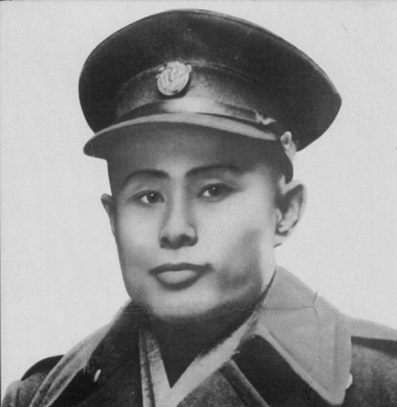

# ဗမာ့လွတ်လပ်ရေး ပြဿနာများ (Problems for Burma's Freedom)
## ဗိုလ်ချုပ် အောင်ဆန်း ၏ သမိုင်းဝင် နိုင်ငံရေးဒဿန စာတမ်းကြီး (အင်္ဂလိပ်-မြန်မာ ၂ ဘာသာ မော်ကွန်း)

**စာရေးသူ/မိန့်ခွန်းပြောကြားသူ:** ဗိုလ်ချုပ် အောင်ဆန်း (မွေး ၁၉၁၅ ခုနှစ် ဖေဖော်ဝါရီလ ၁၃ ရက် - ကျဆုံး ၁၉၄၇ ခုနှစ် ဂျူလိုင်လ ၁၉ ရက်)  
**နေ့စွဲနှင့် နေရာ:** ၁၉၄၆ ခုနှစ်၊ ဇန်နဝါရီလ ၂၀ ရက် | ရွှေတိဂုံစေတီတော် အလယ်ပစ္စယံ၊ ရန်ကုန်မြို့  
**ညီလာခံ:** ဖက်ဆစ်တိုက်ဖျက်ရေး ပြည်သူ့လွတ်လပ်ရေး (ဖဆပလ) အဖွဲ့ချုပ်၏ ဒုတိယအကြိမ်မြောက် နိုင်ငံလုံးဆိုင်ရာ ပြည်သူ့ညီလာခံသဘင်  
**မော်ကွန်းထိန်းသိမ်းမှု:** Htet Official Research Platform Historical Archives (၂၀၂၆)  

---

### အယ်ဒီတာ အမှာစာ (Editorial Commentary & Historical Significance)
၁၉၄၆ ခုနှစ်၊ ဇန်နဝါရီလ ၂၀ ရက်နေ့တွင် ရွှေတိဂုံစေတီတော် အလယ်ပစ္စယံ၌ လူထုသိန်းချီ တက်ရောက်ခဲ့သော ဖဆပလ ပြည်လုံးကျွတ်ညီလာခံတွင် ဗိုလ်ချုပ်အောင်ဆန်း မြွက်ကြားခဲ့သည့် ဤမိန့်ခွန်းသည် မြန်မာ့လွတ်လပ်ရေး ကြိုးပမ်းမှု သမိုင်းတွင်သာမက ခေတ်သစ် နိုင်ငံရေးဒဿနတွင်ပါ အမြင့်ဆုံးသော သီအိုရီ စာတမ်းကြီး ဖြစ်ပါသည်။

ဤမိန့်ခွန်းတွင် အဓိက မဏ္ဍိုင်ကြီး (၅) ရပ်ကို သိပ္ပံနည်းကျ တင်ပြခဲ့သည်-
1. **နိုင်ငံရေး၏ ပကတိသဘော (Politics as Human Everyday Life):** နိုင်ငံရေးဆိုသည်မှာ ပုတ်သိုးညစ်ညမ်းသော အရာမဟုတ်သလို မတန်မရာ မြင့်မြတ်လွန်းသည့် လောကုတ္တရာအရာလည်း မဟုတ်၊ ကျွန်ုပ်တို့ နေ့စဉ် စား၊ ဝတ်၊ နေရေးနှင့် ရှင်သန်ရပ်တည်မှု ပကတိတရား ဖြစ်ကြောင်း ဖွင့်ဆိုခဲ့သည်။
2. **သူရဲကောင်းကိုးကွယ်မှု တိုက်ဖျက်ရေး (Critique of Hero Worship):** လူအနည်းငယ်က သမိုင်းကို ဖန်တီးသည် မဟုတ်ဘဲ လူထုတစ်ရပ်လုံး သူရဲကောင်းဖြစ်လာသည်အထိ လေ့ကျင့်တည်ဆောက်ပြီး မည်သည့်ခေါင်းဆောင်၏ ဦးဆောင်မှုကိုမျှ မလိုတော့သည့် အခြေအနေသို့ ရောက်ရမည်ဟူသော အမြင်။
3. **ဘာသာရေးနှင့် နိုင်ငံရေး ပြတ်သားစွာ ခွဲခြားခြင်း (Secularism & Anti-Priestcraft):** လွတ်လပ်စွာ ကိုးကွယ်ယုံကြည်ခွင့်ကို အပြည့်အဝ အာမခံသော်လည်း နိုင်ငံရေးထဲသို့ သာသနာကို ဆွဲသွင်းခြင်း (သို့မဟုတ်) နိုင်ငံရေးအာဏာအတွက် ဘာသာရေးကို အသုံးချသည့် Priestcraft ကို သမိုင်းဝင် အရည်းကြီးတို့၏ အဖြစ်အပျက်ဖြင့် ပြတ်ပြတ်သားသား ဆန့်ကျင်ခဲ့သည်။
4. **စီးပွားရေး ဖက်ဆစ်ဝါဒ ဝေဖန်ချက် (Critique of Economic Fascism):** ဗြိတိသျှတို့၏ ပရောဂျက်ဘုတ်အဖွဲ့များ (Projects) နှင့် စစ်ပြီးခေတ် လက်ဝါးကြီးအုပ် ခြယ်လှယ်မှုများကို စီးပွားရေးဖက်ဆစ်ဝါဒအဖြစ် သတ်မှတ်ကာ ပြည်သူ့အကျိုးစီးပွား ဗဟိုပြု စီမံကိန်းစီးပွားရေးကို တောင်းဆိုခဲ့သည်။
5. **သိပ္ပံနည်းကျ နိုင်ငံတကာဝါဒ (Scientific Internationalism):** သွေး၊ လူမျိုး၊ ဘာသာ သီးသန့်အပေါ် အခြေမခံသည့် တန်းတူညီမျှသော ဖက်ဒရယ် ပြည်ထောင်စု စိတ်ဓာတ်နှင့် အာရှတိုက်သားများ သွေးစည်းညီညွတ်ရေး။

---

## အပိုင်း (၁) — မြန်မာဘာသာ မိန့်ခွန်း မူရင်းအပြည့်အစုံ

၁၉၄၆ ခု၊ ဇန်နဝါရီလ ၂၀ ရက်နေ့ ရွှေတိဂုံစေတီတော် အလယ်ပစ္စယံ၌ ကျင်းပသော ဖက်ဆစ်တိုက်ဖျက်ရေး ပြည်သူ့လွတ်လပ်ရေး (ဖဆပလ) အဖွဲ့ချုပ်၏ နိုင်ငံလုံးဆိုင်ရာ ညီလာခံတွင် ပြောကြားသော မိန့်ခွန်း။

ရဲဘော်တို့….။

ရာဇဝင် စာတင်ရမည့် ဤပြည်သူ့ညီလာခံ သဘင်ကြီးသို့ ကျွန်ုပ်တို့သည် ပြည်သူ့ကိုယ်စားလှယ်များအဖြစ် လာရောက်ခဲ့ကြပေသည်။ ဤသို့ စုဝေးရခြင်းမှာ ကမ္ဘာသူ ကမ္ဘာသားတို့ ရှေးရိုးစဉ်လာ ဥာဏ်မျက်စေ့ကျယ်စွာဖြင့် ပြုလုပ်ဆောင်ရွက်ခဲ့ကြသော နည်းနာနိသျအတိုင်း ဖြစ်ရကား လျော်ကန် သင့်မြတ်ဖြောင့်မတ်သော စုဝေးခြင်းပေတည်း။ ရှေးပဝေဏီကစ၍ ကမ္ဘာသူ ကမ္ဘာသားတို့သည် ပြဿနာတခုကို တွေ့ကြုံရလျှင်၊ ဤကဲ့သို့ပင် စုဝေးဆွေးနွေး ဖြေရှင်းခဲ့ကြပေသည်။ ကျွန်ုပ်တို့ စည်းဝေးရာ ဒေသသည်လည်း ကျွန်ုပ်တို့ရာဇဝင်တွင် ကြက်သရေရောင် တပြောင်ပြောင်ဖြင့် ကောင်းမြတ်သော မင်္ဂလာအပေါင်းနှင့် ပြည့်စုံသောကြောင့် ကျွန်ုပ်တို့ ညီလာခံသဘင်သည်လည်း ကြက်သရေမင်္ဂလာ အဖြာဖြာနှင့် ပြည့်စုံပါပေ၏။ ဤသိင်္ဂုတ္တရကုန်းသည်ကား လေးဆူဓါတ်ပုံ ရွှေတိဂုံစေတီတော်မြတ်ကြီး တည်ရှိရာ ဖြစ်၏။ စေတီတော်မြတ်ကြီးသည် ကျွန်ုပ်တို့လူမျိုး၏ ဝေဖြာသော စေတနာအလျောက် ကျွန်ုပ်တို့၏ အမွန်မြတ်ဆုံးသော ဆန္ဒကို ပေါ်လွင်စေခြင်းငှာ တည်ဆောက်ခဲ့သည်ဖြစ်ရာ ရွှေရောင်တဖိတ်ဖိတ်နှင့် ကျွန်ုပ်တို့ မြှော်မှန်းရာ အထွဋ်အထိပ်ဖြစ်သော နိဗ္ဗာန် အသင်္ခတသို့ ညွှန်ပြတော်မူရာ ဖြစ်သည့် ဆီမီး တန်ဆောင်ကြီး ဖြစ်ပေတော့၏။ ကျွန်ုပ်တို့၏ ပတ်ဝန်းကျင်ကို ကြည့်ပြန်သော် လွန်ခဲ့သော နှစ်အနည်းငယ်အတွင်းတွင် ကျွန်ုပ်တို့၏ တိုင်းပြည်နှင့်လူမျိုးတို့၏ ကံကြမ္မာကို ဖန်တီးခဲ့သော အရေးတော်ပုံများ ဖြစ်ပေါ်ရာ ဌာန ဖြစ်ရကား၊ ဤဒေသသည် ကျွန်ုပ်တို့ အမျိုးသားအတွက် အလွန်ထူးခြားစွာ လေးစားကြည်ညိုရာ ဖြစ်သော ဒေသ ဖြစ်ပေ၏။ ဤမျှ မကသေး။ ဤနေရာ ဤဒေသသို့ ကျွန်ုပ်တို့ ရာဇဝင်တလျှောက်တွင် ကျွန်ုပ်တို့လူမျိုး၏ ရှေ့ဆောင်ရှေ့သွား ပုဂ္ဂိုလ်အများသည် ကျွန်ုပ်တို့လူမျိုးအတွက် အသက်ကို ပမာဏမထားဘဲ စွန့်စားရန် လာရောက်ခဲ့ကြဘူးပေပြီ။ အတိုချုပ်မှာ “မြန်မာအစ တကောင်းက”ဟု ဆိုသကဲ့သို့ ဤနေရာ ဤဒေသသည်လည်း ကျွန်ုပ်တို့ လူမျိုး၏ ရာဇဝင်တွင် အခါခါပင် စာတင်ခဲ့ရသော အရေးတော်ပုံများ စတင်ရာ ဒေသပင် ဖြစ်ပေ၏။ လေးဆူဓါတ်ပုံ ရွှေတိဂုံစေတီတော်မြတ်ကြီးကို စတင်တည်ဆောက်ရာ အချိန်ကစ၍ ယနေ့အထိ နှစ်ပေါင်း ၂၅၀၀ ခန့်မျှ ရှိလေပြီ။ ဤမျှသော ကာလပတ်လုံး ကျွန်ုပ်တို့၏ ရာဇဝင်အဖြစ်အပျက် ကျွန်ုပ်တို့၏ လူမျိုးအတွက် သတ္တိ ဗျတ္တိနှင့် အံ့ဘွယ်ဘနန်း သက်စွန့်ကြိုးပမ်း အမှုထမ်းခဲ့ကြသည့် မရေမတွက်နိုင်သော သွားလေသူ မျိုးချစ်ပုဂ္ဂိုလ်အပေါင်းတို့နှင့်တကွ ထိုပုဂ္ဂိုလ်တို့ ပေးအပ်ခဲ့သည့် အမွေအနှစ်တည်းဟူသော အာဇာနည်စိတ် စသည်တို့ကို ကျွန်ုပ်တို့ ယခုအချိန်အခါ၌ သတိရကြပေလိမ့်မည်။ သို့သတိရကြသည့် အားလျော်စွာ ထိုထိုသော အာဇာနည်ပုဂ္ဂိုလ်အပေါင်းတို့အား ကျွန်ုပ်တို့သည် ခဏတာမျှ အရိုအသေ ပြုပြီးလျှင် ထိုထိုသော အာဇာနည် ပုဂ္ဂိုလ်တို့၏ အဆင့်အတန်းကို မှီအောင် အားထုတ်လုံးပမ်းမည်၊ ထိုထိုသော အာဇာနည် ပုဂ္ဂိုလ်တို့၏ လုပ်ငန်းကို ဆုံးခန်းတိုင် ဆက်လက်၍ ဆောင်ရွက်မည်ဟူ၍ သစ္စာပြုကြပါစို့။ ကျွန်ုပ်တို့၏ လူမျိုးသည် ဧကန်စင်စစ် ကြီးပွားတိုးတက် တန်ခိုးထွက်ပေတော့မည်။

ကျွန်ုပ်တို့သည် ဤကဲ့သို့ ရာဇဝင်သဘော အခြေခံကို နားလည်ကာ စုဝေးမိကြလေပြီ။ သို့ရာတွင် ဤစုဝေးခြင်းမှာ ပဌမအကြိမ် မဟုတ်ချေ။ ၁၉၂၀ ခုနှစ်က စ၍ ဤစိတ်ဆန္ဒမျိုးနှင့် စုဝေးခဲ့ကြသည်မှာ အကြိမ်ကြိမ် ရှိခဲ့ပေပြီ။ အဘယ်ကြောင့် စုဝေးခဲ့ကြသနည်း။ ယခုလည်း အဘယ်ကြောင့် စုဝေးကြသနည်း။ ကျွန်ုပ်တို့၏ လူမျိုးသည် ရာဇဝင်တလျှောက်တွင် နိုင်ငံခြားသားတို့ စိုးမိုးအုပ်ချုပ် ကျွန်သဘောက်လုပ်ခြင်းကို ပဌမဆုံး ခံခဲ့ကြရကား၊ ကျွန်ုပ်တို့ လူမျိုးမှာ အဖက်ဖက်တွင် နင်းပြား ဖြစ်ခဲ့ကြရသောကြောင့် လူချင်းမတူ သူချင်းမမျှ ကျွန်ုပ်တို့ ဆန္ဒအတိုင်း လူတန်းစေ့ဘဝကို မနေနိုင်ခဲ့ကြချေ။ သို့အတွက် ကျွန်ုပ်တို့လူမျိုးသည် ဤကာလ အတောအတွင်း တဗိုလ်လဲ တဗိုလ်တက်၊ တတပ်ပျက် တတပ်စု၊ လူထုနှင့် ချီ၍ ကျွန်ုပ်တို့၏ ဆန္ဒပြည့်ဝအောင် ကြိုးပမ်းစွန့်စားခဲ့ကြပေသည်။ ကျွန်ုပ်တို့၏ လွတ်လပ်ရေး လုပ်ငန်းသည် အတက်အဆုတ် အဖျက်အရှုတ် မည်မျှလောက်ပင် များစေကာမူ တဖြည်းဖြည်း အင်အား တိုးတက်လာခဲ့လေသည်။ အဆင့်ဆင့် အုတ်မြစ်ကစ၍ တည်ဆောက်ခဲ့ရာ ကျွန်ုပ်တို့ ယခု အခြေအနေသို့ ရောက်ရှိခဲ့ပေသည်။ ရှေးယခင်က ဆောင်ရွက်ခဲ့သော မျိုးချစ်ပုဂ္ဂိုလ်များ၏ နည်းနိသျ လုံ့လဥဿဟကို ယခုအချိန်တွင် ကျွန်ုပ်တို့အထင်သေး အမြင်သေး ဖြစ်ကောင်း ဖြစ်ပေလိမ့်မည်။ သို့ရာတွင် ကမ္ဘာ့ ရာဇဝင်ကို ကြည့်မူ လွတ်လပ်ရေး လုပ်ငန်းကြီးကဲ့သို့သော တိုးတက်မှုသည် မျက်စိတမှိတ် လျှပ်တပြက်အတွင်းတွင် မဖြစ်နိုင်။ အဆင့်ဆင့် အခြေအနေကို ကြည့်ရှုပြီး လုံးပမ်းနိုင်မှ တိုးတက်အောင်မြင်မှု ရှိနိုင်မည်ကို သတိပြုကြရပေလိမ့်မည်။ သို့ဖြစ်သောကြောင့် ကျွန်ုပ်တို့၏ လွတ်လပ်ရေးလုပ်ငန်းကို တခေတ်နှင့်တခေတ် အဖြစ်သနစ် အခြေအနေမှန်ကို ဝေဖန်ပြီးမှသာလျှင် ဆောင်ရွက်ရမည်ကို ကျွန်ုပ်တို့ နားလည်ကြရပေမည်။ ဤကဲ့သို့ အမြင်မှန်မှသာလျှင် လွတ်လပ်ရေး အောင်ပန်း ဆွတ်လှမ်းနိုင်သော အချိန် ကျရောက်သောအခါ ကျွန်ုပ်တို့သာ မဟုတ်၊ ကျွန်ုပ်တို့လူမျိုး တမျိုးလုံး အစဉ်အဆက် သက်စွန့်ကြိုးပမ်းမှုကြောင့် ကျွန်ုပ်တို့ လူမျိုး လွတ်လပ်ရေးကို ပြန်လည် ရယူနိုင်ကြပေသည်ဟူ၍ သိရှိနားလည်နိုင်ကြပေလိမ့်မည်။

သို့သော်လည်း ယခုအခါ၌ လွတ်လပ်ရေးပန်းတိုင်သို့ မရောက်သေးချေ။ ပန်းတိုင်သို့အရောက် ကျွန်ုပ်တို့ အားခဲ၍ သွားကြရပေလိမ့်ဦးမည်။ ရဲဘော်တို့သည် ကျွန်ုပ်အား ဤခက်ခဲသော လမ်းခရီးတွင် ရှေ့ဆောင်စေလိုကြ၏။ ကျွန်ုပ်ကို ဤကဲ့သို့ ယုံကြည်အားထားမှုကြောင့် ကျွန်ုပ်ကျေးဇူး တင်ပါ၏။ သို့သော်လည်း မကွယ်မထောင့် ဖြောင့်မတ်စွာ ပြောရမည်ဆိုလျှင် ကျွန်ုပ်ရှေ့ဆောင် ပြုမှုကြောင့် မြန်မြန်ထက်ထက် လွတ်လပ်ရေးပန်းတိုင်ဖက်သို့ နီးကပ်လိမ့်မည်ဟူ၍ ကတိပေးခြင်းကို မပြုလိုပေ။ အဘယ်ကြောင့် ဆိုသော် လူတဦးတယောက်သည် မည်မျှလောက် စွမ်းပကား ရှိစေကာမူ လူထု၏ အားပေးယိုင်းပင်းမှု မရှိဘဲလျက် ရာဇဝင်တွင်လောက်သော လုပ်ငန်းမျိုးကို ဖြစ်မြောက်အောင် မဆောင်ရွက်နိုင်ခြင်းကြောင့် ဖြစ်ပေ၏။

ကမ္ဘာ့ရာဇဝင်တွင် အလွန်ထက်မြက်သော ပုဂ္ဂိုလ်ထူးများ ရှိခဲ့ဘူးပါ၏။ သို့ရာတွင် အနည်းငယ်သော လူတစုက ရာဇဝင်ကို မပြောင်းလဲ မပြုပြင်နိုင်ချေ။ အထက်၌ ရာဇဝင်၏ ပြောင်းလဲမှုသည် အဆင့်ဆင့် အခြေအနေကို ထောက်ချင့်လျက် တိုးမြင့်ခဲ့ကြောင်း ဖော်ပြပြီးခဲ့ပေပြီ။ ရာဇဝင်တလျောက် သတ္တိ ဗျတ္တိ ရှိသူကို ကြည်ညိုလေးစား အားကိုးအားထားပြုတတ်သော လူများ၏ စိတ်စေတနာကို သိရှိနားလည်ပါ၏။ လူတဦးတယောက်သည် မိမိ၏ သတ္တိ ဗျတ္တိကိုလည်းကောင်း သူတပါးတို့၏ သတ္တိ ဗျတ္တိကိုလည်းကောင်း ယုံကြည်အားကိုးမှသာလျှင် ကြီးကျယ်ခမ်းနား အကျိုးများအောင် ပြုလုပ်ဆောင်ရွက်နိုင်သည်ကိုလည်း သိရှိနားလည်ပါ၏။ သို့သော်လည်း သတ္တိ ဗျတ္တိရှိသူကို အားထား လေးစားပြုမှုကို အရမ်းမဲ့ ဘုရားတဆူ၊ ဂူတလုံးလုပ်ကာ ကိုးကွယ် မြှောက်စားသည့် အဖြစ် ရောက်စေခဲ့လျှင် ဘုရားအတုများ ပေါ်ပေါက်စေတတ် လေသည်။ ဒုက္ခမြားမြောင် ဤလူ့ဘောင်ကြီးတွင် ဤကဲ့သို့ ဘုရားအတုများကို ကျွန်ုပ်တို့ ထပ်မံ အလိုမရှိကြတော့ချေ။ သို့ဖြစ်ရကား ကျွန်ုပ်တို့သည် ကျွန်ုပ်တို့ အားလုံးနှင့် သက်ဆိုင်သော လွတ်လပ်ရေးလုပ်ငန်းအတွက် ဒိုးတူဘောင်ဘက် လက်တွဲလျက် ဆောင်ရွက်ကြပါစို့။ ဤသို့ ဆောင်ရွက်မှ သာလျှင် သတ္တိ ဗျတ္တိ ရှိသူများကို အမြင့်မြတ်ဆုံးသော နည်းဖြင့် လေးစားကြည်ညိုရာ ရောက်ပေမည်။ ဤကဲ့သို့ ဆောင်ရွက်မှသာလျှင် ကျွန်ုပ်တို့၏ လုပ်ငန်းကြီး ပြီးစီး အောင်မြင်၍ ကျွန်ုပ်တို့၏ လွတ်လပ်မှုကို ရကြပေလိမ့်မည်။ သတ္တိ ဗျတ္တိ ရှိသူများကိုသာ အားမကိုးမူ၍ လူတိုင်းလူတိုင်းပင် မိမိတို့ကိုယ်တိုင် သတ္တိ ဗျတ္တိ ရှိသော သူရဲကောင်းများ ဖြစ်အောင် စွန့်စားရပေလိမ့်မည်။ သို့မှသာလျှင် ကျွန်ုပ်တို့အားလုံး လွတ်လပ်ရေး အစစ်ကို ခံစားခွင့် ရကြပေလိမ့်မည်။ ဤကဲ့သို့ လွတ်လပ်ရေး အစစ်ကို ခံစားနိုင်ရန် ကျွန်ုပ်တို့သည် လွတ်လပ်ရေးပန်းတိုင်သို့ ရှေ့ရှု၍ သွားကြပါစို့။

သို့ဖြစ်ရကား ရှေ့ဆောင်ရှေ့သွား ပုဂ္ဂိုလ်များက ကျွန်ုပ်တို့အား အလွန် ကြီးလေးသော တာဝန်ကို ဆက်လက် ဆောင်ရွက်ရန် ပေးအပ်ထားခဲ့သည် ဖြစ်ရာ ကျွန်ုတို့ကလည်း ဤတာဝန်ကို ကျေပြွန်စွာ ထမ်းရွက်ရ ပေလိမ့်မည်။ အဘယ်ကဲ့သို့ ထမ်းရွက်ကြမည်နည်းဟူ၍ ပြဿနာပေါ်လာပေ၏။ ဤပြဿနာကို မဖြေရှင်းမီ ပြဿနာကို ဖြေရှင်းရာ ပြေရှင်းကြောင်း သဲလွန်စအပေါင်းတို့ကို ကျွန်ုပ်တို့ ပတ်ဝန်းကျင်၌ ရှာဖွေသင့်သည် ဟူ၍ ယူဆရပေမည်။ အဘယ်ကြောင့် ဆိုသော် ယခုခေတ် ယခုအခါ၌ ကမ္ဘာသူ ကမ္ဘာသားတို့ ရင်ဆိုင် ကြုံတွေ့နေရသော ပြဿနာအပေါင်းတို့သည် တခုနှင့်တခု ရောထွေးရှက်စပ် ခွဲခြားခြင်းငှာ မတတ်စွမ်းနိုင်သော အခြေအနေသို့ ရောက်ရှိလျက် နေပေသည်။ တနည်းအားဖြင့် ဆိုသော် ကမ္ဘာကြီးတခုလုံးသည် ရုန်းရင်းဆန်ခတ် နေရာမလပ်အောင် လှုပ်ရှား ပြောင်းလဲလျက် ရှိနေပေ၏။ အမျိုးသားရေး၊ လူမျိုးတမျိုးနှင့်တမျိုး ဆက်သွယ်ရေး၊ စီးပွားရေး၊ နိုင်ငံရေး၊ ကြီးပွားရေး၊ ယဉ်ကျေးရေး၊ ဘာသာရေး၊ အကျင့်ကောင်းရေး စသော ထိုထိုသော အရေးတို့သည် စင်စစ်မှာ ဤရောထွေး ယှက်သန်းလျက် ရှိသော ကမ္ဘာ့ပြဿနာကြီး၏ အစိတ်အပိုင်းများသာ ဖြစ်သည့် အားလျော်စွာ ခေတ်ကာလနှင့် လိုက်၍ အစဉ်တစိုက် သဘောသဏ္ဍာန် ပြောင်းလဲလျက် ရှိကြပေသည်။ သို့ပြောင်းလဲလျက် ရှိသောကြောင့် ကျွန်ုပ်တို့သည် ဤအရေး ဤကိစ္စများကို အသီးသီး အသက အသက တခုနှင့်တခု မဆိုင်ဘိသကဲ့သို့ စဉ်းစားခြင်းငှာ မဖြစ်နိုင်တော့ချေ။ ဤအရေး ဤကိစ္စဥဿုံ အလုံးစုံကို ဆင်ခြင်စဉ်းစားသော အခါ၌လည်း ကျွန်ုပ်တို့သည် ခေတ်မမှီသော အတွေးအဆ ခေတ်နောက်ကျ ကျန်ရစ်ခဲ့သော ဥပဒေသတို့ကို လှေနံဓားထစ် လိုက်နာခြင်းငှာ မဖြစ်နိုင်တော့ချေ။ ကျွန်ုပ်တို့ နိုင်ငံတွင် ယခုအချိန်အခါ၌ ခေတ်ပြောင်းခေတ်လွဲ ရှိကြောင်း အငြင်းမထွက်ဘဲလျက် သဲသဲမဲမဲ ရှေးက အတွေးအဆ ရှိသသူများ ရှိကြပေသေး၏။ အချို့သော သူများသည် ယခုထိပင် ယုတ်မာညစ်ထေး ရှေးက နိုင်ငံရေးမျိုးကို သိလျက်နှင့်ဖြစ်စေ၊ မသိဘဲလျက်နှင့် ဖြစ်စေ၊ လိုက်စားလျက် ရှိကြသေး၏။

နိုင်ငံရေးမည်သည် ယုတ်မာညစ်ထေးသည်ဟု ဆိုရမည်လော။ စင်စစ်မှာ နိုင်ငံရေးသည် ယုတ်မာညစ်ထေးသည် မဟုတ်။ နိုင်ငံရေးကို ညစ်ထေးအောင် လုပ်သူတို့သာလျှင် ယုတ်မာခြင်းသာ ဖြစ်ပေ၏။ နိုင်ငံရေးဆိုတာ ဘာလဲဟု မေးဘွယ်ရာ ရှိပြန်၏။ ကျွန်ုပ်တို့သည် သာမန်ပုထုဇဉ်များ ဖြစ်သောကြောင့် နိုင်ငံရေးကို မလုပ်သင့်၊ နိုင်ငံရေးသည်အလွန်မြင့်မြတ်သည့်အတွက် ကျွန်ုပ်တို့နှင့် မတန်မရာ လေးမြတ်စွာ မျှော်ရှုရန်သာလျှင် ရှိသည်ဟု ဆိုရမည်လော။ သို့တည်းမဟုတ် နိုင်ငံရေးဆိုသည်မှာ အချို့သော လူညာလူလိမ်တို့က တောအုံကနား ကျေးတောသား လူရိုးလူအတို့ကို အတိတ်၊ တပေါင်၊ စနည်း ဘဝေါတို့ကို တွင်တွင်ကြီး ဟောပြော၍ ထိုသူတို့၏ မနောအကြိုက်ကို လိုက်၍ အငိုက်ကိုဖမ်းပြီးနောက် စားပေါက်ထွင်ကြသည့်ကိစ္စ ဆိုရမည်လော။ သို့တည်းမဟုတ်၊ နိုင်ငံရေးသည် ကန္တာရခရီးပမာ ကြောက်မက်ဘွယ်သော အန္တရာယ်များစွာ ရှိသော အရေးကိစ္စ ဖြစ်သောကြောင့် ကျွန်ုပ်တို့သည် တတ်သာလျှင် ရှောင်ရှားသင့်သည်ဟု ဆိုရမည်လော။ သို့တည်းမဟုတ်၊ နိုင်ငံရေးသည် ကျွန်ုပ်တို့ ပြောလေ့ပြောထ ရှိသည့်အတိုင်း၊ အမျိုး-ဘာသာ-သာသနာရေးဟူ၍ပင် ဆိုရဦးမည်လော။

နိုင်ငံရေးသဘော အမှန်မှာ ကျွန်ုပ်တို့ လူသားတို့နှင့် မတန်မရာ မြင့်မြတ်လွန်းသည်လည်း မဟုတ်၊ နိမ့်ကျလွန်းသည်လည်း မဟုတ်၊ မျက်လှည့် ဗေဒင်လည်း မဟုတ်၊ အဂ္ဂိရပ်လည်း မဟုတ်၊ ကြောက်မက်ဘွယ် ကောင်းသော ကန္တာရ ခရီးလည်း မဟုတ်၊ ဘယ်သူသေသေ ငတေမာ ပြီးရော- စိတ်ဇောနှင့် လုပ်သော အရေးကိစ္စလည်း မဟုတ်၊ ကျွန်ုပ်တို့၏ ပတ်ဝန်းကျင်၌ ပေါ်ပေါက် ဖြစ်ပွားလျက် ရှိသော အခြေပေါ်တွင် မျှော်ခေါ်၍ ဆောင်ရွက်ရမည်ဖြစ်သော အရေးကိစ္စသာလျှင် ဖြစ်ပေ၏။ အတိုချုပ် ဆိုရလျှင် နိုင်ငံရေးဆိုသည်မှာ ကျွန်ုပ်တို့ နေ့စဉ်နှင့်အမျှ လူ့လောကတွင် တွေ့ကြုံနေကြရသော ကိစ္စပင် ဖြစ်ပေသည်။ တနည်းအားဖြင့် ဆိုသော် နိုင်ငံရေး ဆိုသည်မှာ လူ့ကိစ္စဟု ဆိုရပေမည်။ ကျွန်ုပ်တို့ စားမှု၊ သောက်မှု၊ နေမှု၊ ထိုင်မှု၊ သွားမှု၊ လာမှု အစုစုသည် နိုင်ငံရေးပင် ဖြစ်၏။ ကျွန်ုပ်တို့သည် နိုင်ငံရေးကို မဆင်ခြင် မတွေးတောမိစေကာမူ နိုင်ငံရေးသည် ကျွန်ုပ်တို့နှင့် အမြဲတစေ ဆက်သွယ်နေ၏။ ကျွန်ုပ်တို့သည် နိုင်ငံရေးကို ရှောင်ရှားစေကာမူ နိုင်ငံရေးသည် ကျွန်ုပ်တို့၏ အိမ်၊ ရုံး၊ အလုပ်ရုံ စသည်တို့၌ ပေါ်ပေါက်လျက် ရှိ၏။ ဤဌာနများ၌ ကျွန်ုပ်တို့သည် နေ့စဉ်နှင့်အမျှ နိုင်ငံရေးကိုပင် လုပ်နေကြရပေသည်။ အလုပ်သမားသည် အခကြေးငွေအတွက် အလုပ် လုပ်ရ၏။ တောင်သူလယ်သမားသည် ဝမ်းစာအတွက် လယ်ယာလုပ်ရ၏။ စာရေးစာချီ အမှုထမ်းသည်လည်း လစာငွေအတွက် အလုပ်လုပ်ရ၏။ ကုန်သည်၊ ပွဲစား စသည်တို့သည် အသီးသီး ဝင်ငွေ ရရန် လုပ်ကြရ၏။ အချုပ်မှာ စားသောက်နေထိုင်ရေးအတွက်ပင် ဖြစ်၏။ အလုပ်သမားသည် အခကြေးငွေကို တိုးတက်၍ရပြီးလျှင် စားသာသောက်သာသော အခြေအနေကို ရလို၏။ တောင်သူလယ်သမားသည် မိမိ၏ လယ်မြေကို တိုးတက် ကောင်းမွန်စေ၍ သက်သာချောင်ချိလို၏။ စာရေးစာချီ အမှုထမ်းတို့သည်လည်း ရုံး၌ တကုတ်ကုတ် လုပ်နေရသော ဘဝထက် လွတ်လွတ်လပ်လပ် ချောင်ချောင်လည်လည် ရှိသော အခြေအနေသို့ ရောက်လိုကြ၏။ ကုန်သည်ပွဲစားတို့လည်း လွယ်လွယ်ကူကူ တိုးချဲ့၍ ကူးသန်းရောင်းဝယ်လိုကြ၏။ ဤကဲ့သို့ လူတိုင်း လူတိုင်း မိမိတို့၏ အခွင့်အရေးကို ရယူလိုခြင်းသည် နိုင်ငံရေးပင် ဖြစ်၏။

သို့ရာတွင် ကျွန်ုပ်တို့နေ့စဉ်နှင့်အမျှ ကြုံတွေ့နေရသော နေထိုင် စားသောက်မှုသည် ပြောင်းလဲလျက် ရှိသည့်အားလျော်စွာ ကျွန်ုပ်တို့ နိုင်ငံရေးသည်လည်း ပြောင်းလဲလျက် ရှိ၏။ ကျွန်ုပ်တို့ အားလုံး သက်သက်သာသာ ချောင်ချောင်ချိချိ လူတန်းစေ့အောင် နေနိုင်ရန်အတွက် အခွင့်အရေးများ ပိုမို ရရှိနိုင်အောင် ကျွန်ုပ်တို့သည် လွတ်လပ်ရေးကို တောင့်တကြပေသည်။ လွတ်လပ်ရေး ဆိုရာ၌ နေရေးထိုင်ရေး လွတ်လပ်မှု၊ လူတဦးတယောက်အနေနှင့်၄င်း၊ တမျိုးလုံးအနေနှင့်၄င်း တိုးတက်ကြီးပွားအောင် စီမံဆောင်ရွက်နိုင်အောင် လွတ်လပ်မှု၊ ကျွန်ုပ်တို့၏ ကာယ၊ ဥာဏ၊ စိတ္တ အဆင့်အတန်းတိုးမြင့်အောင် ဆောင်ရွက်နိုင်ရန် လွတ်လပ်မှုတို့ စသည်တို့ကို ဆိုလိုပေသည်။ ဤလွတ်လပ်မှု ရယူလိုမှုသည်ပင်လျှင် နိုင်ငံရေး ဖြစ်၏။ သို့ဖြစ်ရကား- နိုင်ငံရေးသည် လူမှု လူရေးမျှသာ ဖြစ်၏။ နိုင်ငံရေးကို ကျွန်ုပ်တို့ နားမလည်စရာ အကြောင်းမရှိချေ။ သို့ပါလျက်နှင့် အချို့သောသူများသည် နိုင်ငံရေးအလုပ်ကို ယုတ်မာ ညစ်ထေးသည်ဟု ဆိုကြ၏။ အချို့ကလည်း နိုင်ငံရေးသည် ကိုးကွယ်ရာ ဘာသာတရားပင် ဖြစ်သကဲ့သို့ ဆိုကြပြန်၏။ ထိုသူတို့၏ အယူအဆတို့မှာ အလွဲလွဲ အမှားမှား ကွဲကွဲပြားပြား ရှိကြပေ၏။

နိုင်ငံရေးကို ဘာသာတရား ဖြစ်သကဲ့သို့ ပြောဆိုကြသော သူများမှာ ယုတ်မာညစ်ထေးသော နိုင်ငံရေးသမားများပင်လျှင် ဖြစ်ပေ၏။ ထိုသူတို့၏ ရည်ရွယ်ချက်မှာ ဤကဲ့သို့ ကြီးကြီးကျယ်ကျယ် လည်ဆယ်၍ ပြောခြင်းအားဖြင့် ပြည်သူတို့၏ စိတ်ကို ရှုတ်ထွေးစေ၍ အကြောင်းအကျိုး အကောင်းအဆိုးကို ဝေဖန်ခြင်းငှာ မစွမ်းနိုင်အောင် လုပ်ခြင်းမျှသာ ဖြစ်ပေ၏။ အမှန်မှာ ထိုသူတို့ ပြုလုပ်မှုသည် နိုင်ငံရေး မဟုတ်။ မိမိတို့ အကောက်ဥာဏ်ကို သုံး၍ မိမိတို့ ကြီးပွားရေး တနပ်စားနိုင်ငံရေးပင် ဖြစ်ပေ၏။ ကိုးကွယ်သည့် ဘာသာရေးမှာ လူအသီးသီးတို့၏ သက်ဝင် ယုံကြည်မှု ဖြစ်၏။ နိုင်ငံရေးမှာကား၊ လူအသီးသီးတို့၏ ပေါင်းသင်းဆက်ဆံမှု သိပ္ပံအတတ်သာလျှင် ဖြစ်၏။ သိပ္ပံအတတ် အနေအားဖြင့် နိုင်ငံရေးသည် လူအသီးသီးတို့၏ အခွင့်အရေးကို စောင့်ရှောက်ရပေလိမ့်မည်။

အခွင့်အရေးများတွင် လွတ်လပ်စွာ ဘာသာကိုးကွယ်နိုင်မှုလည်း ပါဝင်လေ၏။ ဤအခွင့်အရေး ပေးရာ၌ပင် ကျွန်ုပ်တို့သည် နိုင်ငံရေးနှင့် ကိုးကွယ်သည့်ဘာသာရေး နှစ်ဌာနစပ်ကြားတွင် စည်းတားရပေလိမ့်မည်။ အဘယ်ကြောင့်ဆိုသော နိုင်ငံရေးနှင့် ဘာသာရေးမှာ သဘောမတူ အမူကွဲပြား တခြားစီ ဖြစ်သောကြောင့်တည်း။ ဘာသာရေးနှင့် နိုင်ငံရေးကို ရောစပ်ပါမူ ဘာသာရေး၏ သဘောတရားကို ဆန့်ကျင်ရာ ရောက်ပေ၏။ အကြောင်းမူကား၊ ဘာသာရေးသည် နောင်တမလွန် ဘဝများကို (ဝါ) လောကုတ္တရာကို ရှေ့ရှုသည်ဖြစ်သောကြောင့် လောကအရေးနှင့် များစွာ မသက်ဆိုင်ချေ။ နိုင်ငံရေးမှာမူကား လောကီရေးရာသာ ဖြစ်ပေ၏။

လုပ်ငန်းသဘောမှာ လူမှုတိုးတက်ရေးနှင့် ဘာသာရေးတို့သည် အခြေသဘောအားဖြင့် ဆန့်ကျင်စရာ အကြောင်းမရှိဟု ယူဆမိပေသည်။ ဘာသာတရားက သစ္စာ၊ မေတ္တာနှင့် သမ္မာအာဇီဝ၊ သမ္မာကမ္မန္တ စသည်တို့ကို ဓမ္မအနေနှင့် ဟောကြားခဲ့ရာ လူမှုတွင်လည်း ဤဓမ္မတို့ကို လေးစားကြပေသည်။ သို့ပါလျက်လည်း ဘာသာတရား၏ နာမကို အလွဲသုံးစား ပြုကြပြီးလျှင် လူတဦးသည် တဦး၏ ဆင်ခြင်တုံတရား ကင်းမဲ့ခြင်းကို အကြောင်းပြု၍ မတရားသော အမှုတို့ကို ပြုသည် ရှိသော် ပတ်ဝန်းကျင်ရှိ လူစုသည် ထိုမတရားမှုကို လျစ်လျူရှုခြင်း ဘယ်နည်းနှင့်မျှ ပြုနိုင်မည် မဟုတ်ပေ။ အကယ်၍ ဘာသာကို အမှီပြု၍ အသက်မွေးသူတို့သည် ဘာသာ၏ အမည်ကို သုံးလျက် တရားဓမ္မဖြစ်လေဟန် ဟောပြောချက်တခုကို ပြုလျှင် လူအများကို နစ်နာစေမည် ဖြစ်သောကြောင့် ကျွန်ုပ်တို့သည် လူ့ချမ်းသာကို လိုလားသည့်အားလျော်စွာ တားမြစ်ရပေလိမ့်မည်။ ဤဥပဒေသသည် ကျွန်ုပ်က ထွင်လိုက်သော ဥပဒေသ မဟုတ်ချေ။ ကျွန်ုပ်တို့ ရာဇဝင်တွင် အလွန်ကျော်ကြား ထင်ရှားသော အနော်ရထာ ဘုရင်မင်းမြတ်သည် ဤဥပဒေသကို ထိထိရောက်ရောက် လိုက်နာ ဆောင်ရွက်ခဲ့ဘူးလေသည်။ ရာဇဝင်ကို ကြည့်မူ ဘာသာတရားကို မှီ၍ အသက်မွေးကြသောသူများကို ခွဲခြား၍ သိနိုင်ကြပေလိမ့်မည်။

ဘာသာတရားသည် ကျွန်ုပ်တို့ လူမှုကို ရှုပ်ထွေးစေသည် မဟုတ်။ ဘာသာတရားကို မှီ၍ အသက်မွေးကြကုန်သော သူတို့သာလျှင် ရှုပ်ထွေးစေကြ၏။ ဘာသာတရားကို ကြည့်ပြန်မူ ဤကဲ့သို့သော သူမျိုးကို အားပေးခြင်း မရှိသည်ကို တွေ့မြင်ကြရပေလိမ့်မည်။ သို့သော်လည်း အသီးသီးသော ဘာသာတရားတို့ကို မှီ၍ အသက်မွေးကြကုန်သောသူများ ရှိခဲ့ဖူးလေပြီ။ ဥရောပတိုက်၌ ရဟန်းမင်းကြီးများနှင့် ဧကရာဇ်မင်းတို့ အချင်း ဖြစ်ပွားခဲ့ပုံ၊ ကျွန်ုပ်တို့ နိုင်ငံ၌ အရည်းကြီးများနှင့် အနော်ရထာမင်းမြတ် အရေး တွေ့ရပုံ၊ အနောက်နိုင်ငံကြီးများ နယ်ချဲ့ရာတွင် သမ္မာကျမ်းစာကိုင်သူတို့က ရှေ့သွား လုပ်၍ အလံကိုင်သူနှင့် ကုန်သည်တို့က နောက်မှ လိုက်ရပုံ အကြောင်းစုံတို့ကို ထောက်ထားလျက် မည်သည့်ကာလ ဒေသ၌မဆို ဘာသာတရားကို မှီ၍ အသက်မွေးကြသူများ ရှိခဲ့ဘူးကြောင်းကို ကျွန်ုပ်တို့ သတိရကြပေလိမ့်မည်။

ယခု ဘာသာတရားကို မှီ၍ အသက်မွေးသူများဟု ဆိုရာ၌ ရှင်းလင်းရန် လိုပေသေး၏။ ဘုန်းကြီးပင် ခေါ်ခေါ်- ရဟန်းပင်ခေါ်ခေါ် နှစ်မျိုးနှစ်စား ရှိ၏။ တမျိုးမှာ ဘာသာတရားကို မှီ၍ အသက်မွေးသူများသာ ဖြစ်၍ ဘာသာတရား ပြန့်ပွားတိုးတက်မှုကို သတိပြုခြင်း အားထုတ်ခြင်း မရှိချေ။ ဘာသာတရားနှင့် ဆန့်ကျင်သော အမှုမျိုးကိုပင် ပြုကြ၏။ တမျိုးမှာကား ဘာသာတရား တိုးတက် ပြန့်ပွားမှုကို လေးစား၍ လောကီသားတို့၏ အမှုကို ရှေ့ရှုခြင်း မရှိချေ။ ကျွန်ုပ်တို့၏ တိုင်းပြည်တွင် သင်္ဃာတော် အရှင်မြတ်များသည် ရာဇဝင် တလျှောတ်လုံး ကျွန်ုပ်တို့ လူမျိုး၏ ရှေ့က မားမားမတ်မတ် ရပ်လျက် မြင့်မြတ်သော အမှုမျိုးကိုသာ ပြုခဲ့ကြပေ၏။ ရှေးခေတ်များ၌ သင်္ဃာတော် အရှင်မြတ်များသည် ကျွန်ုပ်တို့ တမျိုးလုံးကို ပညာသင်ပေးရန် တာဝန်ကို ထမ်းဆောင်ခဲ့ကြပေသည်။ ယခုခေတ်၌ပင် တောရွာများတွင် သင်္ဃာတော် အရှင်သူမြတ်များ ပညာသင်ကြားပေးလျက် ရှိကြသောကြောင့် မြောက်မြားစွာသော အမျိုးသားတို့သည် စာပေ တတ်မြောက်ကြပေ၏။ အချုပ်မှာ သင်္ဃာတော် အရှင်မြတ်များ၏ စေတနာ လုံ့လကြောင့် ကျွန်ုပ်တို့၏ စိတ်ဓာတ် မြင့်မြတ်မှု- အသွင်အပြင် ယဉ်ကျေးမှုတို့သည် အထူးသဖြင့် တိုးတက်ခဲ့လေသည်။ ထိုအကြောင်းများကြောင့် ကျွန်ုပ်တို့၏ သင်္ဃာတော် အရှင်မြတ်များသည် ကျွန်ုပ်တို့၏ ထူးကဲသော ကျေးဇူး ဥပကာရများကို ခံတော်မူထိုက်ကြပါပေ၏။ ကျွန်ုပ်တို့နိုင်ငံတွင် များသောအားဖြင့် ဗုဒ္ဓဘာသာကို သက်ဝင် ယုံကြည် ကိုးကွယ်ကြသည် ဖြစ်သောကြောင့် အခြား ဘာသာတရားများကို မထိခိုက်စေဘဲ ပြောလိုသည်မှာ နှစ်ပေါင်း ၂၅၀၀ အတွင်း လိမ်းကပ်၍ လာခဲ့သော ကြေးညှော်တို့ကို ကျွန်ုပ်တို့ ပွတ်တိုက်ခဲ့နိုင်ပါလျှင် ဗုဒ္ဓဘာသာ သာသနာရောင်သည် ကမ္ဘာပေါ်တွင် အထွန်းပြောင်ဆုံး ဖြစ်လာလိမ့်မည်ဟု ယူဆရပေမည်။

သို့ဖြစ်သောကြောင့် ယခု သင်္ဃာတော် အရှင်မြတ်များအား သီးခြား၍ လျှောက်ထားလိုပါသည်ဘုရား။ အရှင်သူမြတ်များ ဘုရား။ အရှင်ဘုရားတို့သည် အလွန်ထူးကဲသော ဗုဒ္ဓသာသနာတော်ထမ်း ရဟန်းမြတ်များ ဖြစ်တော်မူကြပါသည်။ အရှင်ဘုရားတို့က သာသနာတော်ရောင် ထွန်းပြောင်အောင် အားထုတ်တော်မူကြပါ။ ကမ္ဘာလောကကြီးကို သာသနာရောင် အလင်းပေးတော်မူကြပါ။ သို့မှသာလျှင် ကမ္ဘာသူ ကမ္ဘာသားတို့ မေတ္တာတရား ပွားများ၍ သမစိတ္တနှင့် ညီရင်းအစ်ကို - မောင်ရင်း နှစ်မကဲ့သို့ နေနိုင်ကြပါလိမ့်မည်။ အရှင်သူမြတ်များကို ဘုရားတပည့်တော်တို့ ကိုးကွယ် ဆည်းကပ်ပါသည်။ တကမ္ဘာလုံး ကိုးကွယ် ဆည်းကပ်သည်ကိုလည်း မြင်ချင်ပါသည်။ တပည့်တော်တို့ နိုင်ငံတွင်သာမက တကမ္ဘာလုံးမှာပင် မေတ္တာတရား သမစိတ္တ သဘောတရားတို့ကို ပြုပြင်နိုင်သော စွမ်းပကား အရှင်ဘုရားတို့မှာ ရှိပါသည်။ ဤ စွမ်းပကားကို သုံးရာ၌ အောင်မြင်တော်မူပါလျှင် မနုဿ လူတမျိုးလုံး အစဉ်အဆက် နှစ်ပရိစ္ဆေဒ ရှည်လျားစွာ ရှိခိုးပူဇော်ကြပါလိမ့်မည်။ ဤကဲ့သို့ ဆောင်ရွက်မှုသည် သာသနာဖက်ကသာ ကြည့်၍ မြင့်မြတ်သည် မဟုတ်ပါ။ တပည့်တော်တို့၏ နိုင်ငံနှင့် လူမျိုးအတွက် အမြင့်မြတ်ဆုံးသော နိုင်ငံရေးကို ဆောင်ရွက်ရာလည်း ရောက်ပါသည်ဘုရား။ တပည့်တော်တို့ နိုင်ငံအရပ်ရပ်သို့ ကြွရောက်တော်မူပြီးလျှင် မေတ္တာတရား၊ ညီညွတ်ရေး တရားများကို ဟောတော်မူကြပါ။ မြင့်မြတ်သော လွတ်လပ်ရေးတရားကိုလည်း ဟောတော်မူကြပါ။ မြင့်မြတ်သော လွတ်လပ်ရေး ဆိုရာ၌ လွတ်လပ်စွာ ဘာသာတရားကိုးကွယ်နိုင်မှု၊ လွတ်လပ်စွာ ဘာသာတရားကို ကာလ ဒေသမရွေး ဟောပြောနိုင်မှု၊ ကြောက်ရွံ့စိုးရိမ် ပူပန်ခြင်းမှ ကင်းလွတ်မှု၊ လူအ လူန ဘဝမှ လွတ်မြောက်မှု စသည်တို့ ဖြစ်ပါသည်။ အရှင်သူမြတ်တို့သည် သုံးလူ့ထွဋ်ထား မြတ်စွာဘုရား သြဝါဒပေးတော်မူခဲ့သည့်အတိုင်း ‘အပ္ပမာ ဒေန၊ သမ္ပာ ဒေထ’ မမေ့မလျော့ဘဲ အစဉ်ထာဝရ အားထုတ်ကြဘို့ တပည့်တော်တို့ ဗမာလူမျိုး တမျိုးလုံးကို ဆိုဆုံးမတော်မူကြပါဘုရား။ ဤသို့သော မိမိကိုယ်ကို မိမိသာလျှင် အားကိုးမှုဖြင့် တပည့်တော်တို့၏ လူမျိုးသည် လောကုတ် လောကီ နှစ်လီသော အကျိုးထူးများကို ခံစားနိုင်အောင် ဆောင်ရွက်နိုင်ကြပေလိမ့်မည်။ အရှင်မြတ်များ၌ ဤကဲ့သို့သော မွန်မြတ်သည့် တာဝန် ဝတ္တရားများ ရှိပါသည်။ ဤ မွန်မြတ်သော တာဝန် ဝတ္တရားများကို ကျေပြွန်စွာ ထမ်းဆောင်တော်မူကြပါဘုရား။ တပည့်တော်တို့မှာ အရှင်သူမြတ်များကို ရိုသေလေးမြတ်စွာ တိုက်တွန်းစကား လျှောက်ထားခြင်း ကိုသာ ပြုနိုင်ပါသည်။ ဆောင်ရွက်ဘို့ တာဝန်ကျေပြွန်မည် မကျေပြွန်မည်ဟူသော ပြဿနာမှာ အရှင်သူမြတ်များသာ ဖြေရှင်းနိုင်ကြပေလိမ့်မည်။

အရှင်သူမြတ်များကို လျှောက်ထားပြီး၍ ကျွန်ုပ်သည် နိုင်ငံရေးကို ဆက်၍ ပြောရပေဦးမည်။ နိုင်ငံရေးကို ပြော၍ မဆုံးသေးချေ။ စင်စစ်မှာ နိုင်ငံရေးတို့မည်သည် ပြီးဆုံးခြင်း ရောက်ပြီဟူ၍ မရှိနိုင်ချေ. အဘယ်ကြောင့်ဆိုသော် ကျွန်ုပ်တို့ သံသရာ၌ လည်နေရပေ၍ ပဋိစ္စသမုပ္ပါဒ် တရားတော်မြတ်အတိုင်း အကြောင်းနှင့် အကျိုး၊ အတိတ်နှင့် ပစ္စုပ္ပန်၊ ပစ္စုပ္ပန်နှင့် အနာဂတ် ဆက်စပ်၍ မရပ်မနား ရှည်လျားလှသော ခရီးကို တသွားတည်း သွားနေရပေပြီ။ ဤကဲ့သို့ အကြောင်းတရား- အကျိုးတရား အမျိုးအစားကိုလိုက်၍ ဖြစ်ပျက်နေခြင်းသည်ပင်လျှင် နိုင်ငံရေး ဖြစ်၏။ ဥပမာအားဖြင့် ကမ္ဘာပေါ်တွင် စစ်ဖြစ်ပွားသည်မှာ အကြိမ်ပေါင်း များလေပြီ။ စစ်သည် ဘာကြောင့် ဖြစ်ရသည်၊ စစ်ဖြစ်သော အကြောင်းကြောင့် ဘယ်ကဲ့သို့သော အကျိုးတရားများ ရှိသည်ကို ကျွန်ုပ်တို့ ဝေဘန်ကြပါစို့။ ကျွန်ုပ်တို့သည် မကြာမီက ဒုတိယကမ္ဘာစစ်ကြီးမှ လွန်မြောက်လာခဲ့ကြပေပြီ။ ကျွန်ုပ်တို့ နိုင်ငံတွင် ကြီးကျယ်စွာ သတ္တန္တရကပ် ဆိုက်ရောက်ခဲ့ပေပြီ။ အကြောင်းတရားကား အဘယ်နည်း၊ ဖက်ဆစ်ဝါဒသည် အကြောင်းတရား ဖြစ်၏။

ဖက်ဆစ်ဝါဒ ဆိုတာ ဘာလဲ ဟု မေးစရာ ရှိ၏။ ဖက်ဆစ်ဝါဒသည် လွန်ခဲ့သော ၂၅ နှစ်လောက်က အီတလီနိုင်ငံတွင် စတင် မွေးဖွားပြီးလျှင် နောက် ဂျာမနီနိုင်ငံတွင် ကြီးပြင်း၍ လာခဲ့ပေသည်။ ဤဝါဒသည် ကမ္ဘာအရပ်ရပ်သို့ ပြန့်နှံ့၍ ဂျပန်ပြည်၌လည်း အစေ့အညှောက်မှ အပင်ကြီးပေါက်ခဲ့လေပြီ။ ကျွန်ုပ်တို့ နိုင်ငံသို့ပင် ဆက်လက်၍ ရောက်ပြန်ခဲ့လေသည်။ ဤဖက်ဆစ်ဝါဒ ဆိုသည်မှာ အရင်းရှင်ဝါဒ အဆိုးသွမ်းဆုံးသော ဘဝသို့ ရောက်ခြင်းပင် ဖြစ်၏။ အရင်းရှင်ဝါဒ ဆိုသည်မှာ ငွေပင်ငွေရင်း အမြောက်အများ စိုက်ထုတ်နိုင်သောသူတို့သည် ကမ္ဘာပေါ်တွင် ကြီးနိုင်ငယ်ညှဉ်းဆဲလိုသည့် ယုတ်မာညစ်ဆိုး အသားစား၊ ဘီလူးသဘောမျိုးနှင့် နယ်ချဲ့၍ နှိပ်စက်ကလူ ရန်မူသော တကိုယ်ကောင်းအယူဝါဒကို ယူသူများ၏ ဝါဒ ဖြစ်ပေသည်။ အဘယ်ကြောင့် ဤကဲ့သို့ ယုတ်မာ ညစ်ဆိုးဝါဒမျိုးသည် ကျွန်ုပ်တို့ လူလောကတွင် ပေါ်ပေါက်၍ လာရပေသနည်းဟု မေးဘွယ်ရာ ရှိ၏။ အဖြေမှာကား အရင်းရှင်တို့ ဝိသမလောဘ လှုံ့ဆော်မှုကြောင့် စီမံဖန်တီးသော အဓမ္မ မတရားမှုများကြောင့်ဟု ဆိုလိုပေသည်။ အဘယ်ကြောင့်ဆိုသော် ဤကမ္ဘာလောကတွင် ကမ္ဘာသူ ကမ္ဘာသားတို့ သက်သာချောင်ချိ လွတ်လပ်စွာ နေထိုင် စားသောက်နိုင်အောင် ပစ္စည်းဥစ္စာ ရတနာ အမျိုးမျိုး ရှိပါလျက်နှင့် ဝေနေယျတို့၏ ချမ်းသာသုခကို မထောက်မထား စီးပွားလာဘ်လာဘတို့တို့ မိမိတို့ချည်းသာ အဓမ္မ ကြုံးယူလိုကြသောကြောင့် ဆူကြုံ နိမ့်မြင့် အတန်အသင့်မဟုတ်ဘဲ မိုးနှင့် မြေထဲ ခြားနား ကွဲလွဲလျက် ရှိပေသည်။ နောက်ဆုံး၌ မှောက်ပြန်ဂျွမ်းထိုး အမျိုးမျိုးသော ပြဿနာများ ပေါ်ပေါက်လာပြီးလျှင် မရှူနိုင် မရှိုက်နိုင် ဟိုက်ယိုင်၍ ပြိုလဲလေတော့၏။ ဤအဓမ္မ ဝါဒကြောင့် ကမ္ဘာပေါ်တွင် လူတဦးနှင့်တဦး၊ လူမျိုးတစုနှင့် တစု၊ နိုင်ငံတဦးနှင့် တဦး မေတ္တာဓာတ် မကူးနိုင်ဘဲ လောဘ၊ ဒေါသ၊ မောဟတရားတို့ကိုသာ ပွားများ၍ လာခဲ့ကြလေသည်။

ဤဝါဒဆိုးကြောင့် တဖက်ကကြည့်ပြန်လျှင် လောကဓာတ်ပညာ တိုးတက်လာခဲ့၏။ လောကဓာတ်ပညာ တိုးတက်လေလေ ဤယုတ်မာသော ဝါဒကို လက်ကိုင်ထားသူတို့ အလွဲသုံးစားပြု၍ ယုတ်မာလာလေလေ ဖြစ်သည်ကို တွေ့ရှိရပေ၏။ အရင်းရှင် ဝါဒီသမားတို့သည် တဦးနှင့်တဦး တစုနှင့်တစု၊ တမျိုးနှင့်တမျိုး၊ တနိုင်ငံနှင့်တနိုင်ငံ၊ တုပယှဉ်ပြိုင်သောကြောင့် တဏှာ၊ မာန၊ ဒိဌိ၊ ပပဉ္စတရား သုံးပါး တွင်တွင်ကြီး နယ်ချဲ့လေတော့၏။ နောက်ဆုံး၌ အရင်းရှင်နှင့် အလုပ်သမား နယ်ချဲ့နိုင်ငံများနှင့် လက်အောက်ခံနိုင်ငံများ အရင်းရှင် အချင်းချင်း၊ နယ်ချဲ့သမားအချင်းချင်း ရန်သူခပင်း တိုးပွား၍ ကမ္ဘာတခုလုံး ကိုးယိုးကားယား ကမောက်ကမ ဖြစ်လာလေတော့၏

။
ဤသို့သော အကြောင်းတရားကြောင့် ကျွန်ုပ်တို့ ကမ္ဘာပေါ်တွင် ဤခေတ်ဆိုးကြီး၌ မကြာခဏ လှုပ်လှုပ်ရှားရှား စစ်မက်များ ပွားများလျက် ရှိနေရပေ၏။ ဤ အရင်းရှင် ဝါဒ ကမ္ဘာပေါ်၌ ပြန့်နှံ့နေသရွေ့ ကာလပတ်လုံး၊ တနည်းအားဖြင့် ဆိုသော် ဤအရင်းရှင်းဝါဒ ပပျောက်ပြီးလျှင် ဗြဟ္မစိုရ တရားကို အခြေပြုသော ‘ဆိုရှယ်လစ်ဇင်း’ ခေါ် လူအများ ကောင်းစားရေးဝါဒ လူထုကောင်းစားရေးဝါဒ မပြန့်ပွား မစည်ကားသရွေ့ ကာလပတ်လုံး၊ ကျွန်ုပ်တို့ ကမ္ဘာမြေတွင် အထွေထွေသော ကပ်ကြီးများ ဆိုက်ရောက်လျက်ပင် ရှိကြပေလိမ့်ဦးမည်။ အရင်းရှင် ဝါဒီတို့သည် မိမိတို့တကိုယ်ကောင်းအတွက် တိုးတက်၍ အမြတ်များများ နည်းအမျိုးမျိုး ပရိယာယ်အသွယ်သွယ်တို့နှင့် ရယူဖို့ကိုသာ ရှေ့ရှု လုံးပမ်းနေကြရကား အများကောင်းစားရေး၊ ကမ္ဘာ့ကောင်းစားရေးကို မလိုလားနိုင်ကြချေ။ ထို့အတွက် မိမိတို့ ဝါဒ အဆောက်အဦ ယိုင်လဲပြိုပျက်လျက်ရှိသည်ကို ဥာဏ်နီဥာဏ်နက် တို့ဖြင့် ကျားကန်လျက် ရှိနေကြပေပြီ။ ဤသို့ စိုင်းပြင်းမှုကို ကျွန်ုပ်တို့က နယ်ချဲ့ဝါဒ ဟူ၍၄င်း၊ ဖက်ဆစ်ဝါဒ ဟူ၍၄င်း အမည်နှစ်မျိုးဖြင့် ခေါ်ရိုးရှိကြပေသည်။

သို့စဉ်လျက် ဤ ဒုတိယကမ္ဘာစစ်ကြီးတွင် အဘယ်ကြောင့် နယ်ချဲ့ဝါဒီတို့နှင့် ဖက်ဆစ်ဝါဒီတို့သည် ရင်ဆိုင်၍ ယှဉ်ပြိုင် တိုက်ခိုက်ကြပါသနည်းဟု မေးဘွယ်ရာ ရှိပေ၏။ ဤသို့ အချင်းချင်း စစ်မက်ဖြစ်ပွားခြင်းပင်လျှင် အရင်းရှင်ဝါဒ သဘောအတိုင်းပင် ဖြစ်ပေ၏။ လွန်ခဲ့သော နှစ် အနည်းငယ်အတွင်းက အဖြစ်အပျက်ကို စစ်တွက်ရမည်ဆိုလျှင်သော် ပဌမ ကမ္ဘာစစ်ကြီး ပြီးသည့်နောက် အင်္ဂလိပ် ပြင်သစ် စသော နယ်ချဲ့နိုင်ငံတို့သည် ဖက်ဆစ်ဝါဒကို မြှောက်ကော်ပင့်ထိုး အမျိုးမျိုး အားပေးခဲ့ကြပေသည်။ ထို့ကြောင့်လည်း အီတလီနိုင်ငံသည် အဘီဆီနီးယား တိုင်းပြည်ကို သွားရောက် ကျူးကျော်သိမ်းပိုက် နိုင်ခဲ့၏။ ဂျပန်ပြည်သည် တရုတ်ပြည်ရှိ မန်ချူရီးယားနယ်ကို နှိပ်စက်ကလူ တိုက်ခိုက် သိမ်းယူနိုင်ခဲ့၏။ ထို့ပြင် ဖက်ဆစ်ဝါဒသည် စပိန်ပြည်၊ ဂျာမနီပြည် အစရှိသော ဥရောပနိုင်ငံများတွင် ပေါ်ပေါက်ပြန်ပြီးလျှင် ကမ္ဘာတခုလုံးသို့ ပြန့်နှံ့လေ တော့၏။ နောက်ဆုံး၌ ကိုယ်မွေးသည့်မျောက် ကိုယ့်ကိုချောက်၊ သရဲမွေးသည့် အောက်လမ်းဆရာ သရဲ၏ အစာ ဖြစ်ရပြန်သကဲ့သို့ နယ်ချဲ့နိုင်ငံများသည် ဖက်ဆစ်နိုင်ငံများ၏ အံတုခြင်း ရန်ပြုခြင်းကို ခံရလေတော့၏။ ဤသို့ မလွှဲသာ၍ အချင်းချင်း ရန်ပြုရသော်လည်း ဆိုဗီယက်ရုရှား၊ တရုပ်ပြည် အစရှိသော အများကောင်းစားရေး ဒီမိုကရက် လုပ်ငန်း ကြီးပွားတိုးတက်လျက်ရှိသော နိုင်ငံများ၏ အကူအညီကို မယူဝံ့ဘဲ တိုက်ခိုက်ကြရာ သရဲနှင့်လူ အားချင်းမတူသကဲ့သို့ တရှုံးရှုံး၊ တကွဲကွဲ၊ တဘုံးဘုံး၊ တလဲလဲ ရှိကြသောကြောင့် ဥရောပတိုက်၊ အာရှတိုက်တလွှားတွင် ဖက်ဆစ်ဝါဒီများသာလျှင် အနိုင်ရကြလေတော့၏။

ကျွန်ုပ်တို့နိုင်ငံအတွက်ဆိုရမူ ဗြိတိသျှ နယ်ချဲ့သမားတို့သည် ကျွန်ုပ်တို့ လူမျိုး၏ ဆန္ဒကို မထောက်မထား ကျွန်ုပ်တို့၏ နိုင်ငံကိုလည်း ကာကွယ်နိုင်အား မရှိပါဘဲလျက် ကျွန်ုပ်တို့ လူမျိုးနှင့် ပူပေါင်း၍ ကာကွယ်နိုင်အောင်လည်း မဆောင်ရွက်ပါဘဲလျက် ဖက်ဆစ်ဂျပန်ကို ရန်ပြုလေတော့၏။ စစ်ကျေညာစဉ်အခါက ဗြိတိသျှ နယ်ချဲ့ဝါဒသမားတို့သည် ကျွန်ုပ်တို့လူမျိုးကို မိမိတို့နှင့် ပူးပေါင်းတိုက်ခိုက်လိုသော ဆန္ဒ ရှိလာအောင်လည်း မပြုလုပ်ခဲ့ကြချေ။ ထိုစဉ်အခါက ဗြိတိသျှ နယ်ချဲ့ဝါဒသမားတို့သည် အတ္တလန်တိတ် ချာတာစာချုပ်တွင် ပါရှိသော စစ်ရည်ရွယ်ချက်များ၊ ငြိမ်းချမ်းရေး ရည်ရွယ်ချက်များတို့သည် ဗြိတိသျှ လက်အောက်ခံနိုင်ငံ အိန္ဒိယပြည်၊ ဗမာပြည်တို့နှင့် မသက်ဆိုင်ချေ ဟူ၍ အတိအလင်း ငြင်းဆိုခဲ့ကြပေသည်။ ဗြိတိသျှ နယ်ချဲ့သမားတို့သည် စစ်တိုက်ရာတွင် လုံးဝ ဆုံးရှုံးခြင်းတမျှသော ဘဝသို့ ရောက်ခဲ့ကြရလေသည်။ သို့သော်လည်း နောက်ဆုံး၌ မိမိတို့၏ စေတနာကို ဆန့်ကျင်၍ ဆိုဗီယက် ရုရှားနှင့် မဟာမိတ် ပြုရလေတော့၏။ ဂျပန်ဖက်ဆစ်တို့ကို အနှစ်နှစ်အလလ တဦးတည်း ဆန့်ကျင်ခုခံ တိုက်ခိုက်လျက် ရှိသော တရုပ်ပြည်နှင့်လည်း ပူးပေါင်း ဆောင်ရွက်ရပေတော့၏။ ကမ္ဘာပေါ်တွင် ဖက်ဆစ်ဝါဒီတို့၏ လွှမ်းမိုးခြင်း၊ ခြိမ်းချောက်ခြင်းကို ခံကြရကုန်သော နိုင်ငံအသီးသီးရှိ လူထုကြီးများ၏ အင်အားကိုလည်း စုရုံးကြရလေတော့၏။ ဤသို့အားဖြင့် နယ်ချဲ့ဝါဒီ နိုင်ငံကြီးများသည် ကမ္ဘာပေါ်ရှိ ဒီမိုကရက် လူထုအင်အားကို ကြည်ညိုမှု မရှိဘဲလျက် အားကိုးအားထား မဟာမိတ် ပြုကြလေတော့၏။ သို့ လူထု၏ အကူအညီကို ယူကြရာတွင် ကျေးဇူးတင်သော အနေအားဖြင့် အခွင့်အရေး တန်ခိုး အာဏာများ ပိုမို ပေးကြရပြန်၏။ ဤနေရာ၌ အခွင့်အရေး ပေးကြသည်ကို ဗာရာဏသီ ချဲ့၍ ပြောရန်မလိုချေ။

မှတ်သားရမည့်အချက်မှာ နယ်ချဲ့ဝါဒသည် ဖက်ဆစ် ဝါဒကို လူထုအင်အားနှင့် ဖြိုဖျက်ခဲ့၏။ ထိုသို့ ဖြိုဖျက်ရာတွင် မိမိလည်း ယိမ်းယိုင်တော့၏။ လူထုများ၏ ဒီမိုကရက်အင်အားမှာကား ကမ္ဘာပေါ်တွင် တနေ့တခြား ဒီရေအလား တိုးတက် ကြီးမားလာပေတော့၏။ လူထုတို့သည် စစ်ကိုသာ နိုင်အောင် တိုက်ခိုက်သည် မဟုတ်။ ငြိမ်းချမ်းမှု အကျိုးကျေးဇူးများကို ခံစားရန် လုံးပမ်းလျက် ရှိကြပေသည်။ ဤသည်ကား ဒုတိယကမ္ဘာစစ်ကြီး ပြီးသော အချိန်တွင် တွေ့မြင်ရသော အခြေအနေပင်တည်း။

ဖက်ဆစ်ဝါဒီတို့သည် ဤ စစ်ကြီးတွင် ဆုံးရှုံးကြကုန်၏။ သို့သော်လည်း ဖက်ဆစ်ဝါဒသည် အမြစ်တွယ်လျက်ပင် ရှိသေးသောကြောင့် အသက်ရှင်လျက်ပင် ရှိသေး၏။ ဖက်ဆစ်ဝါဒသည် စပိန်ပြည်တွင် ခိုင်မြဲလျက်ပင် ရှိသေး၏။ အခြား အခြားသော နိုင်ငံများတွင်လည်း ဖက်ဆစ်ဝါဒ၏ အရိပ်နိမိတ်များသည် ပေါ်လျက်ပင် ရှိသေး၏။ ဒီမိုကရေစီ စတင်ပေါ်ထွန်းရာ ဗြိတိသျှ နိုင်ငံ၌ပင် ဆာအော်စဝယ်-မိုစလီ ခေါင်းဆောင်လျက်ရှိသော ဖက်ဆစ်ဝါဒသမားများ ရှိသေး၏။ အတိုင်းတိုင်း အပြည်ပြည်တွင် စီးပွားရေး လက်ဝါးကြီးအုပ်သော သူများအဖြစ်ဖြင့် လည်းကောင်း၊ မြောက်မြားစွာသော အသားညို အသားမဲလူမျိုးတို့ကို ဖိနှိပ် ချုပ်ချယ်သူများ အဖြစ်ဖြင့်လည်းကောင်း တွေ့ရပြန်လေသည်။ စင်စစ်မှာ ဖက်ဆစ်ဝါဒ၏ ရေသောက်မြစ်များကို လုံးဝ မသုတ်သင်နိုင်သရွေ့ ကာလပတ်လုံး (ဝါ) ကမ္ဘာပေါ်တွင် အားလုံးသော လူမျိုးတို့သည် လွတ်လပ်စွာ နေထိုင်ပူးပေါင်း ဆက်ဆံခြင်း မပြုနိုင်သရွေ့ ကာလပတ်လုံး ငြိမ်းချမ်းရေးကို တည်မြဲအောင် လုပ်ခြင်းငှာ စွမ်းဆောင်နိုင်ကြမည် မဟုတ်ချေ။

ယခုအခါ၌ နိုင်ငံပေါင်းစုံ ကုလသမဂ္ဂကို တည်ထောင်ပြီးသည်မှာ မှန်၏။ ၄င်း သမဂ္ဂ၏ ရည်ရွယ်ချက်များနှင့် လုပ်ငန်းများမှာလည်း မွန်မြတ်၍ ထောပနာ သြဘာပေးထိုက်ပါပေ၏။ ပဌမ ကမ္ဘာစစ်ကြီး ပြီးသည့်နောက် တည်ထောင်ခဲ့သော နိုင်ငံပေါင်းစုံ အသင်းကြီး ဆောင်ရွက်နိုင်သည်ထက် ငြိမ်းချမ်းရေးအတွက်ကို ဆောင်ရွက်နိုင်အောင် အလွန်အားကိုး အားထားပြုနိုင်သော လုပ်ငန်းအဖွဲ့များကို ဖွဲ့စည်းပြီးလေပြီ၊ ရှေးအခါကနှင့် မတူ ယခုဖွဲ့စည်းပြီး နိုင်ငံပေါင်းစုံ ကုလသမဂ္ဂတွင် အလွန်အထူး တန်ခိုးအင်အားရှိသော ဆိုဗီယက် ရုရှားနှင့် အမေရိကန်ပြည်ထောင်စု နိုင်ငံများသည်လည်း ဝင်ရောက် ဆောင်ရွက်လျက် ရှိကြ၏။ ထို့အပြင် တရုပ်ပြည်ကြီးသည်လည်း ခေါင်းဆောင်တဦးအနေနှင့် ပါဝင်ဆောင်ရွက်လျက် ရှိ၏။ စီးပွားရေး၊ ဘဏ္ဍာရေး ပြန်လည် ထူထောင်ရေးများအတွက်၊ ဘရက်တင်ဝု(ဒ်) ခေါ် ကွန်ဖရင့် အစည်းအဝေးကြီး၌ ထူးကဲစွာ စီမံပြီး ဖြစ်လေသည်။ ယခုအခါ၌ ဤမျှသာလျှင် ပြုလုပ်ဆောင်ရွက်နိုင်ပေသည်ဟု ကုလသမဂ္ဂ လိုလားသူတို့က ပြောကြပေလိမ့်မည်။ ကျွန်ုပ်တို့ မှတ်သားသင့်သည်မှာ ဤနိုင်ငံပေါင်းစုံ ကုလသမဂ္ဂသည် စစ်အောင်မြင်သော နိုင်ငံကြီးများ၏ လက်အောက်ခံ နိုင်ငံများရှိ လက်အောက်ခံ လူမျိုးများအတွက် မည်သို့မျှ မစီမံ မဆောင်ရွက်သေးသောကြောင့် ထိုထိုသော နိုင်ငံငယ်များရှိ လူမျိုးများ၏ နိုင်ငံရေး စီးပွားရေး မြော်လင့်ချက်သည် ရှေးကကဲ့သို့ပင် မသေမချာ မရေမရာပင် ရှိပေသေး၏။

ဤကဲ့သို့ ဝေဘန်ရာတွင် ကျွန်ုပ်ကို ယုံကြည်မှု နည်းသည်ဟူ၍ မယူဆစေလိုပါ။ ယခင် ပထမ ကမ္ဘာစစ်ကြီး ပြီးစက ငြိမ်းချမ်းရေး လုပ်ငန်းများနှင့် ပတ်သက်၍ ဗြိတိသျှ ရာဇဝင်ဆရာတဦးက ဤသို့ ထင်မြင်ချက် ပေးဘူးပါ၏။ ‘နိုင်ငံအသီးသီးတို့၏ ခေါင်းဆောင်တို့သည် အဖြစ်အပျက် ကြီးကျယ်သလောက် အလှမ်းကျယ်အောင် မလိုက်နိုင်ကြချေ။ ထိုသူတို့သည် ငြိမ်းချမ်းရေးကို ထူထောင်ကြ၏။ ငြိမ်ချမ်းရေးမှာကား၊ ငြိမ်းချမ်းရေးအစစ် မဟုတ်ချေ။ အမေရိကန် စေတနာရှင်တို့ပင်လျှင် အပြောအားဖြင့် လူမျိုးအသီးသီးတို့သည် မိမိတို့၏ ကံကြမ္မာကို မိမိတို့ ဖန်တီးနိုင်ကြ၏ဟု ဆိုခဲ့သော်လည်း လုပ်ငန်းမှာမူ ရက်(ဒ) အင်ဒီယင်း လူမျိုးများ၊ အာဖရိက လူမျိုးများနှင့် ပတ်သက်သောအခါ ဤဝါဒကို ကျူးကျော်သော သူတို့ကို လျစ်လျူရှုခဲ့၏။ အိန္ဒိယနှင့် အီဂျစ်ပြည်တို့တွင် အင်္ဂလိပ်တို့ လွှမ်းမိုး ကြီးစိုးလျက်ရှိကြသည်ကို ကြောင်တောင်ကြည့်နေကြ၏။ လူတို့၏ မူလဓလေ့သည် မရွေ့ မပြောင်းသည်ကို တွေ့ရှိရ၏။ ဥရောပတိုက်မှာပင် ဒီမိုကရေစီ ဝါဒအတွက် စိုးရိမ်စရာ မရှိဟု မဆိုနိုင်သေးချေ။ စစ်အောင်မှုသည် ပပျောက်၍ စိတ်ပျက်ဘွယ်ရာ၊ မနှစ်မြို့ဘွယ်ရာသော အကြောင်းများသည် ပေါ်ပေါက်လျက် ရှိနေပေပြီ’ ဟူ၍ ထင်မြင်ချက် ပေးခဲ့ဘူးလေသည်။

သို့ဖြစ်ရကား၊ ယခုအခါ၌ ကမ္ဘာ့ငြိမ်းချမ်းရေးအတွက် ကြီးလေးသော တာဝန် ဝတ္တရားသည် ဆိုဗီယက် ရုရှား -အမေရိကန် ပြည်ထောင်စုနှင့် တရုပ်ပြည်ကြီးပေါ်တွင် ကျရောက်လျက် ရှိနေပေသည်။ ၄င်းနိုင်ငံကြီးများသည် နိုင်ငံပေါင်းစုံ ကုလသမဂ္ဂကို တည့်တည့်မတ်မတ် ခေါင်းဆောင်လျက် ကမ္ဘာသူ ကမ္ဘာသားတို့ ယုံကြည်သက်ဝင် အားကိုး အားထားရာ ဖြစ်သော ငြိမ်းချမ်းရေးကို ဖန်တီးရပေလိမ့်မည်။ ဆိုဗီယက် ရုရှားတွင် လူမျိုးအသီးသီးတို့သည် အာဇာနည်စိတ်ဓာတ်နှင့် မသွေမဖယ် ရဲရင့်စွာ မိမိတို့နိုင်ငံတွင်းတွင် လူထု ကောင်းစားရေး ဆိုရှယ်လစ်ဇင်း ခေါ် ဝါဒအတိုင်း မဆုတ်မနစ်သော လုံ့လဥဿဟနှင့် လုံးပမ်းကြသည် သာမက၊ ဒုတိယကမ္ဘာစစ်တွင် ဖက်ဆစ်ရန်သူတို့ကို ညီညာဖြဖြ ဝိုင်းဝန်း၍ ခုခံဖျက်ဆီးကြသည်များကို စဉ်းစားမိသောအခါ ကျွန်ုပ်တို့သည် အားမတက်ဘဲ မနေနိုင်တော့ချေ။ ဆိုဗီယက် ရုရှားကို ကျွန်ုပ်တို့သည် ကြည်ညိုမိ၏။ အားထားမိ၏။ မြှော်ကိုးမိ၏။ လက်အောက်ခံနိုင်ငံများ၏ လွတ်လပ်ရေးအတွက် အရပ်ရပ်၌ အထူးသဖြင့် ဆန်ဖရန်စစ်စကို ကွန်ဖရင့်၌ ဆောင်ရွက်မှုများအတွက် ဆိုဗီယက် ရုရှားကို ကိုးစားစရာဟု ထင်မှတ်မိ၏။ ဆိုဗီယက် ရုရှားအတွင်း၌ မည်ကဲ့သို့ လူ၏ချမ်းသာသုခကို မည်ကဲ့သို့ စီမံဖန်တီးလျက်ရှိကြောင်း လူ၏ လွတ်လပ်မှုအတွက် ခုခံကာကွယ်တိုက်ခိုက်လျက် ရှိသည်များကို အမှတ်ရသောအခါ အံ့သြမိ၏။ ထိုနည်းတူစွာ နိုင်ငံကြီးငယ်တို့၏ လွတ်လပ်မှုအတွက် ရှေ့တန်းက မားမားမတ်မတ်ရပ်လျက် ပြောဆို ဆောင်ရွက်နေသော အမေရိကန် တိုင်းပြည်၏ စေတနာကြောင့် အားတက်မိ၏။ သမတ ရုစဘဲ့၏ အတ္တလန်တိတ် ချာတာ ဝေဖန်မှု သမတ ထရူးမင်း၏ နိုင်ငံခြားဝါဒ ၁၂ ချက်တို့ကို ဆင်ခြင်မိ၍ မြှော်ကိုးရာဟု ထင်မိ၏။ ပဌမ ကမ္ဘာစစ်ကြီး၊ ဒုတိယ ကမ္ဘာစစ်ကြီးကို ထားဘိဦး။ အဆက်ဆက်သော အမေရိကန် သမတကြီးများ၏ ပြောဆို ပြုလုပ်ချက်များကို ထောက်သော် ကမ္ဘာ့လွတ်လပ်မှုအတွက် ခေါင်းဆောင် ဒီမိုကရက်နိုင်ငံကြီးဟူ၍ ယူဆမိ၏။ ကျွန်ုပ်တို့ နိုင်ငံတွင် ဒီမိုကရေစီ ဆိုသည်မှာ ပြည်သူတို့ကိုယ်တိုင် ပြည်သူတို့အကျိုးအတွက် အုပ်ချုပ်သော အစိုးရဟု သမ္မတ လင်ကွန် ပြောဆိုချက်ကို မကြာခဏ ပြောဆိုခဲ့ကြဘူး၏။ ကျွန်ုပ်တို့၏ အိမ်နီးပါးချင်း တရုပ်ပြည်ကြီး၏ ကြီးမားသော တန်ခိုးအင်အားကို ကြည့်ပြီးလျှင် ဂုဏ်ယူမိ၏။ မိမိ၏ ရန်သူကို မဆုတ်မနစ်သော စိတ်ဓာတ်ဖြင့် နှစ်ပေါင်းများစွာ တဦးတည်း နှိမ်နင်း၍ အောင်မြင်မှုကို ရယူသည့်အတွက် တရုပ်ပြည်ကြီးကို ကျွန်ုပ်တို့ ချီးမွမ်း ထောပနာ သြဘာပေးရပေမည်။ ပမာမှာ တရုပ်ပြည်၏ အောင်မြင်မှုသည် အာရှတိုက်၏ လွတ်လပ်မှုသာမက ကမ္ဘာ၏ လွတ်လပ်မှုအတွက် တိုက်ခိုက် အောင်မြင်မှုဟူ၍ ယူဆရပေမည်။ တရုပ်ပြည်ကြီးတွင် ယခုအခါ၌ ညီညွတ်ရေးလမ်းတွင် ဖြောင့်တန်း တည့်မတ်စွာ သွားနေကြပြီ ဟူသော သတင်းကို ကြားသိရ၍ ကျွန်ုပ်တို့ အလွန် ဝမ်းမြောက်ရပေသည်။ သို့အတွက် ဤမည်သော နိုင်ငံကြီး သုံးနိုင်ငံသည် တဦးနှင့်တဦး ငြူစူခြင်း မရှိဘဲ အတူတူ ပေါင်းသင်းဆက်ဆံ၍ ကမ္ဘာပေါ်တွင် မတရားမှုတို့ကို ပပျောက်စေပြီးလျှင် အလင်းရောင် ပေး၍ လွတ်လပ်မှု ခံစားနိုင်သော ခေတ်သစ်ကြီး ထူထောင်နိုင်ကြပါစေ ဟူ၍ မြှော်လင့် အားထားရပေသည်။ ဤနိုင်ငံကြီး သုံးနိုင်ငံသည် နိုင်ငံပေါင်းစုံ ကုလသမဂ္ဂကို ကမ္ဘာ၏ ငြိမ်းချမ်းမှု၊ ကမ္ဘာ၏ လွတ်လပ်မှု ပေါ်ပေါက်တည်မြဲစေအောင် ခေါင်းဆောင်၍ ဤ ကုလသမဂ္ဂသို့ နိုင်ငံအသီးသီး လူမျိုးအသီးသီးတို့၏ ခေါင်းဆောင်အစစ်များကို ဖိတ်ကြားသင့်ကြပေသည်။ စကားအလျဉ်းသင့်၍ ပြောလိုသည်မှာ အရှေ့ဖျား ကော်မရှင်အဖွဲ့၌ အိန္ဒိယနိုင်ငံနှင့် မြန်မာနိုင်ငံ ကိုယ်စားလှယ်များကို ဗြိတိသျှ အစိုးရက ရွေးချယ်ခန့်ထားခြင်းကို ကျွန်ုပ်တို့ ကန့်ကွက်ရပေမည်။ နိုင်ငံပေါင်းစုံ ကုလသမဂ္ဂသို့ ကျွန်ုပ်တို့၏ နိုင်ငံခေါင်းဆောင် ကိုယ်စားလှယ်များ အဖြစ်ဖြင့် ကျွန်ုပ်တို့ပင် တက်ရောက်သင့်ကြပေသည်။

နိုင်ငံပေါင်းစုံ ကုလသမဂ္ဂသည် ကမ္ဘာ့ငြိမ်းချမ်းရေး၊ ကမ္ဘာ့ လုံခြုံရေးအတွက် ထိထိရောက်ရောက် ဆောင်ရွက်နိုင်သော အဖွဲ့ကြီး ဖြစ်လိုခဲ့ပါလျှင် နိုင်ငံကြီး နိုင်ငံငယ် စက်ဆုပ်ဘွယ် ကောင်းသော အတန်းအစားခွဲခြင်းတို့ကို ပပျောက်အောင် ပြုလုပ်သင့်ကြပေပြီ။ နိုင်ငံကြီး နိုင်ငံငယ် ဆိုရာ၌ ဘယ်အကြောင်းကို ထောက်၍ ဆုံးဖြတ်မည်နည်း။ အကျယ်အဝန်းကို လိုက်၍ ဆုံးဖြတ်မည်လော။ အကျယ်အဝန်းကို လိုက်၍ ဆုံးဖြတ်ခဲ့ပါမူ၊ အိန္ဒိယပြည်ကို အမြဲတစေ နိုင်ငံကြီးဟူ၍ ယူဆရပေမည်။ သို့ရာတွင် အိန္ဒိယကို နိုင်ငံကြီးဟူ၍ မယူဆဘဲ အိန္ဒိယထက် သေးငယ်သော ဂျပန်နိုင်ငံကို နိုင်ငံကြီးဟူ၍ အသိအမှတ် ပြုခဲ့ကြပေသည်။ လူဦးရေကို လိုက်၍ နိုင်ငံကြီးဟု ဆိုရမည်လော။ သို့ဆိုရမည် ဆိုလျှင် အိန္ဒိယ ပြည်သည် နိုင်ငံကြီး တခုပင်တည်း၊ လူဦးရေ နည်းသော အီတလီနိုင်ငံကို အဘယ်ကြောင့် နိုင်ငံကြီးဟူ၍ ယူခဲ့ပေသနည်း။ စင်စစ်မှာ နိုင်ငံကြီး ဆိုသည်မှာ ခေတ်မှီအောင် ကြီးပွားတိုးတက်သော နိုင်ငံကို ဆိုလိုပေသည်။

ရုရှားနိုင်ငံသည် အနှစ် ၃၀၀ ခန့်မျှ တာတာလူမျိုးတို့၏ လွှမ်းမိုးခြင်းကို ခံရ၍ အောက်ကျနောက်ကျ ဖြစ်ခဲ့ဘူး၏။ သို့သော်လည်း ယခုအခါတွင် နိုင်ငံရေး အမည်နှင့်သာ ကြီးကျယ်သည်မဟုတ်။ ကမ္ဘာပေါ်တွင် ဆိုရှယ်လစ်ဝါဒအတိုင်း စီးပွားရေး ကြီးပွားရေး တိုးတက် ပြန့်ပွားရာ ဖြစ်သည့် တဦးတည်းသော နိုင်ငံ ဖြစ်ပေ၏။ ယခုအခါ၌ ဂရိတ်ဘရစ်တိန် ခေါ် အင်္ဂလိပ်နိုင်ငံသည် ဘယ်ကဲ့သို့သော အခြေအနေသို့ ရောက်ရှိခဲ့သနည်းဟူ၍ မေးဘွယ်ရာ ရှိ၏။ ရှင်းရှင်း ပြောရလျှင် ဗြိတိသျှနိုင်ငံသည် နိုင်ငံကြီး မဟုတ်တော့ချေ။ ဗြိတိသျှ အင်ပါယာတွင် နေဝင်သည် ဟူ၍ မရှိဟု ဆိုရိုးရှိ၏။ ယခုအခါ၌ စုပ်စုပ် နေမဝင်သေးသော်လည်း နေဝင်စ ပြုလေပြီ။ ယခင်အခါက ဗြိတိသျှ အင်ပါယာသည် နိုင်ငံရေး မျက်စေ့၊ စစ်ရေးမျက်စေ့ အမြင်နှင့်သာ ကြီးကျယ်သည်မဟုတ်။ စီးပွားရေး ဘဏ္ဍာရေးတွင်လည်း အင်ပါယာတွင်းသာမက အင်ပါယာ ပြင်ပမှာပင် အမျိုးမျိုး ကြိုးကိုင်လျက် ရှိပေသည်။ ယခုအချိန်၌ ဤသို့မဟုတ်တော့ဘဲ မိမိ၏ လက်အောက်ခံ အိန္ဒိယ၊ အီဂျစ် စသော နိုင်ငံများ၏ ကြွေးမြီများ ရှိသောကြောင့် မြီစားဘဝသို့ နိမ့်လျောခဲ့ ပေပြီ။ ကံ ကံ၏ အကြောင်းတရား- အကျိုးတရားကြောင့်၊ (ဝါ) ဖြစ်ပြန် ပျက်ပြန် လောကဓံတရားကြောင့် ဗြိတိသျှ နိုင်ငံသည် ငွေကြေး အထောက်အပံ့ ရရန်အတွက် အမေရိကန် သမ္မတနိုင်ငံကို မကြာခဏ ချော့မော့၍ နေရပေသည်။ ယခင်က ဗြိတိသျှ နိုင်ငံနှင့် အမေရိကန် နိုင်ငံတို့သည် စီးပွားရေး ဘဏ္ဍာရေးတွင် ဂုဏ်တု ဂုဏ်ပြိုင် ပြုသော်လည်း ယခုအခါ၌ ဗြိတိသျှ နိုင်ငံသည် အမေရိကန်နိုင်ငံအား လိမ္မာရေးခြား မျက်နှာချိုသွေး၍ ကြေးငွေများ ချေးငှါးပါမည့်အကြောင်း တောင်းပန် ခယလျက် ရှိပေ၏။ အမြင်အားဖြင့် ဗြိတိသျှ အင်ပါယာသည် တည်ရှိလျက်ပင်။ သို့သော်ငြားလည်း အင်ပါယာအတွင်းရှိ လက်အောက်ခံနိုင်ငံများသည် အင်အား ဖြစ်ရာသော အကြောင်းများ မဟုတ်။ အားယုတ်ရာသော အကြောင်းများ ဖြစ်ချေသည်။ ဗြိတိသျှ နိုင်ငံသည် ဤလက်အောက်ခံ နိုင်ငံများကို ပိုနေမြဲ - ကျားနေမြဲအတိုင်း တည်တံ့အောင် ထားခြင်းငှါ စွမ်းအား မရှိချေ။ ဗြိတိသျှ နယ်ချဲ့ဝါဒီသမားတို့သည် ရာဇဝင်သဘောကို နားလည်ပြီးလျှင် ခေတ်မီသော အတွေးအခေါ်နှင့် ဤလက်အောက်ခံ နိုင်ငံများကို လွတ်လပ်ရေး အစစ်ပေးကာ မိမိပါ တဦးနှင့်တဦး၊ အားလုံး စိတ်ရော ကိုယ်ပါ ပူးပေါင်း၍ အတ္တဟိတ ပရဟိတ အကျိုး နှစ်မျိုးအတွက် ဆောင်ရွက်မည်လော။ သို့တည်းမဟုတ်၊ ရှေးရှေးသော အင်ပါယာတို့၏ သွားလေရာ လမ်းသို့ ကောက်ကောက်ပါအောင် လိုက်ပြီးလျှင် ယိုယွင်းပျက်စီး တွင်းဆုံးကျသော ဘဝသို့ ရောက်မည်လော ဟူသော ပြဿနာကို ဗြိတိသျှနိုင်ငံက ပင်လျှင် ဆောလျင်စွာ ဆုံးဖြတ် ဖြေရှင်းရပေလိမ့်မည်။

ဤ ဒုတိယ ကမ္ဘာစစ်ကြီး၏ ထူးခြားသော အချက်မှာ နယ်ချဲ့ဝါဒ၏ အသက်ငင်ခြင်းပင် ဖြစ်၏။ အထူးသဖြင့် နယ်ချဲ့ဝါဒသည် အာရှတိုက်တွင် အသက်ထွက်လုနီးပေပြီ။ အာရှတိုက်သည် ယခင်ခေတ်ကနှင့် မတူ၊ အမူကွဲပြား အင်အား တိုးတက်၍ ကမ္ဘာ့နိုင်ငံရေး နယ်အတွင်းသို့ ထယ်ထယ်ဝါဝါ ချင်းနင်း ဝင်ရောက်လျက် ရှိပေပြီ။ နိုင်ငံပေါင်းစုံ အဖွဲ့ကြီးများ၌ အာရှတိုက် နိုင်ငံများကို လျစ်လျူရှု၍၊ မထည့်ဘဲ မနေနိုင်တော့ချေ။ အာရှ အသံသည် တဖြည်းဖြည်း ကျယ်လာခဲ့ပေသည်။ အင်ဒိုနီးရှားတွင်၄င်း၊ အင်ဒိုချိုင်းနားတွင်၄င်း ၊ဗမာပြည်တွင်၄င်း၊ အိန္ဒိယတွင်၄င်း အာရှအသံကို တွေ့လျက် ရှိကြပေပြီ။ အထူးသဖြင့် တရုပ်ပြည်တွင် အာရှအင်အားသည် တိုးတက်လျက် ရှိ၏။ အာရှ ညီညွတ်မှုနှင့် အာရှအင်အားကို ကမ္ဘာက အသိအမှတ်ပြုရပေမည်။ ကျွန်ုပ်တို့ အာရှတိုက်သားများကို အစဉ်ထာဝရ နှိမ်နင်း၍ သွေးခွဲခြင်း မပြုနိုင်ချေ။

ကျွန်ုပ်တို့သည် စုပေါင်း၍ အာရှခေတ်သစ်ကို ထူထောင်ကြရမည်။ ဤ အာရှခေတ်သစ်မှာ ဂျပန်၏ အရှေ့အာရှ သာတူညီမျှ စီးပွားရေး စနစ်နှင့် တည်ထောင်သည့် အမည်မျှသာ ဖြစ်သော ခေတ်သစ်ကဲ့သို့ မဟုတ်ချေ။ နိုင်ငံတဦးက နိုင်ငံတဦးအပေါ်တွင် ‘လိုက်နာရမည်’ ဟူသော စံနစ်နှင့် ခေတ်သစ်ထူထောင်ခြင်း မဟုတ်ချေ။ အာရှတိုက်သူတိုက်သားတို့၏ ညီညွတ်စွာ ပူးပေါင်း၍ အာရှလူမျိုးများ၏ လွတ်လပ်မှု၊ လုံခြုံမှု၊ တိုးတက်မှုကို အစပြု၍ ကမ္ဘာ၏ လွတ်လပ်မှု၊ လုံခြုံမှု၊ တိုးတက်မှုကို စီမံ ဖန်တီးနိုင်အောင် ထူထောင်သော ခေတ်သစ်ကြီး ဖြစ်၏။ ဤသို့ ခေတ်သစ် တည်ထောင်ရာ၌ ပထမဦးဆုံး အာရှတိုက်နိုင်ငံ အသီးသီးတို့သည် မိမိတို့၏ လက်ငင်း ပြဿနာများကို ဖြေရှင်းနိုင်အောင် လုံးပမ်း၍ တဖြည်းဖြည်း တစတစနှင့် အာရှတိုက် ပြောင်းလဲ တိုးတက်မှု၊ ကမ္ဘာတခုလုံး၏ ပြောင်းလဲ တိုးတက်မှုအတွက် ဆောင်ရွက်ကြရပေလိမ့်မည်။ သို့ဖြစ်ရကား ကျွန်ုပ်တို့ အာရှတိုက်တွင်သာမက အာရှတိုက် အပြင်၌ မှီတင်း နေထိုင်ကြသော ဖိနှိပ်ချုပ်ချယ်ခြင်း ခံနေရသည့် လက်အောက်ခံ လူမျိုးများသည် လွတ်လပ်သော နိုင်ငံများရှိ စေတနာကောင်း ရှိသူများနှင့်အတူ ပူးပေါင်း ဆက်ဆံပြီးလျှင် ကျွန်ုပ်တို့၏ လက်ငင်းပြဿနာများကို ဖြေရှင်းရပေလိမ့်မည်။ ထိရောက်စွာ ပူးပေါင်း ဆက်ဆံခြင်း မပြုနိုင်လျှင် တဦးနှင့် တဦး ရင်းနှီးစွာ ဆက်ဆံ၍ အကြံဥာဏ် တောင်းယူသင့်ကြပေတော့သည်။ ဤထင်မြင်ချက်များကို အာရှတိုက်ရှိ လူမျိုးပေါင်းစုံတို့ သိစိမ့်သောငှါ ဖော်ပြရပေသည်။

အင်ဒိုနီးရှားနှင့် အင်ဒိုချိုင်းနား မျိုးချစ်တိုင်းရင်းသားတို့သည် အမျိုးမျိုးသော အခက်အခဲများကို ကျော်နင်း၍ မိမိတို့ လွတ်လပ်ခြင်းအတွက် အားထုတ် လုံးပမ်းမှုများကို ပြုလျက် ရှိကြသောကြောင့် ကျွန်ုပ်တို့၏ လူမျိုးကိုယ်စား ကောင်းချီးသြဘာ ပြုလိုက်ပါသည်။ တောတောင်ရေမြေ ခြားနေသော်လည်း ကျွန်ုပ်တို့သည် ထိုအာဇာနည် လူမျိုးများ၏ လွတ်လပ်မှုလုပ်ငန်းကို ကျွန်ုပ်တို့၏ လွတ်လပ်မှု လုပ်ငန်းတည်း ဟူ၍ သဘောထားပါသည်။ အကြောင်းမှာ ကျွနိုပ်တို့သည်လည်း ထိုလူမျိုးများကဲ့သို့ပင် လွတ်လပ်ရေးအတွက် လုံးပမ်းလျက် ရှိကြရပေသောကြောင့်တည်း။ ထိုလူမျိုးများသည် မိမိတို့၏ လွတ်လပ်ရေးကို ပြန်လည် ရယူရန် အဓိဌာန်ပြုထားသကဲ့သို့ ကျွန်ုပ်တို့သည်လည်း မသွေမစောင်း အဓိဌာန် လမ်းကောင်းအတိုင်း သောင်းသောင်းဖြဖြ သွားကြမည်။

အင်ဒိုနီးရှားနှင့် အင်ဒိုချိုင်းနားရှိ အာဇာနည် လူမျိုးများတို့… ကျွန်ုပ်တို့ အသီးသီး လွတ်လပ်မှုအတွက် ကျွန်ုပ်တို့သည် ယခုအခါ၌ ရင်ဘောင်တန်း အားမထုတ်နိုင်သေးသော်လည်း မကြာမီ ကျွန်ုပ်တို့သည် သင်တို့နှင့် ပူးပေါင်းဆောင်ရွက်မည်။ သင်တို့ ကြိူးပမ်းမှုကို ဆက်လက် ဆောင်ရွက်ကြလော့။ သင်တို့သည် အောင်ခြင်း မင်္ဂလာ အဖြာဖြာနှင့် ပြည့်စုံပါစေဟု ဆုတောင်းလိုက်ပါ၏။ မကြာမြင့်မီ သင်တို့၏ လိုအင်ဆန္ဒ တလုံးတဝတည်း ပြည့်စုံပါစေဟူ၍ ထပ်လောင်း၍ ဆုတောင်းလိုက်ပါသည်။ တရုပ်ပြည်ကြီး၏ အကျိုးအတွက်၄င်း၊ အာရှ၏ အကျိုးအတွက်၄င်း၊ ကမ္ဘာ၏ အကျိုးအတွက်၄င်း မြဲမြံစွာ ညီညွတ်ကြပါဟူ၍ တရုပ်ပြည်ကြီးရှိ ပေါက်ဖော်များ၊ မာရှယ် ချန်ကေရှိတ်၊ မော်စီဒုန်း၊ ဂျင်နရယ် ချူတေးနှင့် အခြားအခြားသော ခေါင်းဆောင်ကြီးများအား ကျွန်ုပ် တိုက်တွန်းလိုပါသည်။ တရုပ်ပြည်ကြီး၏ ရာဇဝင်အရ ဆက်ခံခဲ့ကြသော ကြီးလေးသော တာဝန် ဝတ္တရားများကို သတိရကြပြီးလျှင် တရုပ်ပြည်ကြီးအတွက်၄င်း၊ အာရှတိုက်အတွက်၄င်း ကမ္ဘာ့အတွက်၄င်း၊ ကျေပြွန်စွာ ဆောင်ရွက်နိုင်ကြပါစေသတည်းဟု နှိုးဆော်လိုပါသည်။ ဤသို့နှိုးဆော် တိုက်တွန်းရသည်မှာ အိမ်နီးချင်း ငြိမ်းချမ်းမှု၊ ကျွန်ုပ်တို့ နိုင်ငံ ငြိမ်းချမ်းမှု၊ အာရှ ငြိမ်းချမ်းမှု၊ ကမ္ဘာ့ငြိမ်းချမ်းမှုကို လိုလားသောကြောင့် ကောင်းမြတ်သော စေတနာရှေ့ထား၍ မင်္ဂလာစကား ပြောကြားခြင်း ဖြစ်ပေသည်။

ထိုနည်းတူစွာ အိန္ဒိယ တိုင်းသားများ၏ လွတ်လပ်စွာ ချမ်းသာ သုခကို ခံစားနိုင်စရာ အိန္ဒိယ တိုင်းရင်းသားများနှင့်တကွ မိမိတို့၏ ခေါင်းဆောင်ကြီးများ ဖြစ်ကြကုန်သော မဟတ္တမဂန္ဒီ၊ မစ္စတာဂျင်းနား၊ ပန်ဒစ်ဂျဝါ ဟာလာနေရူး၊ မစ္စတာ အိုက်ဇတ် စသည်တို့ကို ညီညွတ်စွာ မိမိတို့၏ မျှော်မှန်းရာ ပန်းတိုင်းသို့ တက်လှမ်းနိုင်ကြပါစေဟု နှိုးဆော် တိုက်တွန်းရပေမည်။

ကျွန်ုပ်တို့ မြန်မာနိုင်ငံ၌ လာရောက် နေထိုင်ကြကုန်သော အိန္ဒိယတိုင်းရင်းသားများ၊ ပေါက်ဖော် တရုပ်များနှင့် ပတ်သက်၍ အနည်းငယ် ပြောလိုသည်။ ကျွန်ုပ်တို့သည် ထိုလူမျိုးတို့ အပေါ်၌သော်၄င်း၊ ကမ္ဘာပေါ်ရှိ အခြားအခြားသော လူမျိုးတို့အပေါ်၌၄င်း၊ ဣဿာ မစ္ဆရိယ ဗျာပါဒ အာဃာတ တရား သဘောထားများ မရှိချေ။ နိုင်ငံခြားသားတို့သည် ကျွန်ုပ်တို့ တိုင်းရင်းသားများနှင့် ဆိုးတူကောင်းဘက်၊ အေးအတူ ပူအမျှ နေထိုင်လိုကြလျှင် ကျွန်ုပ်တို့သည် ညီရင်းအစ်ကိုကဲ့သို့ သဘောထား၍ ကြည်ဖြူစွာ လက်ခံမည်။ နိုင်ငံခြားသားများသည် ကျွန်ုပ်တို့ကို မိတ်ဆွေအိမ်နီးချင်း သဘောထားနှင့် ကူညီယိုင်းပင်းရန် ဆန္ဒရှိပါက ကျွန်ုပ်တို့ကလည်း ကတီညုတ ကတဝေဒီ တရားကို ရိုသေစွာ စောင့်ရှောက်မည်။

ကုလား တရုပ် စသော နိုင်ငံခြားသားများကို သတိပေးလိုသည်မှာ ကျွန်ုပ်တို့၏ နိုင်ငံတွင်းရေး၌ သူတထူးက စစ်တုရင်အရုပ်လုပ်၍ ကစားခြင်းကို မခံကြရအောင် သတိထားဘို့ဖြစ်ပေသည်။ အဘယ်ကြောင့်ဆိုသော် အချို့သောသူတို့သည် ယခုအခါ၌ ကုလား၊ တရုပ် စသော နိုင်ငံခြားသားများနှင့် ကျွန်ုပ်တို့ တိုင်းရင်းသားများကို ကတုံးကတိုက် လုပ်ကောင်း လုပ်ပေလိမ့်မည်။ ကုလား၊ တရုပ် နိုင်ငံခြားသားများကို ၎င်းတို့သည် မမှန်သော ကတိ၊ မမှန်သော ကမ်းလှမ်းခြင်း အမှုများကို ပြုပေလိမ့်မည်။ သို့အတွက် ၎င်းတို့၏ အလှည့်အပတ်ကို မခံရအောင် သတိထားသင့်ကြပေသည်။ ရှင်းရှင်းပြောရမည် ဆိုလျှင် ကုလား၊ တရုပ် စသော နိုင်ငံခြားသားတို့သည် ကျွန်ုပ်တို့ တိုင်းရင်းသားများ၏ မိတ်ဆွေများအဖြစ်ဖြင့် နေထိုင်ကြမည်လော၊ သို့တည်းမဟုတ် ရန်သူများအဖြစ်ဖြင့် နေထိုင်ကြမည်လော ဟူ၍ ဆုံးဖြတ်ရန် လိုပေသည်။ တချိန်တည်းတွင် မိတ်ဆွေနှင့် ရန်သူ နှစ်မျိုး ဟူ၍ မဖြစ်နိုင်။

ဥရောပတိုက်သားများအား ပြောလိုသည်မှာ ကျွန်ုပ်တို့သည် ယခုထက်ထိပင် သင်တို့အား မိတ်ဆွေ အနေနှင့် လက်လှမ်းလျက်ပင် ရှိကြသည်။ သို့ရာတွင် ရှေးကကဲ့သို့ သခင်နှင့် ကျွန်သဘော မဟုတ်ဘဲ တန်းတူသဘောနှင့် ပေါင်းသင်း ဆက်ဆံမှသာလျှင် ၎င်းတို့နှင့် ကျွန်ုပ်တို့ မိတ်ဆွေများ ဖြစ်နိုင်ကြပေလိမ့်မည်။

ယခု ကျွန်ုပ်တို့၏ ပြည်တွင်းနိုင်ငံရေးကို စီစစ်ကြပါစို့။ နိုင်ငံတွင်းရေးကို မစီစစ်မီ ကမ္ဘာတခုလုံးကို ခြုံ၍ ဝေဘန်ရသည့် အကြောင်းမှာ ကမ္ဘာ့အရေးနှင့် ဗမာ့အရေး မည်မျှလောက် ရှက်စပ်နေသည်ကို ကျွန်ုပ်တို့ လွန်ခဲ့သော ၃-၄ နှစ် အတွင်း တွေ့ကြုံခဲ့ကြသည့်အတိုင်း ကမ္ဘာ့အရေးကို ပဌမ ရှင်းလင်း၍ ပြခဲ့ရပေသည်။ ဤအချိန် ဤအခါ၌ ကမ္ဘာပေါ်တွင် လုံးဝ လွတ်လပ်သော အချုပ်အချာ အာဏာပိုင် သဘောရှိသော နိုင်ငံဟူ၍ ကမ္ဘာအရပ်ရပ်တွင် မရှိတော့ချေ။ ကျွန်ုပ်တို့ကဲ့သို့ နယ်ချဲ့ဝါဒီ နိုင်ငံကြီးတို့ လက်အောက်တွင် ရောက်နေသော ကျွန်သဘောက် နိုင်ငံကလေးကို မဆိုထားဘိ၊ လွတ်လပ်သော နိုင်ငံ ကြီးငယ် အသွယ်သွယ်တို့သည်လည်း အထီးတည်း လွတ်လွတ်လပ်လပ် လုံလုံခြုံခြုံ နေခြင်းငှါ မစွမ်းတော့ချေ။ ၁၉၄၀ ခုနှစ်တွင် ပြင်သစ်ပြည်ကြီး ပျက်စီးရပုံကို ထောက်ရှုသော် နိုင်ငံကြီးများသည် နိုင်ငံကလေးများနှင့် မခြား ကျုးကျော် ဝင်ရောက်ခြင်းဘေးမှ မကင်းနိုင်ချေ။ သို့ဖြစ်ရကား၊ ကျွန်ုပ်တို့ မြန်မာနိုင်ငံ၏ လုံခြုံရေးကို ယိုးမယ်ဖွဲ့၍ လွတ်လပ်ရေး မပေးလို မယူလိုကြသော အကြောင်းပြချက်များသည် အနည်းငယ်မျှပင် ခိုင်လုံသည်ဟု မဆိုနိုင်ချေ။ စင်စစ်မှာ ကျွန်ုပ်တို့ နိုင်ငံ လွတ်လပ်ခဲ့ပါမူ ကျွန်ုပ်တို့မှာလည်း မဟာမိတ်များ ရှိပေလိမ့်မည်။ ကျွန်ုပ်တို့သည် ကျွန်ုပ်တို့ မဟာမိတ်များနှင့် ပူးပေါင်း ဆက်ဆံ၍ ကျွန်းကိုင်းမှီ၊ ကိုင်းကျွန်းမှီ ဆိုသကဲ့သို့ အသီးသီးတို့၏ လုံခြုံမှု စီးပွားရေး၊ ကြီးပွားရေး စသည်တို့အတွက် လွတ်လပ်စွာ ဆောင်ရွက်နိုင်စိမ့်သောငှါ ကျွန်ုပ်တို့သည် လွတ်လပ်ရေးကို တောင့်တကြ၏။ ရယူလိုကြ၏။ သိမ်းပိုက်ထားလိုကြ၏။ ကမ္ဘာပေါ်တွင် နိုင်ငံကြီးငယ်တို့ ဆက်သွယ် မှီခို အားထားရမည် ဆိုသော အချက်နှင့် မြန်မာပြည် လုံးဝ လွတ်လပ်ရေး ဆိုသော အချက်နှစ်ခုကို အဘယ်ကဲ့သို့ စပ်ဟပ်မည်နည်းဟု မေးဘွယ်ရာ ရှိပေသည်။ ထီးတည်း ကျံကျံ ရှိသော နိုင်ငံတဦးအနေနှင့် နေရခြင်းထက် ပြည်ထောင်စု တခုတွင် ပါဝင် ပူးပေါင်းနေရသော နိုင်ငံအဖြစ်က သာ၍ပင် မကောင်းဘူးလား ဟုလည်း မေးနိုင်ပါ၏။ ဤစကားသည် မှန်၏ဟု ဖြေရပေမည်။ သို့သော်လည်း ပြည်ထောင်စုတခု ဖွဲ့ရာတွင် တဦးသောနိုင်ငံက တဦးသောနိုင်ငံကို ပါဝင် ပူပေါင်းခြင်း ပြုရမည်ဟု အတင်း မပြုလုပ်ဘဲလျက် နိုင်ငံအသီးသီးတို့သည် မိမိတို့ သဘောအလျောက် လွတ်လပ်စွာ ပါဝင် ပူးပေါင်းခြင်းသာ ဖြစ်စေရမည်။ ဥပမာ အားဖြင့် ယခင်အခါက ဆိုဗီယက် ရုရှား၏ အင်အားကို ကြောက်ရွံ့မှုကြောင့် ဗြိတိသျှ နန်းရင်းဝန်ဟောင်း မစ္စတာ ချာချီ အကြံပေးသော ဥရောပတိုက် ပြည်ထောင်စုမျိုးသည် လွတ်လပ်စွာ ပါဝင် ပူးပေါင်းနိုင်သော ပြည်ထောင်စု မဟုတ်ချေ။

ပြင်သစ် အင်ဒိုချိုင်းနား ခေါ် ပြည်နယ်များ၊ ယိုးဒယားပြည်၊ မာလာယုပြည်နယ်များ၊ အင်ဒိုနီးရှား ပြည်နယ်များနှင့် ကျွန်ုပ်တို့ မြန်မာပြည် တို့ကို မကြာမြင့်မီ ပူးပေါင်း၍ ‘အင်ဒိုချိုင်းနား ပြည်ထောင်စု’ ဟူသော အမည်နာမဖြင့် ပြည်ထောင်စုတခု တည်ထောင်ရန် လိုကောင်း လိုလာပေလိမ့်မည်။ ဤကဲ့သို့ ပြောဆိုရာ၌ လေထဲ တိုက်အိမ်ဆောက်ခြင်း သဘောမျိုးနှင့် ပြောသည်မဟုတ်။ ထိုတိုင်းပြည်များသည် ဘာသာရေး၊ လူမျိုးရေး၊ လုံခြုံရေး၊ စီးပွားရေး၊ ကြီးပွားရေး အဖက်ဖက်တွင် ရာဇဝင်သဘောအရ အလွန်နီးကပ် ဆင်တူသော တိုင်းပြည် နိုင်ငံများ ဖြစ်ကြရာ ၎င်းတို့သည် ပြည်ထောင်စုတခု ဖြစ်လာနိုင်ပေသည်။

သို့အတွက် မိမိ၏ အမျိုးသား ကိစ္စကိုသာမက၊ လူတမျိုးနှင့်တမျိုး တနိုင်ငံနှင့် တနိုင်ငံ နည်းလမ်းတကျ ပူးပေါင်း ဆက်ဆံကြခြင်းကိုလည်း ကျွန်ုပ်တို့ သတိမူရပေလိမ့်မည်။ ထိုသို့ ပူးပေါင်း ဆက်ဆံ ဆောင်ရွက်ခြင်းအားဖြင့် ကျွန်ုပ်တို့ အသီးသီးတို့၏ အကျိုးယုတ်ဘို့ဝေးစွ၊ အမျိုးမျိုးသော အကျိုးထူးများ ခံစားရန်ပင် ရှိသည်ဟု ဆိုလိုပေသည်။ ဤကဲ့သို့ ဆောင်ရွက်နိုင်ပါလျှင် အလွန်မြင့်မြတ်သော ဝံသာနု ရက္ခိတ မိမိ၏ အမျိုးကို မိမိစောင့်သည့်တရားနှင့် ကမ္ဘာသူ ကမ္ဘာသားတို့နှင့် အကျိုးရှိအောင် နည်းလမ်းတကျ ဆက်သွယ် ပေါင်းသင်းရာလည်း ရောက်ပေသည်။ သို့မှသာလျှင် ကမ္ဘာတဝှမ်းလုံးတွင် ငြိမ်းချမ်းမှု လွတ်လပ်မှု ကြီးပွားမှု ရှိနိုင်ပေလိမ့်မည်။ ယခု လောကဓာတ်ဆရာကြီးတို့ တွေ့ရှိပြီး ဖြစ်သော အနုမြူဓာတ်အားကို ကမ္ဘာသူ ကမ္ဘာသားတို့ ချမ်းသာသုခ ဖြစ်ထွန်းအောင် ဆောင်ရွက်နိုင်ကြပေလိမ့်မည်။ ထို အချိန်အခါသို့ ရောက်လျှင် လူတို့သည် အနာရောဂါ ကင်းရှင်း၍ အသက်ရှည်ပြီးလျှင် လူ့စည်းစိမ်၊ လူ့ချမ်းသာကို ပျော်ပိုက် ချမ်းမြေ့စွာ ခံစားနိုင်ကြပေလိမ့်မည်။ ကမ္ဘာအရပ်ရပ်သည်လည်း တရပ်နှင့် တရပ် အိမ်ဦးနှင့် ကြမ်းပြင် ချစ်ခင်စွာ ပူးပေါင်းဆက်ဆံနိုင်သော အိမ်နီးချင်းများ ဖြစ်လာကြပေလိမ့်မည်။ ထိုအချိန်အခါ၌ ကမ္ဘာသူ ကမ္ဘာသားတို့သည် ကမ္ဘာဦးကကဲ့သို့ ကမ္ဘာ့အိမ်ထောင်စု တခုတည်း အနေဖြင့် အေးချမ်း လွတ်လပ်စွာ နေထိုင်နိုင်ကြပေလိမ့်မည်။ ဤသို့ ယူဆပြောဆိုချက်သည် အလွန် မြင့်မြတ်ပါပေသည်။ သို့သော်လည်း အကယ်စင်စစ် မဖြစ်နိုင်ဟု အချို့သော သူတို့က စောဒက တက်ကြပေလိမ့်မည်။ ကမ္ဘာ့ရာဇဝင်အလာ တိုးတက်မှု အဖြာဖြာကို ကြည့်ရှုလျှင် တဖြည်းဖြည်း ပူးပေါင်း ဆောင်ရွက်မှုကိုသာ အားပေးနေသည်ကို သတိပြုမိပါလျှင် ဤပြဿနာသည် မည်မျှလောက်ပင် ကြီးစေကာမူ မျက်မြင်ကိုယ်တွေ့ အဖြစ်သို့ မရောက်နိုင် ဟူ၍ မဆိုနိုင်ချေ။ ယခုအချိန်အခါ၌ တကမ္ဘာလုံး ဤအခြေအနေသို့ မရောက်နိုင်သေးသည်မှာ မှန်၏။ သို့ရာတွင် နီးစပ်ရာ နီးစပ်ရာ နိုင်ငံများ၊ လူမျိုးများ ပူးပေါင်းလိုကြသော ရည်ရွယ်ချက် စီမံချက်များကို ကျွန်ုပ်တို့ အမြဲတစေ ကြားသိနေရချေပြီ။ ဤသို့ ပူးပေါင်းဆောင်ရွက်နိုင်အောင် လောကဓာတ်ပညာ အဖြာဖြာတို့က အားပေးလျက် ရှိလေသည်။ သို့ရာတွင် လူတို့၏ စိတ်ထားသည် လောကဓာတ်ပညာ တိုးတက်သလောက် မမြင့်မြတ်သေးသောကြောင့် အဆင်ပြေအောင် မဆောင်ရွက်နိုင်ကြသေးရကား အထင်မှား အမြင်မှား စစ်ပွဲကြီးများပင် ဖြစ်ပွားလျက် ရှိသေး၏။ တနေ့သောအခါ အဇ္စျတ္တသဏ္ဍာန် မြင့်မြတ်မှုနှင့် ဗဟိဒ္ဓသဏ္ဍာန် တိုးတက်မှုတို့ ကိုက်ညီသောအခါ ကျွန်ုပ်တို့ မျှော်မှန်းရာ ဖြစ်သော ကမ္ဘာ့အိမ်ထောင်စု ဖြစ်လာမည်မှာ မလွဲဧကန်ဟု ဆိုရပေမည်။

သို့ဖြစ်ငြားသော်လည်း ဤမျှော်မှန်းရာသို့ မရောက်နိုင်မီ တနိုင်ငံနှင့် တနိုင်ငံ၊ လူမျိုးတမျိုးနှင့်တမျိုး သင့်တင့်နီးစပ်ရာ ပေါင်းသင်း ဆက်ဆံရပေလိမ့်မည်။ ဘယ်သူသေသေ-ငတေမာ ပြီးရော ဆိုသော သဘောမျိုးနှင့် ပြုလုပ်နိုင်သော အမျိုးသား ကိစ္စဟူ၍ မရှိနိုင်တော့ချေ။

ရာဇဝင်ကြောင်းကို ပြန်ပြောင်း၍ ကြည့်ရှုမူ အမျိုး ဘာသာ သာသနာတို့သည် တည်တံ့၍ မနေ၊ ရောနှော ပြန့်နှံ့လျက် ရှိလေသည်။ ဘယ်နိုင်ငံတွင်မှ လူမျိုး တမျိုးတည်း မရှိချေ။ လူမျိုး တမျိုးတွင်လည်း အမျိုးမျိုးသော ဘာသာတရားတို့ကို အားထား ယုံကြည်မှု ရှိကြပြန်လေသည်။ ဥပမာ အားဖြင့် အမေရိကန်နှင့် ဗြိတိသျှ တို့သည် ဘာသာစကား တူ၏။ လူမျိုးတမျိုးတည်း မဟုတ်ချေ။ ဆိုဗီယက် ရုရှားမှာမူကား လူမျိုးချင်း တူ၏။ ဘာသာစကားချင်း မတူကြချေ။ သို့ဖြစ်ရကား လူမျိုးဆိုသည်မှာ သုခ ဒုက္ခ အတူ ခံစားကြ၍ နီးနီးစပ်စပ် အကျိုးချင်း ထပ်ပြီးလျှင် နှစ်ပရိစ္ဆေဒ ရှည်လျားစွာ တမျိုးတစားတည်းပင်ဟု စိတ်ထားရှိသူတို့ကို တစုတည်း ပေါင်း၍ ခေါ်ဝေါ်ခြင်းသာ ဖြစ်ပေသည်။ အမျိုးအနွယ် ကိုးကွယ်သည့် ဘာသာတရား ပြောဆိုသည့် ဘာသာစကားတို့ကို အရေးထားရမည် ဖြစ်သော်လည်း စင်စစ်မှာ အေးအတူ ပူအမျှ ကောင်းတူ ဆိုးဘက် ပူးပေါင်းလျက် နေလိုသော အစဉ်အလာ ဆန္ဒပေါ်တွင် ဝံသာနု ရက္ခိတ တရားသည် တည်နေပေ၏။

ယခုခေတ်တွင် လူမျိုးတမျိုးနှင့်တမျိုး ရင်းနှီးစွာ ဆက်သွယ်မှုကြောင့် အတိုင်းတိုင်း အပြည်ပြည်တွင် နိုင်ငံခြားသားတို့သည် မိမိတို့ရောက်ရှိနေထိုင်သော နိုင်ငံများတွင် အမျိုးသား လုပ်လိုသော ဆန္ဒရှိပါက လုပ်နိုင်သော အခွင့်အရေးကို ပေးထားပေသည်။ ရှေးအခါ၌ လူမျိုးရေးတရားကြောင့် တမျိုးနှင့် တမျိုး ကွဲပြား ခြားနားခဲ့ကြပေသည်။ ယခုအခါ၌ လူမျိုးရေး တရားသစ်ကြောင့် တမျိုးနှင့် တမျိုး ရင်းနှီး စုရုံးကြပြန်ပေသည်။ ဤသည်ကို ထောက်ခြင်းအားဖြင့် အမျိုးသား အရေးကိစ္စ၏ အဓိပ္ပာယ်သည် ခေတ်အားလျော်စွာ ပြုပြင်ပြောင်းလဲလျက် ရှိနေသည်ကို သိရှိသင့်ကြပေသည်။ တနည်းအားဖြင့် ကြည့်ပြန်မူ၊ မိမိ အမျိုးကို သာ တဖက်သတ် စိတ်ထားနှင့် ကြီးပွားစေလိုသော ဆန္ဒ ရှိ၍ ဖက်ဆစ်ဝါဒကြောင့် ဂျာမန်လူမျိုးတို့ ပျက်စီးရပုံကို မြင်ကြရပြန်၏။ ဂျာမနီပြည်တွင် ဂျာမန်တို့၏ ပြင်းပြသော မျိုးချစ်စိတ်ကို လမ်းကောင်းသို့ မပို့ဘဲ လမ်းမှားသို့ ပို့သော ဖက်ဆစ်ဝါဒီ လူစုကြောင့် အတိဒုက္ခ ရောက်ကြရပေပြီ။ သို့အတွက် ကျွန်ုပ်တို့သည် ကျွန်ုပ်တို့၏ ဝံသာနုစိတ်ကို အလွဲသုံးစား မပြုဘဲလျက် (ဝါ) မျိုးချစ်စိတ်ကို အတိဒုက္ခ ရောက်အောင် အသုံးမပြုဘဲလျက် အမြင်ကျယ်ကျယ်နှင့် သဘောကြီးစွာ ဆောင်ရွက်သင့်ကြပေသည်။

ကျွန်ုပ်တို့၏ အမျိုးသား အရေးကို ကမ္ဘာ့အမြင် အာရှအမြင်နှင့် ကြည့်ရှုခဲ့ပြီးလေပြီ။ ကျွန်ုပ်တို့၏ အမျိုးသား လုပ်ငန်းများကို မည်ကဲ့သို့ ဆောင်ရွက်ကြမည်နည်း။ အရေးကြီးသော လုပ်ငန်းမှာ အမျိုးသား လွတ်လပ်ရေးကို ပြန်လည် ရယူမှုအတွက် လုံးပမ်းရန် ဖြစ်ပေသည်။ မည်ကဲ့သို့ လုံးပမ်းကြမည်နည်း။

ယခုအချိန်အခါ၌ အသီးသီးသော နယ်ချဲ့ နိုင်ငံကြီးများသည် အထူသဖြင့် ဗြိတိသျှ နယ်ချဲ့နိုင်ငံသည် အင်အား ဆုတ်ယုတ်ခဲ့လေပြီ။ အာရှတိုက်မှာကား အင်အား ပြည့်ဖြိုးလာလေပြီ။ ဗြိတိသျှ နိုင်ငံသည် နိုင်ငံခြားရေးရာ ကိစ္စအဖြာဖြာတွင် အမေရိကန်၏ အကူအညီကို တောင်းယူလျက် ရှိနေပေသည်။ အမေရိကန် ပြည်ထောင်စုသည် ဗြိတိသျှ နိုင်ငံကို ကူညီယိုင်းပင်းခဲ့သော်လည်း စင်စစ်မှာ ကမ္ဘာအရပ်ရပ်တွင် တန်ခိုးလုရန် အမျိုးမျိုး အဖုံဖုံ ဤနိုင်ငံနှစ်ခုသည် စီမံဆောင်ရွက်လျက် ရှိကြသည်ကို တွေ့ရှိရပေသည်။ ဗြိတိသျှ နယ်ချဲ့သမားတို့သည် မိမိတို့ အကျိုးကို ကြည့်၍ စီးပွားရေး၊ ဘဏ္ဍာရေး နယ်များတွင် ရှေ့သွား လုပ်နိုင်ရန် စိုင်းပြင်းလျက် ရှိကြပေသည်။ ဤသို့ စိုင်းပြင်းမှုကို အမေရိကန်ပြည်ထောင်စုက ငွေချေးခြင်းနှင့် ပတ်သတ်၍ ဗြိတိသျှ ပါလီမန်တွင် ဆွေးနွေးစဉ်က တကြိမ်၊ ဘရက်တင်ဝု(ဒ်) ငွေကြေးစာချုပ် ချုပ်ဆိုစဉ်က တကြိမ် တွေ့မြင်ရလေသည်။ ဗြိတိသျှ နိုင်ငံသည် မိမိတို့၏ စီးပွားရေး၊ ဘဏ္ဍာရေး ခိုင်လုံရန် အတွက် လုံးပမ်းကြသည်ကို ကျွန်ုပ်တို့ အပြစ်ဆိုစရာ မရှိပေ။ ကျွန်ုပ်တို့ အပြစ်ဆိုရန် အချက်မှာ နိုင်ငံချင်း တခုနှင့်တခု ပေါင်း၍ အသီးသီး ဘဏ္ဍာရေး ချောင်လည် စီးပွားရေး တိုးတက်စေလိုသော ဆန္ဒ မရှိဘဲလျက် တကိုယ်ကောင်း ကြံသော စီးပွားရေး ဘဏ္ဍာရေး နယ်ချဲ့လိုသော စိတ်ဖြင့် ပြုလိုသော ဗြိတိသျှ နယ်ချဲ့ဝါဒသမားတို့၏ အပြုအမူများကိုသာ ရှုတ်ချလိုခြင်း ဖြစ်ပေသည်။ ဗြိတိသျှ နိုင်ငံတွင် ဆိုရှယ်လစ် ဝါဒီ အမည်ခံသော အချို့သော သူတို့ပင်လျှင် ခေတ်မှီအောင် မတွေးမမြင်နိုင်ဘဲ သမရိုးကျ ကျဉ်းမြောင်းသော စိတ်ဆန္ဒဟောင်း စိတ်ဆန္ဒဆွေးများဖြင့် ဆောင်ရွက်လျက်ပင် ရှိကြသေး၏။

အတိုချုပ်မှာ နယ်ချဲ့ဝါဒ၊ အရင်းရှင်ဝါဒ တို့ကို လိုက်နေသရွေ့ ကာလပတ်လုံး အလုပ်မဲ့ပြဿနာ၊ နေထိုင်စားသောက်မှု ချောင်ချိရေး ပြဿနာ၊ စသော စီးပွားရေး၊ ကြီးပွားရေး ပြဿနာတို့ကို ဖြေရှင်းနိုင်လိမ့်မည် မဟုတ်ပေ။ သို့အတွက် စီးပွားရေး၊ ဘဏ္ဍာရေး နယ်တွင် နိုင်ငံအသီးသီး ကောင်းကျိုးအတွက် လွပ်လပ်စွာ ပူးပေါင်းဆက်ဆံမှုကို ကျွန်ုပ်တို့ အားပေးရပေလိမ့်မည်။ ၎င်းနှင့် ဆန့်ကျင်လျှင် ရှုတ်ချရပေလိမ့်မည်။ ဗြိတိသျှ နိုင်ငံသည် မိမိပြည်ထောင်စု အပါအဝင် နိုင်ငံများနှင့် သာတူညီမျှ စီးပွားရေး ကြီးပွားရေး တိုးတက်ကြဘို့ ဆောင်ရွက်မည်ဆိုလျှင် မိမိ၏ အကျိုးကျေးဇူး၊ ပြည်ထောင်စုအပါအဝင်ဖြစ်သော နိုင်ငံ ပြည်နယ် အသီးသီးတို့၏ အကျိုးကျေးဇူးကို ဖြစ်ထွန်းအောင် လုပ်နိုင်ပေလိမ့်မည်။ ဗြိတိသျှ လူမျိုးများက အလုပ်သမား အစိုးရကို လွန်ခဲ့သော ရွေးကောက်ပွဲတွင် မြောက်မြားစွာသော မဲဆန္ဒကို ပေး၍ တင်မြှောက်လိုက်ကြသောအခါ ကျွန်ုပ်တို့သည် ဤကဲ့သို့ စီမံ ဖန်တီးလိမ့်မည်ဟု မြှော်လင့်ခဲ့၏။ အလုပ်သမားအစိုးရသည် ဗြိတိသျှ နိုင်ငံတွင်သာမက အပြည်ပြည် အနယ်နယ်တွင် ဆိုရှယ်လစ်ဝါဒကို ထူထောင်လိမ့်မည်ဟု ယုံကြည်ခဲ့၏။ ဆိုရှယ်လစ်ဝါဒ ဆိုရာ၌ ဆိုရှယ်လစ် ဝါဒ တခုလုံးကို ဆိုလိုသည်။ ဆိုရှယ်လစ်ဝါဒအတိုင်း ကျပ်ပြည့် ဒင်ပြည့် ဆောင်ရွက်နိုင်အောင် ဗြိတိသျှ အလုပ်သမား အစိုးရသည် ရဲရင့် ဖြောင့်မတ် တည်ကြည်စွာ စီမံသင့်ပေသည်။ သို့သော်လည်း ကျွန်ုပ်တို့ အပြင်ပန်းမှ နေ၍ မြင်ရသည်မှာ အလုပ်သမား အစိုးရသည် စိတ်မပါ့ တပါ ကြောက်ရွံ့ရွံ့ ဆောင်ရွက်နေသည်ကို တွေ့မြင်ရပေသည်။ အချို့ကိစ္စများ၌ ဗြိတိသျှ ဆိုရှယ်လစ် အစိုးရသည် ကွန်ဆာဗေးတစ် အစိုးရထက်ပင် ခေတ်နောက်ကျပေသေး၏။ ဘရက်တင်ဝု(ဒ်) ငွေကြေးစာချုပ်နှင့် ပတ်သက်၍၎င်း၊ အမေရိကန်က ငွေချေးမှုနှင့် ပတ်သက်၍၎င်း၊ ဆိုရှယ်လစ် အစိုးရသည် ကွန်ဆာဗေးတစ် ဂိုဏ်းသားတို့နှင့် ဗြိတိသျှ နယ်ချဲ့ဝါဒီ အရင်းရှင်ဝါဒီသမားတို့၏ အလိုကိုလိုက်လျော၍ လုပ်ခဲ့ကြသည်ကို ဆင်ခြင်မိသောအခါ အလွန် ဝမ်းနည်းစရာ ကောင်းလှပေသည်။

ဤကဲ့သို့ ကြောက်ကြောက်ရွံ့ရွံ့ ဆုတ်ဆုတ်ကန်ကန် လုပ်နေကြလျှင် မိမိတို့ နိုင်ငံအတွက်၎င်း၊အခြား နိုင်ငံများအတွက်၎င်း၊ မိမိတို့ တသက်တာတွင် ရယူပြီးသော အခွင့်ကောင်းကြီးကို ဆိုရှယ်လစ်တို့သည် ဆုံးရှုံးကြပေလိမ့်မည်ဟု ဆိုရပေမည်။ မိမိတို့ အလုပ်သမား ပါတီ ပြိုပျက်မည်သာမက ဗြိတိသျှတို့၏ ဂုဏ်နှင့် အကျိုးကို ထိခိုက်ပေလိမ့်မည်။ မိမိတို့ ထိထိရောက်ရောက် မလုပ်နိုင်လျှင် မိမိတို့ နိုင်ငံတွင် ပေါ်ပေါက်လျက်ရှိသော ပြဿနာကြီးများသည် အထူးရှုပ်ထွေး၍ လာပေလိမ့်မည်။ ထိုသို့ ရှုပ်ထွေးလာသောအခါ ဗြိတိသျှ နိုင်ငံတွင် ပြည်တွင်းအရေးတော်ပုံ ပေါ်ပေါက်ကောင်း ပေါ်ပေါက်ပေလိမ့်မည်။ ထိုမျှလောက် အခြေအနေဆိုးဝါးလာလျှင် လက်အောက်ခံ နိုင်ငံများသည် မိမိတို့၏ လွတ်လပ်ရေးကို လက်ဝယ်သို့ သိမ်းယူကြရပေလိမ့်မည်။ အဘယ်ကြောင့် ဆိုသော် လက်အောက်ခံနိုင်ငံများသည် ရာဇဝင်တွင် မကြုံစဖူး အင်အားအထူးရှိသော အခြေအနေသို့ ရောက်နေကြသည်သာမက ကမ္ဘာပေါ်ရှိ လူထုကြီးများ၏ စိတ်ကောင်းစေတနာနှင့် အားပေးအားမြှောက် ပြုခြင်းကိုလည်း ရယူနေကြသောကြောင့် ဖြစ်ပေသတည်း။ ထိုအခါ လက်အောက်ခံနိုင်ငံ ပြဿနာကြီးသည် ကမ္ဘာပေါ်တွင် အထူးသဖြင့် အာရှတိုက်တွင် ပြေရှင်းပေတော့မည်။ ဤသည်ကား ဗြိတိသျှ နိုင်ငံတွင် ဗြိတိသျှ အစိုးရနှင့် ဗြိတိသျှလူမျိုးတို့ ကြုံတွေ့ရမည် ဖြစ်သော အရေးကိစ္စကြီးပေတည်း။

သို့စဉ်လျက် ဗြိတိသျှ နယ်ချဲ့ဝါဒစနစ်သည် ကမ္ဘာပေါ်တွင် စီးပွားရေး ခေါင်းဖြတ်အလုပ်၊ လက်အောက်ခံနိုင်ငံများတွင် စီးပွားရေး ဒမြတိုက်မှု အလုပ်ကို ပြုဆဲပင် ရှိသည်ဟု ဆိုရပေမည်။ ဤသို့ ပြုခြင်းအားဖြင့် ဗြိတိသျှ နယ်ချဲ့စနစ်သည် မိမိ၏ သင်းချိုင်း မိမိကိုယ်တိုင် တူးခြင်းမျှသာ ဖြစ်ပေသည်။ ဤနည်းအားဖြင့် ဗြိတိသျှနိုင်ငံသည် ပြန်လည်တိုးတက်မှုကို မပြုနိုင်ချေ။ မိမိ၏ မူလအခြေအနေသို့ ရောက်ရန် လက်အောက်ခံ နိုင်ငံများ၏ အကျိုးကို ပိုမို ထိခိုက် နစ်နာစေသော အမှုမျိုးကို ပရမ်းပတာ ပြုလုပ်လျက် ရှိနေပေသည်။ ဤသို့ ပြုလုပ်သည်ကို အထက်၌ ဖော်ပြပြီးသော ဘရက်တင်ဝု(ဒ်) ငွေကြေး စာချုပ်နှင့် အမေရိကန်ထံမှ ငွေချေးရာတွင် တွေ့မြင်ရပေသည်။ ကျွန်ုပ်တို့ မြန်မာနိုင်ငံ ၌ ပြန်လည် ထူထောင်ရေး အမည်ဖြင့် ဆင်းမလားမြို့မှ လုပ်လာသော စီမံချက်များအတိုင်း အင်္ဂလိပ် နယ်ချဲ့ဝါဒီ အစိုးရသည် စီးပွားရေး ဒမြတိုက်မှုကို မသိမသာ ခိုးကြောင်ခိုးဝှက် လုပ်လျက်ရှိလေသည်။

ဤစီမံချက်များကို အသေးစိတ် ကျွန်ုပ် မရှင်းလို။ အကြမ်းအားဖြင့် အနည်းငယ် ထင်မြင်ချက် ပေးရပေလိမ့်မည်။ မြန်မာနိုင်ငံတွင် ကယ်ဆယ်ထောက်ပံ့ရေး၊ ပြန်လည်ထူထောင်ရေး၊ ပြုပြင် ထူထောင်ရေးဟူ၍ ပြဿနာကြီး သုံးခု ရှိ၏။ ဤပြဿနာကြီးများကို ဖြေရှင်းရန် ဗြိတိသျှ အစိုးရသည် မည်ကဲ့သို့ စီမံသနည်း။ မိမိတို့ စီမံချက်များအတွက် အတိုးမရှိဘဲ ဘိလပ်အစိုးရထံမှ ဘုရင်ခံက ရွှေဒင်္ဂါး ၈၇ သန်း ချေးယူပြီးသည်ဟု ကြားသိရ၏။ အတိုးမရှိ ဟူသော အချက်ကို သတိချပ်စေလိုသည်။ ဗြိတိသျှ အစိုးရသည် အမေရိကန်နိုင်ငံမှ ၂ိတိုးနှင့် ချေးယူနေရသည့်အခါတွင် ဗြိတိသျှ အစိုးရက မြန်မာပြည်အစိုးရကို အတိုးမယူဘဲ သဒ္ဓါဗလပွနှင့် မည်ကဲ့သို့ ချေးနိုင်ကြသနည်း။ ရှင်းရှင်း ပြောရလျှင် ဤမြောက်မြားစွာသော ရွှေဒင်္ဂါး ၈၇ သန်းသည် ချေးငွေလည်း မဟုတ်၊ အတိုးမရှိ သည်လည်း မဟုတ်၊ ဗြိတိသျှက ငွေချေးသည် ဆိုရာ၌ မြန်မာနိုင်ငံက ကြေးငွေကို ရသည် မဟုတ်၊ ကုန်ဝတ္ထုပစ္စည်းကိုသာလျှင် ရပေသည်။ ထိုကုန်ဝတ္ထု ပစ္စည်းတန်ဘိုးပေါ်တွင် အတိုးအမြတ် ငွေကို ထည့်ပြီးသည်မှာ ထင်ရှားပေသည်။ သို့အတွက် အတိုးမရှိဘဲ ချေးငှားသည် ဟူသော ပြောဆိုချက်ကို အရသာတွေ့အောင် ဆားကလေး မြက်မြက်ခပ်ပြီးမှ မျိုရပေလိမ့်မည်။ ဗြိတိသျှ ပါလီမန်နှင့် ဗြိတိသျှ လူမျိုးတို့က အမေရိကန်ထံမှ ငွေချေးမှုနှင့် ပတ်သက်၍ စဉ်းစား ဆွေးနွေးကြသောအခါ များသော စိုးရိမ်မကင်း ရှိသည့်သူများကို ဗြိတိသျှ အစိုးရက ချေးငွေကြောင့် အမေရိကန်တို့က ဗြိတိသျှတို့ကို ကြိုးကိုင်နိုင်မှု မရှိပါကြောင်း ထပ်တလဲလဲ ယုံကြည်အောင် ရှင်းလင်း ပြောပြရပေပြီ။ ဗြိတိသျှ နိုင်ငံတွင် အချို့က အမေရိကန်အစိုးရကို စိုးရိမ်လွန်းသည် စနစ်ကျလွန်းသည်ဟူ၍ အမျိုးမျိုး အပြစ်တင်ကြလေသည်။ ဗြိတိသျှ အစိုးရက မြန်မာနိုင်ငံကို ငွေချေးသော အခါ၌မူကား ငွေချေးခြင်းနှင့် ပတ်သက်၍ လိုက်နာရမည့် အကြောင်းအချက်တို့ကိုပင် မသိမသာ ပြုလုပ်ထားလေသည်။

ကျွန်ုပ်တို့ သတိပြုသင့်သည်ကား ပဌမအချက်၌ ရွှေဒင်္ဂါး ၈၇ သန်းကို ဗြိတိသျှနိုင်ငံ၌ပင် အသုံးပြု၏။ ဒုတိယ အချက်မှာကား မြန်မာလူမျိုးတို့အတွက် မြန်မာနိုင်ငံကို ပြုပြင်ထူထောင်ရန် မဟုတ်မူ၍ ဗြိတိသျှနယ်ချဲ့ ဝါဒီ အရင်းရှင် ဝါဒီတို့၏ အကျိုးစီးပွားကို ပြန်လည်ထူထောင်ရန် သုံးမည် ဖြစ်သော ငွေပင်ငွေရင်း ဖြစ်ပေသည်။ မြန်မာနိုင်ငံ လက်ရှိအစိုးရ စီမံချက်များမှာ ဆိုရှယ်လစ်ဝါဒ စကားလုံးတို့ကို သုံးပြီးလျှင် အရင်းရှင်ဝါဒ၏ ရှေးထုံး ရှေးနည်းအတိုင်း ကွေ့လည်ကြောင်ပတ်နှင့် အမြတ်အစွန်းရဖို့ မြန်မာ့စီးပွားရေးကို လက်ဝါးကြီး အုပ်ဖို့ပင် ဖြစ်ပေ၏။ ဗြိတိသျှ အရင်းရှင်တို့ကို လျော်ကြေး ပေးဖို့ကား စီမံပြီးလေပြီ။ ကျွန်ုပ်တို့ နိုင်ငံ၌ တိုင်းသူပြည်သားတို့ အမျိုးမျိုး နစ်နာဆုံးရှုံးရသည့် အတွက် လျော်ကြေးပေးမည်။ အထောက်အပံ့ ပေးမည် ဖြစ်သော စီမံချက်များကိုကား မကြားရသေးချေ။

သတိပေးလိုသော အချက်တခုမှာ ကျွန်ုပ်တို့ တိုင်းပြည်၌ ပြာပုံတမျှ ပျက်စီးရသော အကြောင်းမှာ ဗြိတိသျှတို့ ၁၉၄၂ ခုနှစ်တွင် ထွက်ပြေးခါနီး၌ မီးရှို့ မီးတိုက် ဖျက်ဆီးခဲ့ကြသောကြောင့်၎င်း၊ စစ်အတောအတွင်းပင် ဗြိတိသျှ ဗုံးရန်ကြောင့်၎င်း ဖြစ်ပေသည်။ များသောအားဖြင့် ဤအကြောင်း နှစ်ကြောင်းကြောင့် ပျက်စီးကြပေသည်။ ထို့အပြင် ကျွန်ုပ်တို့နိုင်ငံနှင့် ကျွန်ုပ်တို့ လူမျိုး နစ်နာ ဆုံးရှုံးရသည်မှာ ဗြိတိသျှ အစိုးရသည် ကျွန်ုပ်တို့ တိုင်းပြည်ကို မကာကွယ်နိုင်ဘဲ ကျွန်ုပ်တို့ကို စွန့်ထားပြီးလျှင် ထွက်ပြေးသွားကြသောကြောင့် ဟု ဆိုရပေမည်။ ဤအချက်ကို ဗြိတိသျှ ပါလီမန်၌ပင် ဝန်ခံပြီး ဖြစ်လေပြီ။ ကျွန်ုပ်တို့ မှတ်မိသရွေ့ကို ပြောရလျှင် မြန်မာပြည် ကာကွယ်မှုသည် ဗြိတိသျှ အစိုးရက စရိတ်ကုန်ခံ၍ ပြုရမည့် တာဝန် ဟုပင် ဖော်ပြခဲ့ဘူးပေသည်။ သို့ဖြစ်ရကား ဗြိတိသျှ အစိုးရသည် မြန်မာန်ုင်ငံကို ၁၉၄၁ ခု အခြေအနေသို့ ရောက်အောင် ပြန်လည် ထူထောင်ရန်အတွက် ကုန်ကျမည် ဖြစ်သော ငွေကြေးများကို ပေးထိုက်ပေသည်။ အရပ်စကားနှင့် ပြောရလျှင် အလကားပေးသည့် အနေနှင့် ပေးထိုက်လေသည်။ ယခုကား ဤသို့မဟုတ်၊ ကျွန်ုပ်တို့ နိုင်ငံကို ချေးငှားသည့် အနေနှင့် ချေးငှားလေသည်။ ချေးငှားသည် ဆိုရာ၌ နောက်ဆုံးတွင် မြန်မာနိုင်ငံသူ နိုင်ငံသားတို့ ထမ်းဆောင်ရမည်ဖြစ်သော အခွန်တော်ထဲမှ ပေးဆပ်ရမည် ဖြစ်၍ ကျွန်ုပ်တို့ လူထုထံမှ အခွန် ကောက်ခြင်းပင် ဖြစ်လေသည်။ လူထု၏ အကျိုးရှိလျှင် တော်ပါသေး၏။ ယခုမှာကား လူထု၏ အကျိုးအတွက် မဟုတ်၊ ဗြိတိသျှ အရင်းရှင်တို့၏ အကျိုးအတွက် သက်သက်လောက်ပင် ဖြစ်ပေ၏။ သို့အတွက် တိုက်ရိုက် ပြောရလျှင် ဤ ရွှေဒင်္ဂါး ၈၇ သန်းသည် ချေးငွေ မဟုတ်။ မြန်မာနိုင်ငံသူ နိုင်ငံသား (ဝါ) ဗမာလူထုထံမှ အတင်း တောင်းယူသော စစ်လျော်ကြေး ငွေသာလျှင် ဖြစ်၏။ ကျွန်ုပ်တို့ ပြည်သူပြည်သားတို့သည် မိမိတို့ နစ်နာဆုံးရှုံးမှုအတွက် လျော်ကြေးငွေ ရမည် ဝေးစွ၊ တန်ဆာဆင်ထားသော စစ်လျော်ကြေးငွေကိုပင် ပေးရတော့မည်။ ကျွန်ုပ်တို့ ပြည်သူ ပြည်သားများအတွက် လျော်ကြေးငွေ ပေးရန် အဘယ်ကြောင့် မစီစဉ်ပါသေးသနည်းဟု အစိုးရကို မေးရာ အစိုးရက ‘လွန်ခဲ့သည့် ၃ နှစ်အတွင်း မိမိတို့သည် တနိုင်ငံ မြိုင်ယံခြားတွင် ရှိသောကြောင့် လိုအပ်သော အချက်တို့ကို မစုဆောင်းရသေးပါ။ စုဆောင်းရအောင်လည်း ထိုစဉ်အခါက မြန်မာနိုင်ငံကို လာရောက်၍ လေထီးနှင့် ဆင်းပြီး ပြည်သူတို့နှင့် တွေ့ဖို့ မဖြစ်နိုင်ပါ’ ဟု အူကြောင်ကြောင်ပင် ပြန်၍ ဖြေလိုက်သေး၏။ ကျွန်ုပ်တို့ တိုင်းပြည် ပြန်လည် ထူထောင်ရန် ငွေပင်ငွေရင်း လိုသည်မှာ မှန်၏။ သို့သော်လည်း ကျွန်ုပ်တို့သည် တန်ဆာ ဆင်ထားသော စစ်လျော်ကြေးအဖြစ်ဖြင့် ပေးရမည် ဖြစ်သော ငွေများ၊ စီးပွားရေး လက်ဝါးကြီး အုပ်မှုများနှင့် တဖက်သတ် အကျိုးရှိမည် ဖြစ်သော ငွေပင်ငွေရင်း စိုက်ထုတ်မှုများကို အလိုမရှိချေ။

လယ်ယာစိုက်ပျိုးရေး စီမံချက်၊ သစ်စီမံချက် ဝယ်ယူ ဖြန့်ဖြူးရေး စီမံချက် စသည်တို့နှင့် ပတ်သက်၍ ပြောလိုသည်မှာ အစိုးရက မက်လောက်သော အဖိုးများကို ပေး၍ အားလုံးသော ပိုလျှံမည့် ကောက်ပဲသီးနှံများကို ဝယ်ယူမည်ဟု ဆိုထားပြန်၏။ မက်လောက်သော တန်ဖိုးများကို တောင်သူ လယ်သမားများအား ပေးမည်လော၊ အစိုးရ အတွက် အဝယ်တော် လုပ်မည့် နိုင်ငံခြား ကုမ္ပဏီကြီးများအား ပေးမည်လောဟု မေးရပေလိမ့်မည်။ အစိုးရက စျေးနှုန်း ကန့်သတ်မည် ဟု ဆိုပြန်၏ စျေးနှုန်း ကန့်သတ်ခြင်း စနစ်ကို ကျွန်ုပ်တို့ ကြိုက်နှစ်သက်၏။ သို့ရာတွင် စျေးနှုန်း မကန့်သတ်မီ အလွန်တန်ဖိုး ယုတ်လျော့လျက် ရှိသော ငွေကြေး ပြဿနာကို ဖြေရှင်းရပေလိမ့်မည်။ ဤငွေကြေး ပြဿနာကို မဖြေရှင်းရမီ စျေးနှုန်းကို ကန့်သတ်လျှင် ကျွန်ုပ်တို့ တောင်သူ လယ်သမားများ၏ လယ်ဇိကို ညှစ်သည်နှင့် အတူတူပင် ဖြစ်၏။ ကျွန်ုပ်တို့ တောင်သူလယ်သမားများ ကျပ်တည်း ကျဉ်းမြောင်းသော ဘဝသို့ ရောက်လျှင် နိုင်ငံတွင် ခိုးမှု၊ တိုက်မှု၊ ရာဇဝတ်မှုများ များပြားလာပေလိမ့်မည်။ လက်ရှိအခြေအနေပင် မည်မျှလောက် ဆိုးနေသည်ကို ဖော်ပြရန် မလိုချေ။ အစိုးရ စီမံကိန်းအရ ထွက်ကုန် ဝင်ကုန်ကို အစိုးရက အုပ်ချုပ်မည် ဟု ဆိုပြန်၏။ ဤသို့ အုပ်ချုပ်ရာ၌ ဆိုဗီယက် ရုရှားတွင် အစိုးရက အုပ်ချုပ်နည်းမျိုး မဟုတ်၊ အစိုးရကိုယ်စားလှယ် အဝယ်တော်များကို အသုံးပြုပြီးလျှင် အုပ်ချုပ်ရန် ဖြစ်လေသည်။ ဤ အဝယ်တော်များမှာ နိုင်ငံခြား ကုမ္ပဏီကြီးများ ဖြစ်၏။ မြန်မာလူမျိုးတို့သည် ထွက်ကုန် ဝင်ကုန် ကိစ္စတွင် ကျွမ်းကျင် လိမ္မာခြင်း မရှိဟု ဆိုထား၏။ အကြံဥာဏ် ပေးလျှင် မြန်မာလူမျိုးတို့ မလုပ်နိုင်စရာ အကြောင်း မရှိချေ။ အစိုးရက ပြန်လည်၍ စီမံသင့်ပေသည်။

ဤမျှ မကသေး။ ဂျပန်ငွေစက္ကူကို တန်ဘိုးမရှိဟု ကြေညာခဲ့သောကြောင့် တနိုင်ငံလုံးတွင် အတိဒုက္ခ ရောက်ကြရပေသည်။ အာရှတိုက် အရှေ့တောင်ဖက်ရှိ မဟာမိတ်များ သိမ်းပိုက်ထားသော နယ်များတွင် တန်ဘိုး ထားသင့်သလောက် ထားပါလျက်နှင့် မြန်မာနိုင်ငံတွင် အဘယ်ကြောင့် တန်ဘိုးလုံးလုံး မရှိဟု ကြေညာခဲ့ပါသလဲ။ ဗြိတိသျှက ထိုနယ်များကို အဘယ်ကြောင့် မျက်နှာလိုက်ပါသလဲ။ ဂျပန်ငွေစက္ကူ ထပ်ပြီး တိုးစရာ အကြောင်း မရှိသည်ဖြစ်၍ ထိုနိုင်ငံများကဲ့သို့ မြန်မာနိုင်ငံတွင်လည်း တန်ဘိုး ပေးသင့်သည်။ မြန်မာ ပြည်သူပြည်သားတို့၏ ကိုယ်စားလှယ်များ နိုင်ငံပေါင်းစုံအဖွဲ့များတွင် ပါဝင်၍ ဂျပန်ပြည်မှ ဂျပန်ငွေ စက္ကူများအတွက် ရထိုက်ရစရာ ရှိသော တန်ဘိုးကို ရနိုင်အောင် ဗြိတိသျှ အစိုးရက စီစဉ်ပေးသင့်သည်။ ဤနှစ်ချက်ကို ဗြိတိသျှ အစိုးရက အဘယ်ကြောင့် စီစဉ်မပေးနိုင်သနည်းဟု မေးလိုသည်။

ဤသို့ ပရိယာယ်အမျိုးမျိုးဖြင့် ဗြိတိသျှ နယ်ချဲ့ဝါဒီသမားတို့သည် စီးပွားရေး ဖက်ဆစ်ဝါဒကို မြန်မာပြည်တွင် စိုက်ထူရန် စီစဉ်လျက် ရှိနေကြသည်။ ငွေကြေး တန်ဘိုး ယုတ်မှု ပြဿနာကြောင့် ကျွန်ုပ်တို့ တိုင်းပြည်တွင် အလုပ်မရှိသူ အမြောက်အမြား၊ ငွေသား ငွေစက္ကူ မကိုင်နိုင်သူ အမြောက်အမြား ရှိ၏။ သို့စဉ်လျက် ပြည်သူတို့ ချောင်ချိအောင် ဗြိတိသျှ အစိုးရသည် လွတ်လပ်စွာ ကုန်ကူးသန်းရောင်းဝယ်ရေးကို အားမပေးဘဲ၊ အခြားနိုင်ငံများကို ချုပ်ချယ်၍ ထားလေသည်။ မိမိတို့ နိုင်ငံကလည်း အချိန်မှီ လုံလောက်အောင် ကုန်စည်ဝတ္ထုပစ္စည်း မပေးပို့နိုင်ဘဲလျက် တကိုယ်ကောင်း ကြံလိုသော စိတ်နှင့် အခြားနိုင်ငံများက ကုန်စည် ဝတ္ထုပစ္စည်းများ ပို့ခြင်းကို ပိတ်ပင်ထားလေသည်။ ‘အန်းရား’ ခေါ် နိုင်ငံပေါင်းစုံ ကယ်ဆယ် ထောက်ပံ့ရေး၊ ပြန်လည် ထူထောင်ရေးအဖွဲ့ကိုပင် တားမြစ်ထားလေသည်။ ဤသို့သော စီမံချက်ဖြင့် ဗြိတိသျှ နယ်ချဲ့ဝါဒီတို့သည် မိမိတို့ အကျိုးကို ဖြစ်ထွန်းစေနိုင်လိမ့်မည်ဟု ပြုလုပ်၏။ နောက်ဆုံး၌ မိမိတို့ပင် အကျိုးယုတ်မည်မှာ သိသာနိုင်ပေ၏။

ဥပဒေနှင့် ပတ်သက်၍ အနည်းငယ် ပြောလိုပါသည်။ ဘုရင်ခံ၏ ကိုယ်စား တရားဝန်ကြီးတယောက်သည် ဥပဒေသစ်အချို့ကို ပြုထား၏။ ၁၉၄၃ ခု အထူးတရားသူကြီး အက်ဥပဒေ ၅ အရ၊ အထူးတရားသူကြီးတဦးသည် သက်သေထွက်ချက်တို့ကို အတိုချုပ် မှတ်သားရန်သာ လိုသည်။ တရားခံသည်လည်း ခေါ်လိုသော အရေးကြီးသည့် သက်သေများကို ခေါ်ပိုင်ခွင့်မရှိ၊ တရားသူကြီးကသာလျှင် ခေါ်ပိုင်ခွင့် ရှိသည်ဟု ဖော်ပြထား၏။ အချုပ်မှာ အထူးတရားသူကြီးတယောက်သည် သေးငယ်သော ပြစ်မှုများတွင် တချက်လွှတ် အမိန့် ချနိုင်သကဲ့သို့ လူသတ်မှု စသော အမှုကြီးများတွင် တချက်လွှတ် အမိန့်ချနိုင်သည်ဟု ဆိုရာ ရောက်ပေသည်။ နောက်တချက်မှာ အထူးတရားသူကြီး၏ အပြစ်ဒဏ် ပေးချက်ကို ခံယူရပြီးသည့်နောက် အယူခံပိုင်ခွင့် မရှိချေ။ အဆိုပါ အက် ဥပဒေ ပုဒ်မ ၆(၁) အရ တရားလွှတ်တော်ကပင်လျှင် ပြန်လည် စစ်ဆေးခွင့် မရှိချေ။ ပုဒ်မ ၆(၂) အရ သေဒဏ်ပေးသော အမှုတမှုတွင် တရားဝန်ကြီးတဦးသာ ပြစ်မှုကို စစ်ဆေးနိုင်သည်။ တနည်းအားဖြင့် ဆိုသော် သေဒဏ် ပြစ်မှုက လွဲ၍ အခြားသော ပြစ်မှုများ ရသော တရားခံတို့မှာ အယူခံပိုင်ခွင့် မရှိသော ဘဝသို့ ရောက်ကြရခြင်းပင် ဖြစ်၏။

၁၉၄၃ ခု တရားရုံးတော်များ အရေးပေါ် အက် ဥပဒေပုဒ်မ ၁၄ အရ တရားခံတဦးသည် ပဌမတန်း၊ ဒုတိယတန်း၊ တတိယတန်း အာဏာရှိသော တရားသူကြီးများက အပြစ်ပေးသောအခါ အယူခံပိုင်ခွင့် မရှိချေ။ တရားခံတဦးသည် အထူးအာဏာရ တရားသူကြီးက ပြစ်မှုပေးသော အခါ ထောင်ဒဏ် ငါးနှစ်က မကျော်လွန်လျှင် အယူခံပိုင်ခွင့် မရှိချေ။ တရားခံတဦးသည် စက်ရှင်တရားသူကြီး သို့မဟုတ် တွဲဘက် စက်ရှင်တရားသူကြီးက ပြစ်မှုပေးသောအခါ သေဒဏ်မဟုတ်လျှင် အယူခံပိုင်ခွင့် မရှိချေ။ အထူး အာဏာရ တရားသူကြီးရုံး၌ ငါးနှစ်ထက် ကျော်သော ထောင်ဒဏ် ပေးလျှင် တရားလွှတ်တော်သို့ မဟုတ်ဘဲ စက်ရှင်တရားသူကြီး ရုံးသို့သာ အယူခံနိုင်သည်။ ယခုအခါ စက်ရှင် တရားသူကြီးသည် အထူးတရားသူကြီးလည်း ဖြစ်နေပြန်သောကြောင့် အလွန် အလုပ်များရာ အယူခံမှုများကို သေချာစွာ စစ်ဆေးနိုင်လိမ့်မည် မဟုတ်ချေ။

အထက်ပါ အက်ဥပဒေ ပုဒ်မ ၁၄ အရ ပုလိပ်ကို ဖြောင့်ချက်ပေးခြင်းတို့ကို သက်သေထွက်ချက်ဟူ၍ တရားသူကြီးများက လက်ခံနိုင်သည်။ ထို့အပြင် အမှု စုံစမ်းရေး ပုလိပ်အရာရှိအား ထွက်ဆိုချက်တို့သည်လည်း တရားဝင်ပြန်လေသည်။ သို့အတွက် အမှု စုံစမ်းရေး ပုလိပ်အရာရှိသည် လူတယောက်ကို မဖမ်းမီ၊ မိမိတို့ အလိုရှိသော ထွက်ချက်ကို ရအောင် ပရိယာယ်အမျိုးမျိုးဖြင့် မေးတတ်လေသည်။ တရားခံတဦးသည် ပုလိပ်အရာရှိ၏ ခြိမ်းမှု ချောက်မှု စသည်တို့ကို ပေါ်အောင် လုပ်နိုင်ရန် အလွန် ခဲယဉ်းသည် ဖြစ်ရာ ပုလိပ်လက်ထဲ၌ ဤကဲ့သို့ တိုးချဲ့၍ အာဏာ ပေးထားခြင်းသည် အန္တရာယ်များစွာ ပေါ်ပေါက်ပေလိမ့်မည်။ တရားခံနှင့် ပုလိပ် နှစ်ဦး စကားကို တရားသူကြီးက ဆုံးဖြတ်ဖို့သာ ရှိပေသည်။

မကြာမီက ကျွန်ုပ်သည် ဗြိတိသျှ တရားစစ်ဆေးရေး စနစ်သည် ဂျပန် ကင်ပေတိုင်စနစ်နှင့် တူနေသည်ဟု ပြောခဲ့ဘူးပေပြီ။ ယနေ့ သည့်အတိုင်းပင် ထပ်၍ ပြောလိုသည်။ အချုပ်မှာ ဤ ဥပဒေသစ်များကြောင့် ကျွန်ုပ်တို့ ပြည်သူပြည်သားများကို ယုတ်မာသော ပုလိပ်မျိုးနှင့် လက်စားချေလိုသော တရားသူကြီးမျိုး လက်ထဲတွင် ဝကွက်၍ အပ်ခြင်းပင် ဖြစ်ပေတော့သည်။ ထိုမျှ မကသေး။ တရားစစ်ဆေးရာတွင် မြို့နယ်အုပ်ချုပ်ရေး အရာရှိများက ဝင်ရောက်စွက်ဖက်သည်များကိုလည်း ကျွန်ုပ်တို့ သိရှိကြ၏။ ဤ ဥပဒေသစ်များကို အရေးကြုံ၍ ယာယီသဘော လုပ်ရပါသည်ဟု ဆိုပြန်၏။ မြန်မာနိုင်ငံ၌ ဘာအရေး ရှိနေလို့ပါလဲ၊ စစ်အပြီးတွင် အခြားနိုင်ငံများ၌ လွတ်လပ်မှုများကို ပြန်လည် ရရှိပါလျက် အဘယ်ကြောင့် ကျွန်ုပ်တို့ နိုင်ငံတွင် မရနိုင်ပါသလဲ။ ဗြိတိသျှတို့သည် စိတ်ကောင်း စေတနာနှင့် မြန်မာများကို ဂျပန့်လက်တွင်းက ကယ်ဆယ်ဘို့ လာရောက်ပါသည်ဟု ဆိုကြသည်။ ဤ ဥပဒေသစ်များနှင့် စီးပွားရေး စီမံချက်များသည် ဗြိတိသျှတို့၏ မွန်မြတ်သော စေတနာ၏ ရှေ့ပြေးနိမိတ်များ ဖြစ်သလောဟု မေးလိုပါ၏။ သို့ဖြစ်သောကြောင့် ကျွန်ုပ်တို့ နိုင်ငံရှိ လူ ၁၇ သန်းတွင် ၁၇ ယောက်မျှသာ ဥပဒေအကြောင်းကို ကောင်းကောင်း နားလည်သည်ဟု ပြောဆိုခြင်းသည် ဆင်သေကို သားရေဖြင့် ဖုံး၍ မရသကဲ့သို့ ရှိချေသည်။ ဤကဲ့သို့ ပြောဆိုမှုမျိုး ပြခဲ့သော “လေထီးနှင့် ဆင်းပြီးကာ မေးရမည်လော’’ ဟူ၍ မလောက်လေး မလောက်စား ပြောဆိုမှုမျိုးသည် အရာ မရောက်။ ကျွန်ုပ်တို့ တိုင်းပြည်တွင် ဗြိတိသျှတို့ကို မုန်းတီးသော စိတ်ကို မြှောက်ပင့်ပေးရာ ရောက်သည်သာလျှင် ဖြစ်သည်ဟု အာဏာပိုင်တို့အား ကျွန်ုပ်က သတိပေးလိုသည်။

အထက်၌ ဖော်ပြပြီးခဲ့သော နည်းအမျိုးမျိုးဖြင့် ကျွန်ုပ်တို့ နိုင်ငံတွင် စီးပွားရေး စိုက်ထူနိုင်လိမ့်မည်ဟု မြှော်လင့်ကြ၏။ ဥပဒေအရဟု ဆိုနိုင်ရန် ဥပဒေကိုပင် မိမိတို့ အလိုကျ ပြင်လိုက်သေး၏။ ဤမျှ မကသေး။ ဘုရင်ခံကို လုံးဝ အာဏာပေး၍ အုပ်ချုပ်စေ၏။ ဥပဒေအရဆိုလျှင် ဘုရင်ခံသည် မြန်မာနိုင်ငံ၏ အာဏာရှင်ဖြစ်၏။ ဤသို့သော အကြောင်းများကြောင့် ဘုရင်ခံနှင့် ကျွန်ုပ်တို့ ယခုအခါ၌ သဘောကွဲလွဲနေကြ၏။ ကျွန်ုပ်တို့သည် မဖြစ်နိုင်သည်ကို မတောင်းဆိုခဲ့ကြချေ။ ဘုရင်ခံသည် မိမိ၏ မိန့်ခွန်းများတွင် အားလုံး နိုင်ငံရေး ပါတီကြီးများ၏ ကိုယ်စားလှယ်များဖြင့် မိမိ၏ အမှုဆောင် ကောင်စီကို ဖွဲ့လိုပါသည်ဟု အတန်တန် ဖော်ပြဘူးသည့်အတိုင်း ကျွန်ုပ်တို့သည် ဤကဲ့သို့သော ကောင်စီကို ဖွဲ့ရန်ကိုသာ တောင်းဆိုခဲ့၏။ ဥပဒေအရ အမှုဆောင် ကောင်စီဝင် လူကြီးများသည် ဘုရင်ခံကိုသာ လုံးဝ တာဝန် ရှိသော်လည်း ဒီမိုကရေစီ ဝါဒအတိုင်း ကောင်စီဖွဲ့သူများသည် တစုတပေါင်းတည်း တိုင်းသူပြည်သား (ဝါ) လူထုကိုသာ တာဝန် ရှိစေသင့်သည်ဟု တောင်းဆိုခဲ့၏။ စင်စစ်မှာ ကျွန်ုပ်တို့သည် မူလ ရည်ရွယ်ချက်ထက်ပင် တထစ်လျှော့၍ တောင်းဆိုခြင်း ဖြစ်၏။

မူလက ကျွန်ုပ်တို့သည် အားလုံးသော အာဏာများကို ပေးအပ်ခြင်း ခံရသည့် ဗမာလူမျိုးများပါဝင်သော ယာယီ အမျိုးသား အစိုးရကို တောင်းဆိုခဲ့ပေသည်။ သို့ရာတွင် အပေးအယူသဘောမျိုးဖြင့် ကာကွယ်ရေး၊ နိုင်ငံပ ရေးရာ၊ တောင်ရိုးနယ်များ ကိစ္စတို့ကို ဘုရင်ခံလက်ထဲ၌ ထားခြင်းကို သဘောတူသည်သာမက ကောင်စီတွင် အချို့အင်္ဂလိပ်တို့ကို ထည့်ခြင်းပင် လက်ခံသဘောတူခဲ့လေသည်။ ဘုရင်ခံ ခန့်အပ်သော အမှုဆောင် ဝန်ကြီးတဦး၏ လက်ထဲတွင် ဘဏ္ဍာရေးကို ထားခြင်းပင်လျှင် ကျွန်ုပ်တို့ လိုက်လျောခဲ့၏။ အချုပ်မှာ ကျွန်ုပ်တို့ တောင်းဆိုခြင်းသည် တခုတည်းပင် ဖြစ်၏။ ဘုရင်ခံသည် ဥပဒေအရ တိုင်းပြည်ကို အုပ်ချုပ်ရာတွင် တာဝန် ရှိသော်လည်း ဒီမိုကရေစီဝါဒအတိုင်း အုပ်ချုပ်ရန် တောင်းဆိုခြင်းမျှသာ ဖြစ်ချေသည်။ ဤသို့ တောင်းဆိုရာ၌ ကျွန်ုပ်တို့သည် ပြည်ထဲရေးဌာနကို ကျွန်ုပ်တို့ အုပ်ချုပ်လိုပါသည်ဟု ထည့်၍ပြောခဲ့၏။ ဤသို့ ပြည်ထဲရေးဌာနကို တောင်းခြင်းသည် မကောင်းသော အကြံနှင့် တောင်းခြင်း မဟုတ်။ ကျွန်ုပ်တို့သည် ဘုရင်ခံ၏ စေတနာကို ယုံကြည်မိသည်တကြောင်း၊ တိုင်းပြည်၏ အခြေအနေ အစဉ်အလာကို ထောက်၍၎င်း၊ တောင်းဆိုခြင်း ဖြစ်ပေသည်။ ရဲဘော်တို့ နားလည်သည့်အတိုင်း ဤတောင်းဆိုချက်သည် မဖြစ်နိုင်သော တောင်းဆိုချက် မဟုတ်၊ အသင့်အတင့်မျှ တောင်းဆိုခြင်း ဖြစ်ပေသည်။ သို့သော်လည်း ဘုရင်ခံသည် မိမိသာလျှင် သိသော အကြောင်းများကြောင့် ကျွန်ုပ်တို့၏ တောင်းဆိုချက်ကို လက်မခံဘဲ ငြင်းဆိုခဲ့၏။

ကျွန်ုပ်တို့ အပေးအယူ သဘောမျိုးဖြင့် လျှော့ပေါ့၍ တောင်းဆိုခြင်းသည် ကျွန်ုပ်တို့ စိတ်ဓာတ် ညံ့ဖျင်း၍ မဟုတ်၊ ယခုလို အခါ၌ ကျွန်ုပ်တို့၏ နိုင်ငံနှင့် ကျွန်ုပ်တို့ လူမျိုး အကျိုးကို မြန်မြန်ထက်ထက် သည်ပိုးချင်သော ဆန္ဒအတွက် ဖြစ်ပေသည်။ ကျွန်ုပ်တို့သည် အရေးကြီးသော ဌာနတို့ကို ဘုရင်ခံလက်ထဲ၌သော်၎င်း၊ ဘုရင်ခံကိုယ်တိုင် ရွေးချယ် ခန့်ထားသော လူကြီးများ၏ လက်ထဲ၌သော်၎င်း ထားခြင်း အားဖြင့် တန်ခိုးအာဏာ များစွာ မရှိသည်ကို သိလျက်နှင့်ပင် တိုင်းပြည် ပြန်လည်ထူထောင်ရေးအတွက် အကျယ်အကျယ် မငြိမ်းဘွယ် မဖြစ်စေရန် ပူးပေါင်းဆောင်ရွက်လိုသော ဆန္ဒနှင့် စကား ကမ်းလှမ်းခဲ့လေသည်။ သို့သော်လည်း ကျွန်ုပ်တို့ အလိုဆန္ဒအတိုင်း မဖြစ်ခဲ့ချေ။ ကျွန်ုပ်တို့ နိုင်ငံတွင် အာဏာပိုင်များသည် အလွန် သာယာနာပျော်ဘွယ် ကောင်းသော စကားလုံးများကိုသာ သုံးပြီးလျှင် စီးပွားရေး ဖက်ဆစ်ဝါဒ ထူထောင်မှုကို ကြိုးစားနေကြပေပြီ။ ထို့အတွက်ကြောင့်လည်း အာဏာပိုင်တို့သည် ယခုအခါ၌ တိုင်းပြည်၏ အခြေအနေ အဖြစ်သနစ် အကျိုးအကြောင်း အမှန်တို့ကို သိလျက်နှင့်ပင် မျက်စေ့စုံလုံး မှိတ်၍ ပြည်သူတို့၏ (ဝါ) လူထုဆန္ဒကို ပြောင်ပြောင်ကြီး ဆန့်ကျင်ကာ ဗြိတိသျှအစိုးရနှင့် ဗြိတိသျှလူမျိုးတို့ကို ကျွန်ုပ်တို့၏ လွတ်လပ်မှုအတွက် သွားရောက် ရှင်းလင်း ပြောဆိုဖို့ အခွင့်အရေးကိုပင် မပေးဘဲ နေသည်သာမက ကျွန်ုပ်တို့၏ ဂုဏ်သရေကို ပျက်စိမ့်သောငှါ (ဝါ) ကျွန်ုပ်တို့၏ အင်အားကို ယုတ်စိမ့်သောငှါ ဥာဏ်နီ ဥာဏ်နက် အမျိုးမျိုးနှင့် ပြောဆို ပြုလုပ်လျှက် ရှိကြပေပြီ။ ကျွန်ုပ်တို့ကိုလည်း မခံချင်အောင် အမျိုးမျိုး ဆွကြလေသည်။

သို့သော်လည်း ကျွန်ုပ်တို့ကို ဆွ၍ ရမည် မဟုတ်ပေ။ နောက်ဆုံး၌ ကျွန်ုပ်တို့ အနိုင်ရမည်မှာ သေချာသည်ကို ကျွန်ုပ်တို့ သိသည်။ ကျွန်ုပ်တို့ အင်အားကို ကျွန်ုပ်တို့ သိသည်။ ကျွန်ုပ်တို့ကို ခြေလှမ်းမှားအောင် ဆွ၍ မဖြစ်နိုင်ချေ။ ကျွန်ုပ်တို့၏ အချိန်ကို ရွေး၍ ကျွန်ုပ်တို့ လူထု မကြိုးပမ်းသင့်သော နေရာတွင် မကြိုးပမ်းစေဘဲ ဖြောင့်ဖြောင့်တန်းတန်း လွတ်လပ်ရေး ပန်းတိုင်လမ်းသို့ ဆက်လက် ချီတက်မည်။ ကျွန်ုပ်တို့သည် လွတ်လပ်ရေး ရစေရန် ကြိုးစားရာ၌ ကျွန်ုပ်တို့ သတိပြုရမည်မှာ လွတ်လပ်ရေးသည် အကျိုးတရား မဟုတ်၊ လွတ်လပ်ရေးသည် ကျွန်ုပ်တို့၏ ဆန္ဒအတိုင်း ကျွန်ုပ်တို့၏ ကံကြမ္မာကို ဖန်တီးနိုင်သော အကြောင်းတရားသာ ဖြစ်ချေသည်။ ကျွန်ုပ်တို့သည် လွတ်လပ်ရေးကို ဟန်ပြအနေနှင့် အလိုမရှိ။ ကျွန်ုပ်တို့ကိုယ်တိုင် တန်ခိုးအာဏာ အခွင့်အရေး မရှိသော (ဝါ) အနှစ်မရှိ အကာအတိသာ ဖြစ်သော လွတ်လပ်ရေးကို ကျွန်ုပ်တို့ကိုယ်တိုင် ကြုံ တွေ့ဘူးသည် ဖြစ်၍ ၎င်းလွတ်လပ်ရေး အတုမျိုးအတွက် ကျွန်ုပ်တို့ ထပ်မံ ကြိုးပမ်းလိမ့်မည် မဟုတ်ချေ။

ရဲဘော်တို့၊ လွတ်လပ်ရေး ဆိုသည့် ဝေါဟာရကိုသာ မကြည့်ရှုပါနှင့်။ ဤ လွတ်လပ်ရေးကို ရသောအခါ လွတ်လပ်ရေးကို အကြောင်းပြု၍ လွတ်လပ်မှု အကျိုးတရားများကို ခံစားနိုင်အောင် ယခုကပင် ဤ လွတ်လပ်ရေးကို ပရိယာယ်အမျိုးမျိုးဖြင့် မသိမသာ ချုပ်ချယ်မှုတို့ကို ကြီးစွာသော သတိနှင့် ကန့်ကွက်ရပေလိမ့်မည်။ ဤပြဿနာများကို ကျွန်ုပ်တို့ ယခုအခါ၌ တိုင်ပင် ဆွေးနွေး စဉ်းစားလျက် ရှိကြပေသည်။ သို့အတွက် ဘုရင်ခံသည် အဖြစ်သနစ် အစစ်ကို ရှောင်ရှား၍ ကျွန်ုပ်တို့ အဖွဲ့ချုပ်ကို နိုင်ငံရေး ပြောက်ကျား တိုက်ပွဲနည်း စံနစ်ဖြင့် စစ်ဆင်လိုက ဆင်ပါစေ၊ စီးပွားရေး ဖက်ဆစ်ဝါဒ တိုက်နည်းကို သုံးလိုက သုံးပါစေ၊ သို့သော်လည်း ကျွန်ုပ်တို့မှာ မတုန်မလှုပ် စိတ်ဓာတ် ခိုင်မြဲစွာနှင့် လွတ်လပ်ရေး ပန်းတိုင်သို့သာလျှင် ရှေ့ရှုပြီး ချီတက်လျက် ရှိကြသည်။ ကျွန်ုပ်တို့သည် ဘုရင်ခံ၏ ပြောက်ကျား တိုက်ပွဲများ ရှုံးမည်ကို သေသေချာချာ သိပြီး ဖြစ်၏။ အဘယ်ကြောင့် ဆိုသော် ပြောက်ကျားတိုက်ပွဲ နည်းစံနစ်ကို လူထုက သောင်းသောင်းဖြဖြ အားမပေးဘဲ အောင်မြင်စွာ အသုံးမပြုနိုင်ချေ။ ဘ

---

## အပိုင်း (၂) — Problems for Burma's Freedom (English Original Address)

Problems for Burma's Freedom
Comrades,
We have come here today as delegates of the nation to join in this momentous assembly. It is meet that we have gathered like this, for this is the one infallible way that mankind in its pristine wisdom has taken to itself for the solution of any question before it ever since the days of ancient tribal assemblies. It is also appropriate and indeed auspicious that we have assembled ourselves at a place hallowed in our history. Here, on this height, under whose shadow we are meeting, stands the majestic Shwedagon Pagoda which is the standing monument of our nation's labour of love, the shrine and refuge of our nation's deathless hopes and boundless inspirations, the gigantic feat of human creation chiselled out of hoary legion, reflecting, in its golden beauty, mortal man's tireless striving after the infinite and the absolute. Here, before us, lies the rolling health; over its expanse, several years ago, great events rumbled loud and long, and scarred its face not too gently at times and made it what it has been to this day - a consecrated land revered by our nation. Here, great men of our history came in days of yore and offered to dedicate themselves to the service of the nation. Here, in short, our history might be said to have germinated as it had in the other noted region of our country, Tagaung, and had, phoenix-like, resurrections several times again!
Imperishable memories rise in our mind today as we stand on this sacred ground covered by the mantle of twenty-five centuries spread out from the holy brow of the Shwedagon Pagoda. Imperishable memories of the countless thousands who have participated in the endless march of history, of untold sacrifices and matchless deeds of heroism and valour wrought by giants of old and new rising ever to the call of historic destiny, and of the unquenchable and invincible spirit they have bequeathed to us as their richest legacy. We must, for a moment, bare our heads and bow to those dead and mighty, and we shall vow to them that we too in our time will lift ourselves to their heights and make ourselves worthy of their shades and the heritage they have handed down to us. Our nation shall live again!
In such historical consciousness we have now gathered together, and we have gathered not for the first time. Before us there have been several congregations of the kind, particularly round about the Twenties. Why have they met? And why are we meeting now?
For years, and for the first time in our history, our nation has lain prostrate under the heels of foreign imperialism. For years, our creative potentialities have been held in leash and gradually atrophied by the scheme of things of imperialism, so that we cannot order to ourselves a life we hold most dear, a life far better, richer and more complete, a life in which the free development of each will be the condition for the free development of all. And for one generation after another, our nation rose and rallied again and again so that we might live and develop freely as a nation and individuals. Bit by bit, our movement has grown and advanced amidst shoals of reactions, passions and prejudices. Bit by bit, the generations before us have laid the foundation for us to build upon. Today we, standing on top of their creation, may feel like belittling their efforts. But such is the nature of a freedom struggle and historical progress. The development of history is not a sudden and accidental flash in the pan, but a continuous dynamic process involving several layers of men and women reacting to such given historical conditions extant in life and society; and it is not always a smooth placid one in its course. This then is how we must conceive of our freedom struggle - that it is a developing process which the entire nation must help to work in the light of its objective possibilities, that it may run several gauntlets before it comes to its destined goal and that it cannot be treated as a question of days, months or even years in a number of instances. When we come to see our freedom struggle in such perspective, we also come to know that we cannot, when victory comes, carry away the laurels all to ourselves which must likewise be shared by all peoples and generations concerned together, for they have also contributed their parts in their way and time.
But then victory is not yet. We have still an arduous way to traverse before we reach our goal. And you want me to pilot you safely to that journey's end! I cannot thank you easily for this gesture of trust and confidence you have reposed in me. I must tell you quite frankly from the outset that I cannot dangle any promise of speedy results or sudden windfall of millennium before you. No man, however great, can alone set the wheels of history in motion, unless he has the active support and co-operation of a whole people. No doubt individuals have played brilliant roles in history, but then it is evident that history is not made by a few individuals only. I have already mentioned to you above how history develops as the cumulative creation of generations of men responding to the demands of ever growing logical events. I am well aware that there is such a great craving in man for heroism and the heroic, and that hero worship forms not a small motif in his complex. I am also aware that, unless man believes in his own heroism and the heroism of others, he cannot achieve much or great things. We must, however, take proper care that we do not make a fetish of this cult of hero-worship, for then we will turn ourselves into votaries of false gods and prophets. And we have had more than enough of such false gods and prophets for this trouble-ridden world.
So then we must labour together in the common cause which concerns all and affects everybody. This is the best way in which we can show our highest sense of homage to our heroes; this is the only way in which we can accomplish the mission before us and find our salvation. We must strive and work, all of us, until we become heroes all, so that we can ultimately dispense with any leader or leadership. For only then we can have freedom in a real and absolute sense. But I have gone far ahead. We have yet to win our national freedom before we can hope to help ourselves progressively to that absolute conception of freedom.
We have then a big historic task which we have received from those who have gone ahead and passed, as an inviolable trust. How shall we fulfill it? Before we seek the answer to this question, it is essential in my opinion that we look round and find the threads that could lead us to the final solution. For the problems that confront humanity today are closely interwoven and form one indivisible fabric. Such is the order of the world today which is in a vast melting pot. Internationalism and nationalism, economics and politics, politics and sociology, sociology and culture, religion, ethics, etc., are but different parts of the one complex whole, each related to the other, ever changing in form and content. We cannot think, live and move in watertight compartments only. We cannot keep on holding fixed, rigid dogmas which can no longer be in tune with the spirit of the times. Today in our country several of us have not yet been able to comprehend the phenomena of life and society in truer light. Some of us have been going still, consciously or unconsciously, about the same old way of "dirty" politics. But is politics really "dirty"? Certainly not. It is not politics which is dirty, but rather the persons who choose to dirty it are dirty. And what is politics? Is it something too high above us to which we can just look up in respectful awe and from which we refrain, because we are just mortal clay in His hands and cannot do it? Is it, as some charlatans, roaming occasionally about in distant nooks of our country, used to prey upon the credulous imagination of some of our people, the kind of thing capable of being set aright only by fanciful tales and legends? Is it a dangerous ground which we must be wary to tread and might as well avoid, if we possibly could? Is it just a question of "race, religion and language" forever, as we were once wont to say? What is it, then, really? The fact is that politics is neither high nor low, neither magic nor astrology nor alchemy. Nor is it simply a dangerous ground to tread upon. It is not also a question of bigoted or parochial nationalism either. It must always approximate to the truth of marching events. In short, after all is said and done, politics mean your everyday life. It is you in fact; for you are a political animal as Aristotle long ago declared. It is how you eat, sleep, work and live, with which politics is concerned. You may not think about politics. But politics thinks about you. You may shun politics. But politics clings to you always in your home, in your office, in your factories. There, everyday you are doing politics, grappling with it, struggling with it. The worker works for his wages, the peasant tills for his living, the clerk and the official toil for salaries, the trader and the broker struggle for decent incomes. It is, all, the question of livelihood. The worker wants to have higher wages and live in better conditions. The peasant desires to improve his land and his lot. The clerk and the official want something more than the drudgery of office, something more secure, more complete, more independent. The trader and broker want fair opportunities for trading and business. Thus you have to live and get certain things that are yours for your living, and this is your politics. This is your everyday life; and as your everyday life changes, so changes your politics. It is for you to have such opportunities for your livelihood and better life that we say there must be freedom, freedom to live, freedom to create and develop nationally, and individually, freedom which can raise your and our standards without affecting others. And this is politics. Politics, then is quite human! It is not dirty. It is not dangerous. It is not parochial. It is neither magic nor superstition. It is not above understanding. Alas! This is not to be, for so some wiseacres have ordained. They say politics is dirty. They say politics is religion. They say these all in contradiction with each other in one and the same breath. Politics is religion! Is it? Of course not. But this is the trump card of dirty politicians. In this way, they hope to confuse and befog the public mind, and they hope to slur over and cloud real issues. Their's is the way of opportunism, not politics. Religion is a matter of individual conscience while politics is a social science. Of course, as a social science, politics must see that the individual also has his rights, including the right to freedom of religious worship. But here we must stop and draw the line definitely between politics and religion, because the two are not one and the same thing. If we mix religion with politics, this is against the spirit of religion itself, for religion takes care of our hereafter and usually has not to do with mundane affairs which are the sphere of politics. And politics is frankly a secular science. That is it.
Practically, and as far as I can see, sociology has and should have no quarrel with religion in the absolute. If we but take its absolute doctrines of love, truth and righteous living, even though these conceptions may be considered abstract, they can also be taken as social values all right and no harm can be done to society at any time. But when, in the name and respectable cloak of religion, superstition, unreason and exploitation of man by man, and any form of injustice is upheld, then society cannot possibly remain indifferent to what a particular thing is about. However may be the ominous prophecy of its priests, we must, as faithful students of social history, cry halt and see that it does not become a law unto itself and injure humanity. This is not after all a new sociological doctrine of mine. It had been rigorously applied by one of the greatest men of our history, [Anawratha](http://aungsan.com/probburma.htm#footnote1) and we have owed so much progress in our history to this one act of historical surgery. The truth is, history has shown us that there is such a thing as priestcraft aside from religion. And that is what has caused so much muddling of our affairs and not religion as religion in the ultimate analysis of it. It may be here pointed out that this has nothing to do with religion and that such priestcraft is never sanctioned by religion. True, but as students of history we have seen that priestcraft usually came along with every religion. The quarrels between Popes and Emperors, between [Aris](http://aungsan.com/probburma.htm#footnote2) and Anawratha in our history or that too well-known saying that Trade and the Flag follow the Bible - these serve to remind us, too painfully, of the existence of priestcraft, the bane and excrescence of every religion, and also of every society at any time. But we must here distinguish between priestcraft and priesthood. Whatever we say of priestcraft does not hold true in the case of priesthood. In our instance, priesthood has imprinted to this day, indelible marks upon the face of our history and for good reasons too. It was in fact priesthood which had taken upon itself the entire social obligation of educating our whole nation in olden days; it is priesthood which is now still mainly responsible for whatever education our country folks are receiving and for the still fairly high standard of literacy in this country. It was priesthood which helped to enrich our culture and civilisation greatly. We thank our priesthood from the bottom of our hearts for all these they did and have done which has helped the progress of our history so much.
Speaking of Buddhism particularly, which is the religion professed by the greatest bulk of our people, I can say without prejudice to other religions that it is more than a religion itself and has several indications of its becoming possibly the greatest philosophy in the world, if we can help to remove the trash and travesties which antiquity must have doubtless imposed on this great religion. I wish therefore to address a special appeal to the Buddhist priesthood and say to them: Reverend Sanghas! You are the inheritors of a great religion in the world. Purify it and broadcast it to all the world so that all mankind might be able to listen to its timeless message of Love and Brotherhood till eternity. Reverend Sanghas! We will worship you forever as Promoters of Love and Brotherhood. We are prepared to listen to your exhortation for Love and Brotherhood not only amongst our own people, but also amongst the peoples of this wide world. And we will support you in this respect as best we could for this is what the world and our country need very badly at this moment. Reverend Sanghas! You have a tremendous role to play the world history, and if you succeed, you will be reserved by the entire mankind for ages to come. This is one of your high functions ordained by your religion; and this is the highest politics which you can do for your country and people. Go amongst our people, preach the doctrine of unity and love; carry the message of higher freedom to every nook and corner of the country, freedom to religious worship, freedom to preach and spread the Dharma anywhere and anytime, freedom from fear, ignorance, superstition, etc., teach our people to rely upon themselves and re-construct themselves materially, spiritually and otherwise. You have these and many more noble tasks before you. Will you or will you not rise equal to your tasks? The answer lies doubtless with you.
But I must come back to politics. And I have not finished talking about it! As a matter of fact, politics knows no end. It is Samsara in operation before our eyes, the Samsara of cause and effect, of past and present, of present and future which goes round and round and never ends. What cause and what effect, what past and what present, what present and what future holds for us now in politics? We have wars and wars. What cause? What effect? Let us survey these.
Until a few months ago, we had been living in a world of storms and strives which did not escape our very soil. What cause? Of course Fascism! Why Fascism? And what is it any way really? Draped in Italian dress, manufactured in Germany mostly, copied by Japan and imported to a large part of the world (including our own country) until recently, Fascism is the worst product of Capitalism the world has ever seen. It is the most reactionary jingoism, imperialism and, indeed, rule of Finance Capital. How is it that the growth of such a monstrosity of humanity and history has been made possible? The answer lies in the very laws of capitalist society. Capitalism, being based on anarchic production for profit and resultant inequalities in distribution of wealth, is no longer able to solve the problems that is itself sets. Instead it has called forth irreconcilable antagonism between man and man, race and race, nation and nation, which is greatly intensified and extended in depth and range, by the very culture that it breeds (the culture of profit, motive, greed and hate) and by the very technique it has forged - Science! As the contradictions and crisis of Capitalism deepen further and further, it grows more and more desperate, and thus it resorts to all sorts of strategems, subterfuges and stupidities. Unable to solve the crisis of "overproduction" which it creates, it destroys goods and machinery, exploits workers and the home market more intensively while it also hunts furiously for foreign markets and colonies. Desiring to get more profit and yet more profit, it gets less and less, and therefore it sets in motion unbridled competition amongst the capitalists of the same country and between one state and another, leading progressively to the elimination of one by the other and formation of trusts, cartels and such forms of monopoly nationally and internationally which again intensify competitions, seek more fields and pastures new and attempt to exploit or rob existing ones harder and harder until it calls in sharp divisions and struggle between capital and labour, between state and state, between imperialist countries and colonial countries, and finally leads to a series of local wars extending at last to a large part of the world and affecting it to its very foundation. This is how, roughly, the laws of capitalist development operate. These laws, by their very nature and logic, lead to and end in repeated crisis and wars; and they will continue that way, as long as capitalism exists on the face of this earth, and until it faces the logical music of history and transforms itself into socialism. But this is what capitalist society does not want to do. Instead it seeks to prop itself up by various artificial devices and means. Thus we came to have Imperialism and Fascism, the two expressions of the same phenomenon in different forms - Finance Capital. How is it then, that Fascism and Imperialism, even though facets of the same thing, have ranged themselves in opposite camps in the world war just ended? Again we find the answer in the inexorable logic of capitalist development. History is fashioned not by the good intentions or wishful fancies of any individual or group of individuals, but ordered according to the iron laws of historical necessity. We have a classic example in the events of this decade wherein we have observed these laws in relentless operation. We have seen how at the beginning imperialist circles in Britain, France and elsewhere tried to foster and sponsor their bastard half brother, Fascism. The Munich Gang in Britain, for instance, was responsible, in a large way, for the rape of Abyssinia and Manchuria, and for the triumph of Fascism in Spain, Germany, Europe and the world. In our East too, it was these self same ruling classes of imperialism who had egged on Japanese militarism in many ways. They had thus counted on these forces of reaction coming finally out against the rising forces of history in their homes and the world abroad. But they failed dismally. Their Frankenstein monster turned against themselves and threatened to seize them and the whole world by the very throat. Then they were forced by the iron laws of historical necessity to fight against Fascism in the opposite camp. But even then we have seen how they tried at first to fight Fascism half-heartedly, in their mortal fear of having to ally with the rising forces of history such as the Soviet Union, China and other democratic movements, and thus had to pay very dearly for that original sin of theirs. The lightning advance of Fascism throughout the greater part of Europe and Asia at the beginning was, in no small measure, due to their criminal folly and stupid action then. In Burma, British imperialism declared our country to be a belligerent without consulting the opinion of our people at all and in that way invited aggression to our country while it took no sufficient care to defend her or let her enable our people to defend. At the same time, British imperialism did not do anything to give our people a cause to fight for, for it made itself clear at the very outset that the war or peace aims enunciated in the Atlantic Charter and any other Charters and statements did not apply to British possessions like India and Burma. That was how they had at first fought the war against Fascism and nearly lost. But then the forces of history proved to be much stronger then the will and wishes of our imperialists. They were forced to ally with the Soviet Union, they were forced to come to help of China which had to fight alone against Jap militarism for years, they were compelled to go to their own people more and more, they had to rally all peoples of the world and especially those suffering under the heel of Fascist dictatorship. They had to appeal to world democratic opinion and thus became allies, though unwilling, of progressive forces in their own countries and the world. Thus they had to fight with the help and support of the peoples of the world, doling out bits of power and concessions to the latter in return for their help and support. But what matters here was not these concessions of power on the part of imperialism but the iron logic of the situation which made them go to the peoples and fight and win the war against Fascism and in that way defeated Fascism and weakened their own position still further while the progressive movements of the peoples all the world over have been made much stronger then ever, and in many cases, have been won the peace for themselves. This is the perspective that World War II has opened before us. Of course it is true that Fascism has suffered only military defeat, and its roots remain and are yet alive. We find them visible in a full-grown stage in one country at least - Spain. We can find them lying in ambush, one-way or the other in some countries still. We find them even in the home of democracy, Britain, where Fascism led by Sir Oswald Mosley is still respectable among some members of the British ruling class. We find them in international trusts and cartels, we find them in the enslavement of many millions of brown and black peoples of the world including our own. Unless these roots were taken out completely, unless the whole world becomes a world of free peoples living and co-operating for multi-lateral development in all respects, the world cannot yet claim that it has discovered enduring peace out of the ashes of the recent worldwide conflagration. Of course there is the United Nations Organisation. Of course its objects and purposes are laudable. Of course it has set up more powerful machinery than the old League of Nations did for the construction of peace. Of course it has greater sanction behind it with the powerful participation of the Soviet Union and U.S.A. apart from the possession of an international force. Of course China is one of the Big Five. Of course the way for international economic co-operation and for battering down economic and financial walls has been prepared in such organisation as the International Monetary Fund and the Bank for Reconstruction and Development by the Bretton-Woods Conference of the United Nations. Perhaps it is a good beginning that the United Nations has made. But even its most enthusiastic supporter cannot yet say that it is what mankind today can do most. The question of colonial peoples, especially of those old ones subjected to victorious powers, remains conveniently shelved. Their political and economic future is still as hazy as ever.
I have no desire to be cynical. But I cannot help quoting a British historian's comment on the peace-making efforts after World War I. He wrote thus: "The statement had not been equal to the grandeur of events. They had made a peace which was no peace. American idealists who were well content that the doctrine of self-determination should be violated in respect to their Red Indians and Africans, joined with English idealists, who were not proposing to march out of India or Egypt in denouncing the lapses from the high doctrine of self-determination which were noted in their treaties. Human nature, it was widely felt, had failed. Europe has not been made safe for democracy. The bright exhilaration of victory was soon blotted out by the fog of disillusion, resentment and despair."
A tremendous responsibility rests upon the Soviet Union, United States and China to follow up this beginning of the United Nations Organisation to a far better end, and we look to these three great countries for a more positive and bolder lead in the making of peace which will command the goodwill of the overwhelming sections of the peoples of the world. We have been greatly inspired by the undaunted courage and the heroic spirit of socialist emulation with which the peoples of the Soviet Union have striven to win Socialism in their own country and build planned economy and with which they rallied to the tasks of defeating the brigand hordes of Fascist barbarism in World War II, even when they had to fight alone and single-handed for a protracted period. We greatly admire the might and prowess of this Socialist Fatherland and we recognise its great role in defeating Fascism in Europe especially. We have been also impressed very much by the way this great land of Socialism has sponsored the cause of dependent and colonial peoples both in domestic affairs and at San Francisco. Similarly we have been awed by the production might of U.S.A. which came into the effective waging of war against Fascism, and we have been genuinely pleased that it sent its forces in large numbers to Europe and the Pacific theatre to give her utmost in the war against Fascism. We have been encouraged by the intention of this greatest democracy of the world to champion the liberty and freedom of all nations in the world as testified to by the late President Roosevelt's interpretation of the Atlantic Charter and by President Truman's twelve-point foreign policy. We have been very much elevated by the great contributions made by this world's Number One Democracy to the cause of world freedom and by those of her greatest men of history such as George Washington, Thomas Jefferson, Abraham Lincoln, and the late President Roosevelt. In our country we have learnt to repeat often the immortalised phrase of President Lincoln - "Government of the people, by the people, and for the people." Finally we are proud that our great neighbour, the titanic dragon of China has proved its greatness and prowess in the historic events of this decade. We salute their epic courage and marvellous tenacity in standing alone against a powerful enemy for long years. We are justly proud of their victory. We hail it in fact as the victory of Asia and we appreciate the fight they put up so gloriously for Asia's and the world's liberation. We congratulate them and we welcome the unifying process of China which we trust, will be running smoothly now. Having said all these, we look to these three great countries on earth, great not only in size and population but in other respects as well, to band together instead of one manoeuvring against another and so forth as in the old League and to stifle all attempts to re-establish the old world of inequalities and maladjustments, and they should vie together to bring in immediately a new world of freedom and light, with no patched of darkness in it. We look to these three great nations to make this U.N.O. a real organisation of all united nations as opposed to the old League style organisation of governments and their satellites. It is essential for U.N.O. to be a real one at that by asking particular member nations to elect and send accredited representatives of nations respectively and not merely obscure personnel picked and chosen by ruling governments. We take great exception to the way India was represented in International conferences and organisations and to the way Burma was represented in such as the Far Eastern Commission, by the nominees of British Government.
If the U.N.O is really to become an effective organisation for world peace and security, then attempts must be made to blot out invidious distinctions between Big Nations and Small Nations. After all how do we judge a nation to be a big or small one? Is it size in territory that matters? Certainly not. If it is, a country like India should always be entitled to the position of a big Nation. But we know that it is now. Japan, until recently, was considered big. But we know very well that her size did not entitle her to that. Is it population that counts? Again the reply is in the negative. India is the classic answer to that. Is it then possession of resources and raw materials that make a nation big? But we have seen Japan and Italy could have become big without such plenitude of resources. A nation is considered big because and only because that nation could have marched greatly more in tune with the music of history than others. At one time Russia lay writhing and wriggling under the whip of Tartar rule for two or three centuries. But today she is a great country, unique in her greatness, for she is now not only one of the biggest political and military powers on earth, but also the one great land where a new civilisation of socialism is being developed.
Now what of Great Britain itself, after this war? Great Britain is no longer "great" and the sun over her empire has begun sinking though it has not sunk completely. At one time British imperialism was the biggest empire in the world not only in the political and military spheres but also though less visibly, in the economic and financial spheres pulling many strings in many countries even outside her visible empire. But today, this is no longer true. She is a debtor even to her colonies and dependencies like India and Egypt. By the ineluctable laws of historical Karma, she has been compelled to pay frequent pilgrimages to the Mecca of World Finance, to the United States of America. Though some years ago, there had been a fierce, yet silent warfare between the two, away on the high sea of Finance the once dogged and tenacious John Bull has now turned himself into Mohamed frequenting the Mountain on which the Statue of Liberty stands greeting every one who comes. Even though outwardly she retains her colonial empire her colonies in the very logic of things, have become more liabilities than assets, and she cannot afford to keep them for long to her own detriment. Whether British imperialism will see the writing on the wall in time and shed her imperialism not only in words but also in fact and thus seek the willing and energetic co-operation of the peoples in those countries which are now her colonies, in order to harness productive potentialities at home and abroad to the maximum and thereby regenerate her own country and the countries which are now her colonies; or whether she will choose to go the same old way of other empires and decay and perish ultimately - this is the question which Britain must decide now or never.
* * * * * * * * * * * * * * * * * * * * * * * * * II * * * * * * * * * * * * * * * * * * * * * * * * * *
One thing that has come out of World War II is this. That the days of imperialism are numbered especially in Asia. Asia has been rejuvenated and is progressively coming into world politics. Asia can no longer be ignored in international councils. Its voice grows louder and louder, you can hear it in Indonesia, you can hear it in Indo-China, you can harken to it in Burma and India and elsewhere. And we can see Asia rising unmistakably in China. Asia is marching. The world must reckon now with gathering Asian unity and strength. We cannot be divided and kept down and apart for all time. We shall come together, we will come together and build a new Asian order. But it will not and must not be one like the Co-prosperity Sphere of militarist Japan, nor should it be another Asiatic Monroe doctrine, nor Imperial Preference or Currency Bloc. It should not be one, imposed on us, separately or altogether, in which one race or the other can come to dominate and dictate and wire pull. At any rate we must see that it does not become camouflaged Balkanisation of Asia where some people from outside can come in and play one against the other. It should become the Asiatic branch of the world family organisation formed for the purpose of Asian unity and co-operation to win not only Asia's but also all the world's freedom, security and progress and peace; and it should not permit of any exclusionism in any sphere within the walls of ethnic and geographical limits, though no doubt we must set before us the primary and practical task of putting our own home in order, first, and though no doubt we can and will have such tasks as are peculiar to Asia only, such as reintegration and reorientation of Asian culture, so that we might rediscover our Asian destinity and thus contribute further for the enrichment of world culture and civilisation.
This is how I visualise the coming of the new Asian order. In the meantime we must - with whoever wants to come and can come now, in Asia and, possibly, outside Asia, such as oppressed and exploited peoples of the world and the like and also whoever desire to support such of our cause - we must march together, work together and join hands together and form, if necessary, interim joint arrangements to face common problems of the immediate present, on the initiative taken by us or by any other or others. Personally I think such step may be necessary before we can have that bigger concept in effective co-operation. Anyway, I place these views before our brethren in Asia and, indeed before all the world, for what they are worth.
Before I pass on, I desire on behalf of our entire nation, to pay my heartfelt tribute to the patriotic peoples of Indonesia and Indo-China for the valiant struggles they are waging against dark and evil forces of tyranny, physical might and willful slander. Though mountains and seas divide us, I want these brave and heroic peoples to know that we are with them and that we regard their struggles as our own struggle. And we are determined to be free just as they. Gallant peoples of Indonesia and Indo-China! Though today, for various reasons, we cannot yet come together for our common tasks, still we will come and must come together; and we will try our best to come to you. Carry on your fight. We send you our best wishes and blessings. Nay, we will, if we can, do more than send you best wishes and blessing. Anyway, may you be crowned with success in your high endeavour none too long.
I desire also to appeal to the peoples of China, to Marshal Chiang Kai-Shek, Mao Tse-Tung, General Chu Teh and others of light and leading in China to unite firmly and unbrokenly for China's sake as well as for the sake of Asia and world. Might I in all humility remind them all to be ever conscious of the immense obligation they owe to history for China and Asia and indeed for the world, and might I remind them further that they can, if they will, fulfill this obligation to history and can themselves become one of the greatest peoples in the world for a long time to come again. We appeal to them, first, because we are their immediate neighbour who has solicitude for his other neighbour's peace quite genuinely. We appeal to them because we love peace in our country, in the East and in the world.
Similarly, I desire to appeal to India and to her leaders, Mahatama Gandhi, Mr. Jinnah, Pandit Jawaharlal Nehru, President Azad and others to be united and march together as one to a free happy India.
I want also to address the Indians and Chinese residing in this country. To them I say: we have no bitterness, no ill will for them, or for that matter for any race and nationality in the world. If they choose to join us, we will welcome them as our own brethren. If they desire to help us as good friends, and neighbours only, again we shall be glad to reciprocate their friendship and sympathy. But they must be careful not to be made pawns in the game of our internal politics. For today, interested parties may try to use them in Burma and to make them play against us. These interested parties will come to them with specious pleas and promises and little concession. They must not allow themselves to be taken in by those interested parties. They must choose and choose once and for all whether they will be our friends or foes. And they cannot be both. To Europeans we say we will offer our hand of friendship but that relation cannot definitely be on the present basis of master and servant. It must be only on terms of equality.
* * * * * * * * * * * * * * * * * * * * * * * * * III * * * * * * * * * * * * * * * * * * * * * * * * * *
Now, I shall come closer home. But before I do that, I must explain why I am treating things and events from outside at considerable length. The fact is that as we all know, events in the world are organically connected with one another, and whether we like it or not we are influenced by them. We have ourselves known it actually during this past three of four years. It is therefore imperative for us to follow and understand things in the world intelligently. Moreover we all know that conceptions of independence and sovereignty are now losing their former absolutism. This is true for all nations big or small, and not for particular instance of a small nations like ours as advanced by our imperialists and their trainbearers as an argument against our national independence. After all, many small nations are still independent in the world today. If somebody points out that such independent small nations are helpless before external aggression, the recent war has proved that big nations are likewise not secure as can be seen in the fall of France in 1940. So such an argument against our independence does not bear even our superficial scrutiny. After all, an independent Burma will not be friendless, and it is because we desire to order our own life in our country by co-operating and forming friendships with other nations freely for mutual or multi-lateral interests of defence or economics, etc., that we want to be free and independent. But, how, some will ask will I reconcile my conception of a universal interdependence of nations with that of national independence for Burma? Will not a greater union or commonwealth or bloc be a better conception, more in harmony with the needs of the time, you might ask? Yes, it is a better one, provided it is a voluntary affair and not imposed from above as I have already dealt with it earlier, provided it is not the kind like the United States of Europe. Mr. Churchill once suggested obviously as a check against any advancing influence of the Soviet Union conceived in the narrow spirit of the classic balance of power. In fact some day it may be proved necessary and possible for us to have, say, something like the United States of Indo-China comprising French Indo-China, Thailand, Malaya, Indonesia and our country. This is not an idealist conception. It is one that may be well commended by historical developments of these countries having several points of affinity with one another ethnically, strategically, economically and otherwise. So then we must understand and try to understand internationalism and learn to cultivate the right spirit of internationalism. For, by co-operating with other nations for multi-lateral interests we can have the benefit of world's best in every possible way and thus our life will become infinitely higher and richer, whereas by keeping to ourselves we might be always balancing the ends and meeting finally, more likely than not, our own doom. This sort of scientific internationalism, the internationalism of creative mutuality, is indeed in accord with the highest interests of nationalism. For if only there comes to be such internationalism it will mean not only abiding peace, universal freedom, it will mean incalculable progress, for then we shall avail ourselves of the best that can come out of creative human labour of the entire mankind and then such scientific discovery of atomic energy can be most effectively employed not in mutual destruction but in releasing unimaginable forces of production, and almost all the problems that we face today might be solved very radically in that event. There will be greater health, longer life; there may be no problem of over or under population, there will be plenty in many things. Time and space will be conquered and the world will become a world of immediate and not distant neighbours. We will come back to the idea of world family which mankind was originally in a much higher form. This is a very beautiful conception no doubt. But this is not practical. So some will argue. But we have seen now the increasing universal interdependence of nations which logic will progressively urge the world to unite. It is not unpracticable. It is only that time is not yet ripe for it to mature into reality. Even now we hear so much about regional blocs and things like that. This sort of logic is the very nature of life and things. Such process has been and will be very much accelerated by modern science. Only because physical and natural sciences run very far ahead of social and mental sciences, we see a number of maladjustment and dislocations in the form of wars and crisis. But these sciences are also catching up, and when they catch up with the other sciences, finally, the above conception of internationalism will enter the realm of practical possibility. In the meantime, we must work within existing practical limits toward that ideal. This is scientific internationalism. There is no such thing as pure nationalism. What is nationalism any way? Is it something static, absolute and final? No it is not. It is ever changing in form and content. Every student of social and political science knows very well that such slogans as race, religion, language do not alone constitute nationalism. There are one or more races in almost every country. Nowadays, we have different religions being embraced by members of the same nationality. Americans and British speak the same language but do not form one nation. In the Soviet Union, there are several languages and yet these people are one. What then constitutes nationalism? The main factor is the having to lead together one common life sharing joys and sorrows, developing common interests and one or more common things like racial or linguistic communities, fostering common traditions of having been and being one which give us a consciousness of oneness and necessity of that oneness. Race, religion, and language are thus by themselves not primary factors which go to the making of a nation but the historic necessity of having to lead common life together that is the pivotal principle of nationality and nationalism. Nowadays, with the increasing mutual intercourse of nations, there is such a provision in many of the constitutions of the world for naturalisation of foreigners. As I see it, at one time nationalism took a centrifugal turn, as races streamed off from the main stock and family, and now the process seems to be otherwise; it seems to be taking a centripetal course. So our conception of nationalism must move, change and rise with the times. Otherwise we will stew in the juices of parochial nationalism or even jingoism which we have seen how undesirable for humanity from the rise of Fascism and which finally will spell our nation's doom as in the case of Germany. But it is in history that opportunist political leadership taking advantage of the strong national sentiments of the people may try to exploit the nationalism of the people for their selfish individual or group interests. We must be careful of such exploitation of nationalism. For then racial strives and bitterness will be fomented and fostered among us by interested parties in order to divert our attention from the main objective.
Now we have surveyed the world and Asian perspectives. We have cleared many foggy notions enveloping our heads. We see now more correctly and clearly. How then shall we carry out our national tasks before us? We have seen that the greatest of our national tasks is to win national freedom. How shall we win it?
Today world imperialism in general and British imperialism in particular is very much weakened. We have observed this face in the earlier part of my address. Today Asia is coming into her own. Today we have built a strength of our making. This strength is ever rising and developing. As events move on, British imperialism will get into deeper and deeper waters in her home and in the international field. Though in her foreign policy British imperialism clings to U.S.A. for support, and though U.S.A. somewhat seems to lend it to her up to now, one can notice feverish preparations going on behind the scene for another silent warfare on the high distant sea between the two British imperialism thinks still in terms of economic and financial blocs and preferences, and we have noticed this tendency in the discussions carried on in and out of British Parliament on the subject of the financial loan from U.S.A. and the Bretton-Woods Monetary Agreement. We of course must oppose attempts to form economic blocs and preferences. We stand for free, mutual economic co-operation and transaction with any nation or nations. For this is what the world and our country need at the moment. But British imperialism dose not feel like agreeing to such free and multi-lateral economic co-operation in the international field. Even some so-called Socialists in Britain appear to be opposed to such free economic internationalism. They cannot yet get out of the old outlook of economic nationalism or rather economic imperialism in their case. They cannot yet get over the old scares of deflation which they associate with unemployment and so on. They are still half-inclined to think that exchange controls and some preferences are necessary. The fact is this. It is not an ostrich-like policy in economics or politics that will solve the problems of unemployment and other problems. We can see that unemployment and doles are brought about not because of deflation exactly but because of the inevitable way in which capitalism works. If the people of Britain desire to build a new and prosperous Britain with plenty for all, the only way for them to do is apply Socialist programme to all problems, domestic, colonial and international. At home, the state must take the primary responsibility for economic welfare of the people and should not leave it to the whims and caprices of private capital. Abroad, full economic internationalism should be supported. All colonies must be freed. The productive forces of freed colonial peoples will be then tremendously enhanced and could be brought to play in the life of the peoples in Britain herself which will then become much richer and more complete. That is how we have understood the return of the Labour Government to power by the British electorate - that they desire to build Socialism at home, abroad and everywhere, for they cannot desire otherwise. Socialism by patches and bits will not solve existing problems effectively. The Labour Government of Britain needs to take a bolder step towards Socialism. But to us from the outside, the Socialist Government of Britain is going its way haltingly and hesitatingly. In some respects, they are found to be more conservative than the Conservatives. It is indeed a pathetic sight to see how the Socialist Government go about such things as the Bretton-Woods Agreement and loan from U.S.A. half-apologetically, half-bowing to the Conservatives and the British ruling class. If they go on this way, I am afraid that they will lose the chance of their lifetime to do anything at home and abroad. It will mean the undoing of not only their great party, but of British prestige and interests as well. Housing, coal and labour shortages, social security etc., these problems in their own home will become more and more acute. Britain may have to face internal divisions then. And colonies, of course will free themselves, for they are now in a much stronger position than at any time in history and moreover they have and will have the increasing sympathy and support of the peoples of the world and other forces. The forces of history now seem to be working all in their favour. The colonial question all over the world and especially in Asia has become one which has received the blessing and the will of history in a very large measure. This is the prospect before Britain, her government and people. How will they face it worthily?
But British imperialism seems so far to be following the line of economic opportunism in the international sphere and economic fascism in her colonies. It is digging its own grave thereby. That way does not lie Britain's regeneration. But British imperialism is blindly and desperately trying to retrieve her old position at greater expense of the colonies. We have seen British imperialism trying to do something for herself in the international economic field at the expense of colonial members of her Sterling bloc like India. We have noticed that in the Bretton-Woods Monetary Agreement and the question of the loans from the U.S.A. In Burma British imperialism is surreptitiously bringing in economic fascism in the name of reconstruction by means of many plans and projects hatched long ago at Simla in those days of defeat and disgrace after it had to run for its life out of Burma before the advancing tide of Fascist invasion and in the absence of popular support in Burma because of its unwise war policy. I have not the time to go into everyone of them. I shall just content myself with certain general observations regarding these plans and projects.
There is no denying the fact in all quarters that the greatest things Burma needs now are relief, rehabilitation and reconstruction. But how does the British Government propose to do that? Ostensibly for financing those so-called reconstruction projects, the Governor has received already a loan of £ 87 millions without interest, so it is said. Without interest! How is it possible for the British Government which itself is borrowing from U.S.A at 2 per cent interest rate to lend us so generously without interest? As a matter of rude fact this is neither loan to us nor without interest. When we hear getting such and such a loan from Britain, it is in goods and not in cash. Evidently whatever interests our creditors wanted had been counted when the prices of these goods were fixed. So this talk about loan without interest must be received with a grain of salt. When the British Parliament and public discussed the loans to be received from U.S.A so much concern was felt by so many, and their government had to assure and reassure her Parliament and public that there were no strings attached to the loans and so forth. Some blamed the U.S Government for being too business-like and timid and all sorts. Some say if Imperial preferences are to go, then Government lends money to Burma, the conditions of its acceptance, even though not explicitly laid down, are there. What are they? Leaving aside the question of the loans having to be spent in Britain, by examining the reconstruction projects made by the Governor, we can see that the loan was, after all, not for the reconstruction of economic life of the peoples of Burma but for the rehabilitation of British economic strangle-hold on our country. In the name of State control and plausible objectives, British Government will try to set up the old British interests and businesses for a limited period, and after that most of these economic set-ups will be handed back to the old British vested interests as compensations and what not. This is roughly how the British Government intends to do in Burma. But up to now we have not heard of a single thing the British Government has done to compensate so many thousands of our people in this country who have suffered so much damage in lives and properties. The great amount of devastation and damages in our country during this war were mostly done by British scorched-earth policy when they withdrew from Burma in 1942 and by British bombing and destruction. Moreover, this country and our people suffered so much in this war because the British Government could not defend Burma and because they left us in the lurch for reasons of imperial strategy. That they had great responsibility for such debacle in Burma, they themselves had admitted in their Parliament. If I remember correctly, they even had said that the defence of Burma was an Imperial Charge. Therefore if finances are supplied by the British Government for rehabilitation and reconstruction of Burma up to 1941 level, they should be advanced gratis, as the British failed to give security to Burma in 1942 and themselves caused most of these damages in Burma by scorched-earth policy and the like. But they advanced these finances as loans which mean of course deferred taxation of the people of Burma. Even apart from this fact, if the people will benefit from these loans, this is all right to some extent. But now they will be mainly employed to regenerate British vested interests. So these are not loans, after all; as a matter of blunt fact, they are exactions for War Indemnity from the people of Burma! Our people, instead of going to receive compensations, will have now to pay disguised war Indemnity. This is the naked truth. And when we ask Government why it is that nothing has been done for compensation to the people, their graphic answer is that they could not possibly do anything about it during the past three years as they were not in possession of facts and could not come down by parachutes to gather facts or consult public opinion! As against this, the other argument that we must know how to attract capital as apologia for bringing in the old vested British interests is more plausible. We must attract capital no doubt. We need it. But we do not want disguised war indemnities or monopolies or unilateral investments in our country.
Passing on to the projects such as, for example, the Civil Supplies Board, Agricultural Project etc., it is proposed that "Government should come forward and declare itself as a buyer of all produce of certain named crops surplus to local requirements." Only thus. So Government hopes, "by guaranteeing a market at attractive prices, will the necessary stability of projects be forth-coming to encourage maximum production and an early return to normalities". Attractive prices! For the farmers who produce or for so-called would-be agents of Burma? I quite agree that the prices of agricultural produce should be fixed by Government. We asked for such thing from the very beginning even before the war, but to no avail. Now in these era of mounting inflation these prices will be fixed. How will this be done? I quite agree that we must fix the prices of such basic products from the point of view of world market and the consumers. But before we fix such prices, we must tackle the problem of inflation first. Without doing that, the control of the prices of the agricultural produces can mean only one thing-squeezing the throats of our farmers and peasants. And what will be the consequences? We see these in widespread robberies and clandestine dealing in military goods (which is an open secret). How can we combat inflation? We all know that one of the first things which we must do about inflation is to make immediately the free flow of commodities possible inside and from outside, and whatever steps are necessary to do that, production, transport etc., for the moment, must be done; while government, if it is not prepared to take the whole burden, need only to watch that there are no economic excesses, so to speak. Now here comes the question of exports and imports too. These will be now, in effect the monopoly of Government, but it is not the kind of state monopoly that is comparable in any way to the monopoly of foreign trade, held for example, by the U.S.S.R. No, here agents come in because it is said that Government has no experience in such matters. Very well, if Government cannot take upon itself the whole responsibility, why should agencies be confined to the old monopolists? Cannot our people be brought in as agents too? It is argued that we have no experience. Experience! In that name, we have always been deprived of any opportunity to learn ourselves. What is there so obstruse about buying and selling that Burmans cannot be supposed to do? If at all they need some more advice cannot Government arrange for that? Added to this the declaration of Japanese currency null and void as legal tender has worked a great havoc upon the people, especially in the countryside. It is curious that while in Burma the Jap currency was declared invalid, it was given some value in some other occupied territories of South East Asia. What guiding reason led British authorities to do that? Is it because they could be more disinterested in those territories as they were non-British colonies? Now that military operations are over the danger of the enemy issuing unlimited volume of Jap currency is already past. Why can't Government fix some value of these currencies as done in those territories and get them into circulation again after taking necessary precautions, while arrangements are made to enable Burma, represented not by the British Government's nominees but by our people's representative, to make due claims that our people ought to get from Japan on international commissions or bodies concerned?
Well, endless arguments are thus given by British imperialists for introducing economic Fascism in Burma. Inflation in our country is assuming ominous proportions. Many are unemployed. People have no money. These and many others form a string of portentous economic factors operating in Burma now. And British Government instead of throwing the doors wide open for the free flow of trade to and from outside, while she herself cannot yet supply us all in sufficient quality and in good quality and time, she is adopting the dog-in-the-manger policy by shutting out goods from other countries, shutting even UNNRA. But this is not the way British imperialism can retrieve her old position. This way prepared defeat and disaster for her. But she is heedless of these. She is desperate. She must recuperate her old imperialism. And therefore she prepared legal sanction for the introduction of economic Fascism in Burma. And what are they?
As my time is short, I will just mention a few of these legal enactments done by a judge in the name of the Governor.
Section 5 of the Special Judges Act, 1943, requires only that the Special Judge will record a memorandum of substance of the statements of the witnesses, and the accused is not entitled as of right to call witnesses he considers. Only witnesses the Judge considers material can be called.
In other words, even in capital cases, the Special Judge tries the accused as in a summary trial generally considered suitable only for minor offences.
There is no right either of appeal or revision from the conviction or sentence of a Special Judge. Even the high Court is barred by the words of Section 6(1) of the Act from interfering in revision. But where a sentence of death is passed, the sentence is subject to review by one Judge of the High Court under Section 6(2). In other words, on a conviction and any sentence following is short of capital one, the accused is left without any means of questioning his conviction and sentence.
By virtue of Section 14 of the Courts (Emergency provisions) Act, 1943, no accused convicted by a first, second or third class Magistrate can appeal against the conviction and sentence. An accused who is convicted by a Special Powers Magistrate cannot appeal unless he is convicted to a term exceeding 5 years' imprisonment. An accused convicted by a Sessions Judge or an Additional Sessions Judge cannot appeal unless the death sentence is passed against him.
An appeal by an accused who has been sentenced to a term of imprisonment in excess of 5 years is made not to the High Court but to the Sessions Judge, who in these days is also a Special Judge and is generally too busy to give adequate attention to the appeals.
Confessions made to the Police are rendered admissible in evidence by Section 14 of the Act; and the rule against statements alleged to have been made to the Investigating Police Officer by the accused person being proved against him is withdrawn by the rules made under Section 14 of the Act. Thus prosecution is allowed to prove that (a) the accused made a confession to the Police and (b) the accused made certain statement to the police in course of the investigation. The only restrictions on such evidence being used are (a) that the accused at any time the alleged statement was made should not be in police custody and (b) that no threat, coercion and undue influence is proved against the police. The usual dodge of the police is not to make a formal arrest before they get the statement and is always a difficult thing for the accused to prove threat, coercion or undue influence by the police. In the hands of unscrupulous, investigating police officers who want to have convictions to their credit, these are dangerous powers. It will be only the accused's word against that of the police.
I said last time that the British Judicial system in Burma has become like the Japan Kempetai System. Exactly it is. For these amendments of laws at once place our people constantly exposed to unscrupulous police terror as well as to the tyranny of vindictive judges. And we are not unaware of many instances in the districts of interferences by the executive side in judicial matters. It is argued: these laws are temporary and for emergency period only. But where is the emergency situation in our country? While in other countries increasing liberties follow with the cessation of hostilities, here in Burma in the name of emergency people are deprived of their liberty. Through British Parliament and highly placed people, we are told that the British are coming back to Burma with goodwill and for our liberation. Are these emergency laws and economic projects an earnest of their laudable intensions? It is no use prevaricating these facts by condemning statements about legal intricacies which can be understood only by 17 people in Burma out of her 17 millions and so forth. Another argument is that "We could not come down by parachutes and consult you" when we said from the last mass meeting held in this place asking for publication of their projects and plans and urging their final adoption only after public opinion had been consulted. Expressions of this kind, let me remind those in authority, will not enhance their prestige, but will promote a lot of anti-British feelings in this country.
This is how British Government hopes to bring in economic Fascism in Burma. That is how they mean to push it through "legally". That is why there must be the personal rule of Governor. For legally, the Governor is the Dictator of Burma.
That is what explains the disagreement between the Governor and ourselves. We are not asking for the impossible. We are only asking that the Governor should form an Executive Council which will be representative of all principal political groups as he himself has said in his speeches and as an interim Government in our circumstances must always be. We are only asking that this Executive Council, though legally to be solely responsible to the Governor, should as by democratic practice and convention be able to act with collective responsibility to the people. We came down far from our original stand for the formation of a National Government which must consist of all Burmans and which must have all powers. We agree to the reservation of important subjects like defence, External Affairs and Scheduled Areas in the hands of the Governor and we agree to accept the Governor's nominees both Burman and British. We even do not grudge a very important portfolio like Finance being held by one of his nominees. The only thing we ask of Governor is that, though legally he has the sole responsibility for administering the country, he should as by convention democratise his rule. To that we attach one condition that one of our nominees should be given the Home portfolio. When we attach this condition, we do so neither out of malice or spite nor from evil designs. We do so because we are concerned, as former American Ambassador to Japan Joseph Grew once said there, not with professions but with such precedents and records that existed in this country. This is, as you can see it, a very moderate proposition. But the Governor somehow or other finds himself unable to entertain it. Hence the deadlock. We have come down so much not because of any weakness on our part, but because we want to avoid any negative action which we do not feel desirable at this trying time when our country has suffered so much for the past three years and more. We have asked only for such minimum conditions even though we know very well that in the Governor's construction of things he holds vital strings not only in a legal sense but also such important subjects as Defence, Finance, and so on, because and only because as I have said, we desire to show our readiness to work for the reconstruction and freedom of our country peacefully. But this is not to be. The powers that be are giving lip service to sweet sentiments while they are at the same time attempting to establish economic fascism in our country. Thus they are willfully shutting their eyes to factual posture of things, going about, openly flouting popular opinion in this country, denying us opportunities to present our case and slandering us in the eyes of the world, trying to undermine our strength in many imaginable ways, and subjecting us to a number of little provocations. But we shall not be provoked. We know we will win in the end, we know our strength and we need not to hustled into action. We will take our own time and will march to our freedom without unnecessary sacrifices on the part of the people. These are the questions we are considering. Let the Governor if he so wishes, evade reality and resort to his ways of manoeuvre, let him resort to his political guerilla tactics and his grand strategy of economic fascism. But we are not perturbed. We know his political guerilla warfare will fail, as the secret of successful guerilla action lies only in the sanction he does not and cannot have.
Very well, then, what is our programme and how do we intend to go about it? You have already known that our objective is the right of our nation to self-determination, and our proposals to the British Government for realising this objective are immediate elections on universal adult suffrage and then convocation of Constituent Assembly. In the meantime we have suggested that there should be a National Government which will be competent to deal with the British Government for whatever arrangements that must be deemed necessary to be done for the eventual transfer of power to the hands of our people. But the British Government merely gives us a White Paper with vague promises about the so-called Promised Land of theirs - Dominion Status within an indefinite period of time. Now that, the British may not give us what we want what shall we do, you will ask? What if no early elections? It won't be difficult for the British Government to hold elections early if only it is willing to do so. Preparations for them can be made within six months. If the British Government says that it cannot finish those preparations, that only proves to be an argument against them. For what is there to do about general elections? Franchise and electoral rolls only. Communications there are sufficient for the purpose of holding elections. In the past some elections had been held in worse conditions of communications. Franchise? That can easily be decided. We have spoken our views on this matter. And we are putting them up again at this Congress. I need not repeat here. Others have done the same. Electoral Rolls? They can be prepared within six months. It has been proved to be possible elsewhere and before. What else? There must be conditions for fair and free elections. We agree; but we are not in the way. "The country must be at peace." Exactly. I think I can claim that barring some dacoities which existed before and which exist now and in other countries too, including Britain, ours is about the most peaceful country in the east. Very well then, inspire of such arguments, elections may not be held. Then the logic of historical events will take its own course and decide for us. We will reconstruct our country with the help of our people and we will reconstruct our way to freedom? We are placing a rough programme before you at this Congress. I need not dilate upon them. I wish to say only a few things. Though it is a fairly comprehensive programme, we need not be too ambitious at first. We start on a modest scale in a developing form. And we must do first things first and begin with basic things such as relief, supplies, transport, communications, law and order, education, housing and public health on a progress scale. And we must for our success apply principles of co-operation wherever necessary and practicable.
Supposing we get elections all right, but not Constituent Assembly? Our view on this is that Constituent Assembly does not descend to us, it can be and will be forged by the very logic of events. So if the general election comes, we will, with your support, win it and force British imperialism to meet us squarely or else the inevitable music. If there are no such opportunities for determining the destiny of our people and freedom. This does not mean the static theory of parallel Government tactics which some people suggest. This is the dynamic people's strategy and tactics which is far superior to the Atomic bomb, for once our people are organised and fully mobilised conscious of their creative power and historic destiny then no dead material force, however great, can stand this people's general offensive.
* * * * * * * * * * * * * * * * * * * * * * * * * IV * * * * * * * * * * * * * * * * * * * * * * * * * *
This leads me to come to the task of organising and mobilising our entire people in the country for our common national objective. Of course the first thing before us is national unity. Now we have the AFPFL as the central organisation symbolising this. We must further consolidate its position, systematise it and develop it. We have placed our suggestions for its constitution and further improvement before you. But here I want to discuss what we mean by national unity and what form it should take. By national unity, we don't mean only unity; we mean the unity of the entire people, irrespective of race, religion, sex and sectarian and party interests, in action and not in words for national takes and objectives. As for the form this country is to take, there are some views that all parties should merge their identities completely with the national organisation. Those holding such views are genuinely concerned that the existence of parties may undermine the strength of the national movement. But we must face this question as a practical one. Parties will exist even after their formal abolition if I understand by "Party," it means an organisation of people holding more or less the same view on questions of the day and representing definite interests whether they are the interests of workers or peasants or others. What is important is not exactly that they exist or do not exist but that they will engage in partisan activities detrimental to national interests. On all national questions, they should and must come together and work together without any sectarianism in the affair. Their role as parties should be confined to such as persuading the greater bulk of such representative body of the national organisation as this conference to their school of thought. In other words their role should be educative and not partisan. If this is so, the existence of parties will not be a source of weakness of our organisation. In this way we can develop dynamically to a higher and higher form of unity till we have the best we can have. This is our primary task.
Next we must tackle the many questions of propaganda, organisation and reconstruction. To be able to do all these, we must have the personnel to carry out these things - personnel prepared to work for the love of work for the nation, and qualified to do it, those who will plan and execute and train people who will execute. In other words, we must have a well-established General Headquarters, planning, directing and executing political and economic tasks. In this respect we need many volunteers from those qualified sections of the people prepared to place their services at the disposal of the nation. I therefore send out this call to those who will, to come out and serve in our organisation and for that purpose to come and register their names and say what and how they can do to help us in our tasks. Their services will no doubt be gratefully received and remembered by the nation.
But this is not enough. This general headquarters must be equipped with up-to-date technique and apparatus and facilities for propaganda, organisation or any other task. This only brings us to the last but most important question - Funds. We must have Funds, and Funds again. Of course we shall devise ways and means of getting it in a self-supporting way, but first and always the public must come forward to finance this organisation which is after all their organisation.
So then, these are the tasks before all of us. I say then to you: come and let us do them and achieve them, for it is in our power to make or mar our destiny. Above all, have no doubt about your creative power which can move mountains and even Heaven. And what Heaven on this earth can stand before the united will and wisdom of our people conscious of their strength and power and harnessing it firmly to the chariot wheels of history? We are out for ordered progress and we will, with your hearty co-operation, win our freedom peacefully and speedily.
* * * * * * * * * * * * * * * * * * * * * * * * * * * * * * * * * * * * * * * * * * * * * * * * * * * * * * * * * * *
***** Anawratha - One of the greatest Kings of Burma in Burmese History. He reigned over one thousand years ago with his capital in Pagan. He was the first monarch to unify the whole country, was responsible for introducing Buddhism in Upper Burma by defeating the reactionary clericalism of the Aris who were the corrupt priests of the day. Feudalism was introduced in Burma in his time.
***** Aris - Priests in Anawratha's time before the introduction of proper Buddihism. They preached such nefarious doctrines that any sinner could escape from sinning by means of some incantations. They directed every bride to be sent to their monastries on the first day of the marriage, etc.

---

### Academic Citation (APA 7th)
> Aung San, Bogyoke. (1946, January 20). *Problems for Burma's Freedom*. Presidential Address delivered at the Second All-Burma National Congress of the Anti-Fascist People's Freedom League (AFPFL), Middle Terrace of the Shwedagon Pagoda, Rangoon. Preserved in Htet Official Research Platform Historical Archives.
