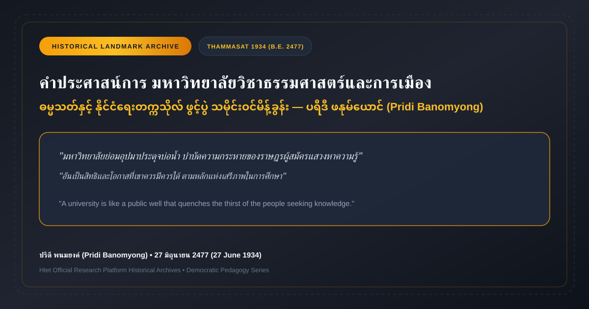

# คำประศาสน์การ มหาวิทยาลัยวิชาธรรมศาสตร์และการเมือง (၁၉၃၄)
## ဓမ္မသတ်နှင့် နိုင်ငံရေးတက္ကသိုလ် ဖွင့်ပွဲ သမိုင်းဝင်မိန့်ခွန်း — ပရီဒီ ဖနုမ်ယောင် (Pridi Banomyong)
### Inaugural Address of the University of Moral and Political Sciences (Thammasat University)

**မိန့်ခွန်းပြောကြားသူ:** ပရီဒီ ဖနုမ်ယောင် (ปรีดี พนมยงค์ / Pridi Banomyong, 1900–1983)  
*ထိုင်းနိုင်ငံ၏ ဝန်ကြီးချုပ်ဟောင်း၊ ဘုရင့်အတိုင်ပင်ခံအဖွဲ့ ဥက္ကဋ္ဌ၊ ခါနာရတ်ဆာဒွန် (ပြည်သူ့ပါတီ) တော်လှန်ရေးခေါင်းဆောင်နှင့် ဓမ္မသတ်တက္ကသိုလ် တည်ထောင်သူ*  
**နေ့စွဲ:** ၁၉၃၄ ခုနှစ်၊ ဇွန်လ ၂၇ ရက် (၂၄၇၇ ခုနှစ်)  
**နေရာ:** ဥပဒေကျောင်းဟောင်း အဆောက်အအုံ၊ ဖန်ဖိဖုတ်လီလာ တံတားအနီး၊ ဘန်ကောက်မြို့  
**မော်ကွန်းထိန်းသိမ်းမှု:** Htet Official Research Platform Historical Archives (၂၀၂၆)  
**မူရင်းရင်းမြစ်:** [สถาบันปรีดี พนมยงค์ (Pridi Banomyong Institute)](https://pridi.or.th/th/content/2026/04/2822)  

---

### အယ်ဒီတာ အမှာစာ (Editorial Commentary by Htet)
၁၉၃၂ ခုနှစ်တွင် သက်ဦးဆံပိုင်ဘုရင်စနစ်ကို ဖြိုဖျက်ကာ ဖွဲ့စည်းပုံအခြေခံဥပဒေအောက်ရှိ ဒီမိုကရေစီစနစ်သို့ ပြောင်းလဲခဲ့သော ထိုင်းနိုင်ငံ၏ **ခါနာရတ်ဆာဒွန် (ပြည်သူ့ပါတီ)** တော်လှန်ရေးခေါင်းဆောင် **ပရီဒီ ဖနုမ်ယောင် (Pridi Banomyong)** က ဓမ္မသတ်နှင့် နိုင်ငံရေးတက္ကသိုလ် (มหาวิทยาลัยวิชาธรรมศาสตร์และการเมือง) ကို စတင်ဖွင့်လှစ်ချိန်တွင် ပြောကြားခဲ့သည့် ဤမိန့်ခွန်းသည် **ပြည်သူ့ဒီမိုကရေစီ ပညာရေးဒဿန (Democratic & Popular Pedagogy)** ၏ သမိုင်းဝင် မှတ်တိုင်ကြီး ဖြစ်ပါသည်။

ပရီဒီ ဖနုမ်ယောင်က **"တက္ကသိုလ်ဆိုသည်မှာ ပညာရေး လွတ်လပ်ခွင့် အခြေခံမူအရ နိုင်ငံသားတိုင်း ရပိုင်ခွင့်ရှိသည့် အခွင့်အရေးဖြစ်သော ပညာရှာမှီးလိုသည့် လူထုကြီး၏ ရေငတ်မွတ်မှုကို ပြေပျောက်စေသည့် အများပြည်သူဆိုင်ရာ ရေတွင်းကြီးသဖွယ် ဖြစ်သည်"** ဟု အမြော်အမြင်ကြီးမားစွာ တင်ပြခဲ့သည်။ အထက်တန်းလွှာ လူနည်းစုအတွက်သာ မဟုတ်ဘဲ၊ သာမန်ပြည်သူလူထုတစ်ရပ်လုံး နိုင်ငံရေး၊ ဥပဒေနှင့် ဒီမိုကရေစီ အသိပညာများကို တန်းတူ လွတ်လပ်စွာ သင်ယူခွင့်ရရှိမှသာ ဖွဲ့စည်းပုံအခြေခံဥပဒေ ဒီမိုကရေစီစနစ် ခိုင်မာမည်ဟု ယုံကြည်ခဲ့သည်။

ဤဒဿနသည် ယနေ့ခေတ် မြန်မာ့နွေဦးတော်လှန်ရေးတွင် စစ်အာဏာရှင်စနစ်၏ ကျွန်ပညာရေးကို ငြင်းပယ်ကာ တည်ထောင်နေကြသော **မြန်မာ့နွေဦးတက္ကသိုလ် (MNOU)** နှင့် ဖက်ဒရယ် ဒီမိုကရေစီ ပြည်သူ့စာသင်ခန်းများအတွက် အလွန်တရာ အဖိုးတန်သည့် သီအိုရီ စံနမူနာ ဖြစ်ပါသည်။

---

## အပိုင်း (၁) — မြန်မာဘာသာပြန် အပြည့်အစုံ (Myanmar Translation)

**ဘုရင့်ကိုယ်စားလှယ်တော် အိမ်ရှေ့မင်းထံ ဂါရဝပြု လျှောက်ထားချက်**

ယနေ့သည် မင်္ဂလာအခါသမယ (၂) ပါး တစ်ပြိုင်နက်တည်း ကြုံကြိုက်သော နေ့ထူးနေ့မြတ် ဖြစ်ပါသည်။  
ပထမတစ်ချက်မှာ— ယနေ့ ဇွန်လ ၂၇ ရက်နေ့သည် ထိုင်း (ဆယမ်) ဘုရင့်နိုင်ငံတော်၏ ယာယီဖွဲ့စည်းပုံအခြေခံဥပဒေကို အပ်နှင်းထုတ်ပြန်ခဲ့သော သမိုင်းဝင်နေ့ ဖြစ်ပါသည်။  
ဒုတိယတစ်ချက်မှာ— ဓမ္မသတ်နှင့် နိုင်ငံရေးတက္ကသိုလ် တည်ထောင်ခြင်းဆိုင်ရာ အက်ဥပဒေအရ ဓမ္မသတ်နှင့် နိုင်ငံရေးပညာရပ်များကို လာမည့် ဇူလိုင်လ ၁ ရက်နေ့တွင် အချိန်မီ စတင်ပို့ချနိုင်ရန်အတွက် အထူးကြိုးပမ်းဆောင်ရွက်ခဲ့ရာ ယနေ့တွင် အောင်မြင်စွာ ဖွင့်လှစ်နိုင်ခဲ့ခြင်း ဖြစ်ပါသည်။

တက္ကသိုလ်တစ်ခုအဖြစ် ပညာရေးဌာန တည်ထောင်ခြင်းသည် တိုင်းပြည်တိုးတက်မှု၏ ပြယုဂ်နှင့် အဓိကတွန်းအား ဖြစ်ပါသည်။ ထိုင်းပြည်သူတို့သည် အခြေခံအဆင့်မှသည် အဆင့်မြင့်ပညာရေးအထိ ကောင်းမွန်သော ပညာယဉ်ကျေးမှုဖြင့် ဖွံ့ဖြိုးတိုးတက်လာရမည် ဖြစ်သည်။ ထို့ကြောင့် ယခုခေတ်အခါတွင် တိုင်းသူပြည်သားတို့၏ လိုလားချက်နှင့် အကျိုးစီးပွားကို ဖြည့်ဆည်းပေးနိုင်ရန်အတွက် ပညာရေးအဆင့်အတန်း အားလုံးကို အပြည့်အဝ ဖြည့်ဆည်းပေးရန် မဖြစ်မနေ လိုအပ်ပေသည်။

> **"တက္ကသိုလ်ဆိုသည်မှာ ပညာရေး လွတ်လပ်ခွင့် အခြေခံမူအရ နိုင်ငံသားတိုင်း ရပိုင်ခွင့်ရှိသည့် အခွင့်အရေးနှင့် အခွင့်အလမ်းဖြစ်သော ပညာရှာမှီးလိုသည့် လူထုကြီး၏ ရေငတ်မွတ်မှုကို ပြေပျောက်စေသည့် အများပြည်သူဆိုင်ရာ ရေတွင်းကြီးသဖွယ် ဖြစ်ပေသည်။"**

အစိုးရအဖွဲ့နှင့် ပြည်သူ့လွှတ်တော်တို့သည် ဤအချက်၏ မရှိမဖြစ် အရေးပါမှုကို မျက်မြင်တွေ့ရှိခဲ့ကြသည့်အတွက် ဤတက္ကသိုလ် တည်ထောင်ခြင်းဆိုင်ရာ အက်ဥပဒေကို ပြဋ္ဌာန်းခဲ့ခြင်း ဖြစ်ပါသည်။

*"ယခုမျက်မှောက်ခေတ်တွင် ကျွန်ုပ်တို့ တိုင်းပြည်သည် တိုင်းသူပြည်သားတို့၏ ပညာရည်အဆင့်အတန်းကို ခေတ်ကာလနှင့် လျော်ညီစွာ အဆင့်မြှင့်တင်ရန် ကြီးမားသော ဆန္ဒရှိပေသည်။ အကယ်၍ ပညာရေးအဆင့်အတန်းသည် လိုအပ်သော အဆင့်သို့ မရောက်ရှိသေးသမျှ ကာလပတ်လုံး တိုင်းပြည်၏ တိုးတက်ဖွံ့ဖြိုးမှုသည်လည်း အချိန်ကြာမြင့်စွာ မမြင်နိုင်သေးသော အရာအဖြစ်သာ ရှိနေပေလိမ့်မည်။ အထူးသဖြင့် ကျွန်ုပ်တို့နိုင်ငံသည် ဖွဲ့စည်းပုံအခြေခံဥပဒေ ဒီမိုကရေစီစနစ်ဖြင့် အုပ်ချုပ်နေသော ဤခေတ်သမယတွင် နိုင်ငံသားတိုင်းအား ဓမ္မသတ်နှင့် နိုင်ငံရေးပညာရပ်များကို တတ်နိုင်သမျှ အများဆုံး သင်ကြားဖြန့်ဝေပေးမည့် တက္ကသိုလ်တစ်ခု ရှိရန် အထူးပင် လိုအပ်လှပေသည်။ တိုင်းပြည်နှင့် လူမျိုး၏ ရေရှည်အကျိုးစီးပွားအတွက် ပညာရေးလွတ်လပ်ခွင့်ကို နိုင်ငံသားတိုင်း ကျယ်ကျယ်ပြန့်ပြန့် အသုံးချနိုင်မည့် အခွင့်အလမ်းကို ဖွင့်လှစ်ပေးရမည် ဖြစ်သည်။"*

ဓမ္မသတ်နှင့် နိုင်ငံရေးတက္ကသိုလ် စတင်တည်ထောင်သည်မှစ၍ ပြည်သူလူထု၏ ထောက်ခံအားပေးမှုသည် မျှော်လင့်ထားသည်ထက် များစွာ ကျော်လွန်ခဲ့ပါသည်။ ဤပထမအသုတ်တွင် ကျောင်းသား/သူ လျှောက်ထားသူပေါင်း **၇,၀၉၄ ဦး** အထိ ရှိခဲ့သည်။ ပညာသင်ယူမှုကို ရပ်နားထားသည်မှာ ကြာမြင့်ပြီဖြစ်သော သူများပင်လျှင် တက္ကသိုလ်ကျောင်းသားအဖြစ် ပြန်လည်စတင် သင်ယူခဲ့ကြသည်။ ဤသည်မှာ ဓမ္မသတ်နှင့် နိုင်ငံရေးပညာရပ်များကို ပြည်သူလူထုအတွင်း ကျယ်ကျယ်ပြန့်ပြန့် လေ့လာသင်ယူစေရန် ဟူသော မူလရည်မှန်းချက်၏ ပထမခြေလှမ်း အောင်မြင်ခြင်းပင် ဖြစ်သည်။

ယခုအခါ ဓမ္မသတ်နှင့် နိုင်ငံရေးတက္ကသိုလ်၏ လုပ်ငန်းဆောင်တာများသည် အဆင်ပြေချောမွေ့စွာ ပြီးမြောက်ခဲ့ပြီး ဥပဒေ၏ ရည်ရွယ်ချက်နှင့်အညီ ပညာရပ်များကို စတင်ပို့ချရန် အသင့်ဖြစ်ပြီ ဖြစ်ပါသဖြင့် ဤတက္ကသိုလ်ကြီး စဉ်ဆက်မပြတ် ဖွံ့ဖြိုးတိုးတက်စေရေး မင်္ဂလာအပေါင်းနှင့် ပြည့်စုံစေရန်အတွက် မင်္ဂလာဦးအဖြစ် ဖွင့်လှစ်ပေးပါရန် အိမ်ရှေ့မင်းထံ ရိုသေစွာ ဖိတ်ကြားအပ်ပါသည်။

---

## အပိုင်း (၂) — คำประศาสน์การ มหาวิทยาลัยวิชาธรรมศาสตร์และการเมือง (Thai Original Text)

ขอพระราชทานกราบทูล ทรงทราบใต้ฝ่าละอองธุลีพระบาท

วันนี้เป็นวันมงคลดิถีบรรจบพร้อมกัน 2 ประการ ประการหนึ่ง วันที่ 27 มิถุนายนนี้ เป็นวันพระราชทานรัฐธรรมนูญชั่วคราวแห่งพระราชอาณาจักรสยาม ประการที่สอง มหาวิทยาลัยวิชาธรรมศาสตร์และการเมือง ได้พยายามเร่งรัดการงานจนสามารถเปิดได้ในวันนี้ เพื่อดำเนินการสอนวิชาธรรมศาสตร์และการเมืองตามพระราชบัญญัติที่ได้ประกาศตั้งมหาวิทยาลัยนี้ขึ้นให้ทันในวันที่ 1 กรกฎาคม นี้

การตั้งสถานศึกษาตามลักษณะของมหาวิทยาลัย ย่อมเป็นเครื่องพิสูจน์และเป็นปัจจัยในการแสดงความก้าวหน้าของประเทศ ประชาชนชาวสยามจะเจริญในอารยธรรมการศึกษาอันดี ตั้งแต่ชั้นต่ำตลอดจนถึงการศึกษาชั้นสูง เพราะฉะนั้น ในการที่จะอำนวยความประสงค์และประโยชน์ของราษฎรในสมัยนี้ จึงจำต้องมีการศึกษาให้ครบบริบูรณ์ทุกชั้น

> **"มหาวิทยาลัยย่อมอุปมาประดุจบ่อน้ำ บำบัดความกระหายของราษฎรผู้สมัครแสวงหาความรู้อันเป็นสิทธิและโอกาสที่เขาควรมีควรได้ ตามหลักแห่งเสรีภาพในการศึกษา รัฐบาลและสภาผู้แทนราษฎรเห็นความจำเป็นในข้อนี้ จึงได้ตราพระราชบัญญัติจัดตั้งมหาวิทยาลัยขึ้น"**

"ในปัจจุบันนี้ ประเทศสยามมีความประสงค์อันยิ่งใหญ่ที่จะปรับระดับการศึกษาของราษฎรให้ถึงขนาดเหมาะแก่กาลสมัย ถ้าระดับการศึกษายังไม่เจริญถึงขนาดตราบใดความก้าวหน้าของประเทศ ก็ยังจะเป็นสิ่งที่มองไม่เห็นอีกนาน ยิ่งในสมัยที่ประเทศของเราดำเนินการปกครองระบอบรัฐธรรมนูญเช่นนี้แล้ว เป็นการจำเป็นอย่างยิ่งที่จะต้องมีมหาวิทยาลัยสำหรับประศาสน์ความรู้ในวิชาธรรมศาสตร์และการเมืองแก่พลเมืองให้มากที่สุดที่จะเป็นได้ เปิดโอกาสให้แก่พลเมืองที่จะใช้เสรีภาพในการศึกษากว้างขวางยิ่งขึ้นเพื่อประโยชน์ของประเทศชาติสืบไป"

นับแต่มหาวิทยาลัยวิชาธรรมศาสตร์และการเมืองได้ตั้งขึ้นแล้ว ปรากฏว่าได้รับความนิยมของมหาชนเกินความคาดหมาย โดยมีผู้สมัครเข้าเรียนในชั้นนี้ถึง 7,094 คน แม้ผู้ที่ได้ละทิ้งการศึกษามานานแล้ว ก็กลับเริ่มศึกษาในฐานะเป็นนักเรียนของมหาวิทยาลัย นับได้ว่าบรรลุผลชั้นต้นของความมุ่งหมายที่จะได้เรียนรู้วิชาธรรมศาสตร์และการเมืองกันแพร่หลาย

บัดนี้กิจการของมหาวิทยาลัยวิชาธรรมศาสตร์และการเมืองได้ดำเนินมาโดยเรียบร้อย เตรียมพร้อมที่จะเปิดทำการประศาสน์วิชาให้สมกับความประสงค์ของพระราชบัญญัติแล้ว ข้าพระพุทธเจ้าขอกราบทูลอัญเชิญฝ่าละอองธุลีพระบาท ได้ทรงเปิดมหาวิทยาลัยวิชาธรรมศาสตร์และการเมืองเป็นปฐมฤกษ์ เพื่อความสวัสดิมงคลให้บังเกิดความวัฒนาถาวรแก่มหาวิทยาลัยนี้สืบไป

ควรมိควรแล้วแต่จะกรุณาโปรดเกล้าฯ

---

## အပိုင်း (၃) — English Translation (Inaugural Address)

May it please Your Royal Highness,

Today marks an auspicious convergence of two historic events. First, this 27th of June is the anniversary of the granting of the Provisional Constitution of the Kingdom of Siam. Second, the University of Moral and Political Sciences has expedited its preparatory work so that it can inaugurate today, preparing to deliver instruction in moral and political sciences in accordance with the Act establishing this university, in time for the commencement of classes on the 1st of July.

The establishment of an educational institution of university stature is both testament to and catalyst for the progress of a nation. The people of Siam will flourish in civilization and sound learning from the elementary through to the highest tiers of education. Therefore, to meet the aspirations and serve the common welfare of the citizenry in this era, education must be provided comprehensively across all levels.

> **"A university is likened to a public well that quenches the thirst of the people seeking knowledge, which is a right and opportunity they ought to possess, according to the principle of academic freedom. The Government and the People's Assembly, recognizing this vital necessity, promulgated the Act establishing this University."**

"At present, Siam possesses an earnest desire to elevate the educational standard of the populace to meet the demands of the modern era. So long as educational standards do not reach that standard, the progress of our nation will remain an unseen horizon for a long time to come. Especially in an era where our country is governed under a constitutional order, it is profoundly essential to establish a university to disseminate knowledge in moral and political sciences to the broadest body of citizenry possible, opening opportunities for them to exercise academic freedom widely for the enduring benefit of the nation."

Since the establishment of the University of Moral and Political Sciences, public enthusiasm has exceeded all expectations, with 7,094 individuals enrolling in this inaugural class. Even those who had long set aside formal study have returned to resume learning as students of this university. This marks the initial fulfillment of our core aspiration: to democratize knowledge in moral and political sciences across society.

Now, all preparations for the University of Moral and Political Sciences have proceeded smoothly and are fully prepared to impart knowledge in alignment with the Act. I humbly invite Your Royal Highness to formally inaugurate the University of Moral and Political Sciences on this auspicious occasion, invoking prosperity and enduring permanence upon this institution.

---

### Academic Citation (APA 7th)
> Banomyong, Pridi. (1934, June 27). *Inaugural Address of the University of Moral and Political Sciences (คำประศาสน์การ มหาวิทยาลัยวิชาธรรมศาสตร์และการเมือง)*. Inauguration Ceremony, Bangkok, Siam. Preserved in Htet Official Research Platform Historical Archives.
